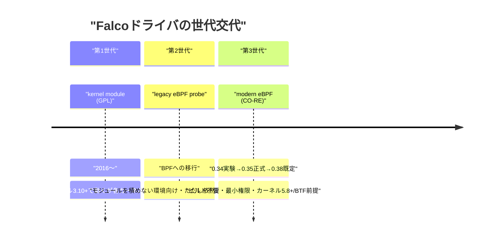
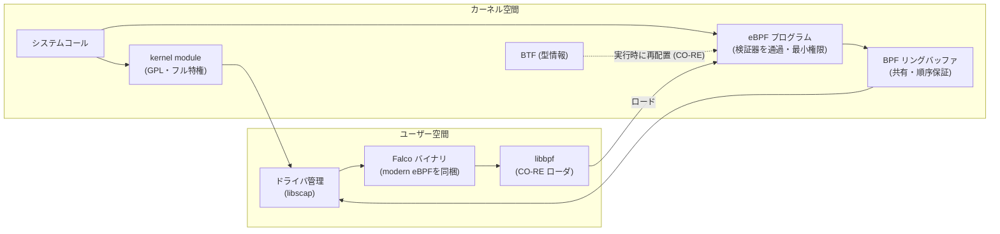
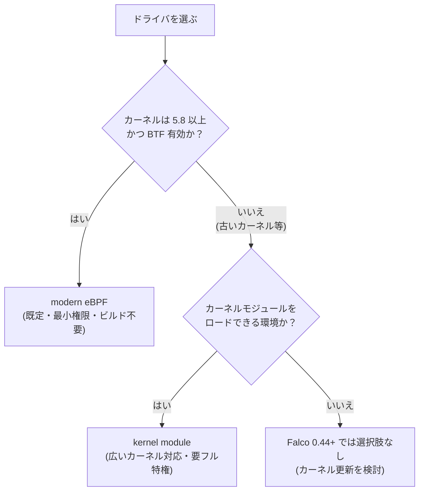
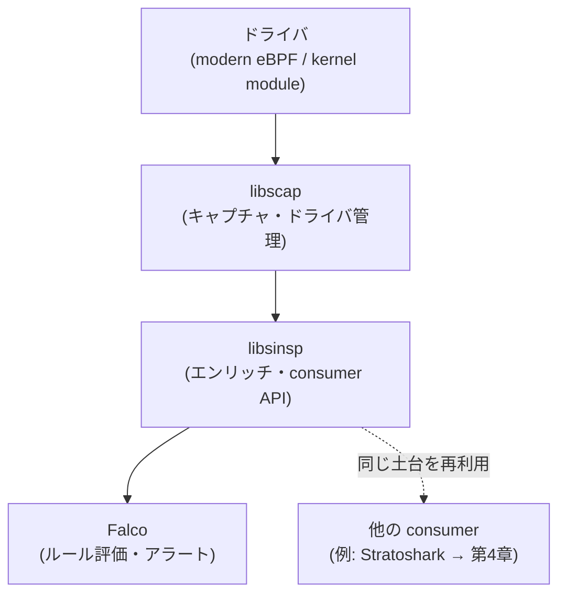
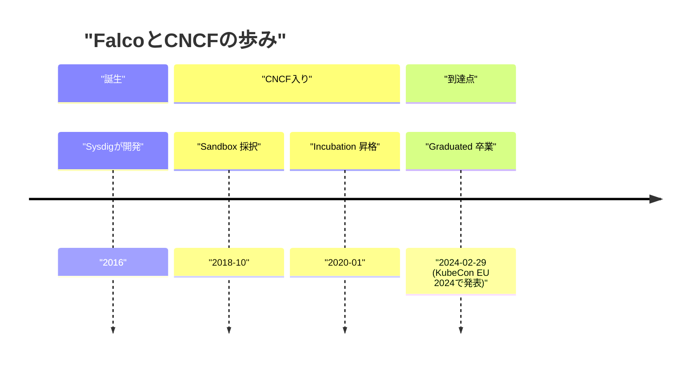

# 第1章：Falcoの進化史 — kernel module から modern eBPF、そしてCNCF卒業へ

Falcoというプロジェクトを一言で表すなら、「どこからカーネルを覗くか」を10年近く問い続けてきた歴史だと言えます。検知ルールの書き方やクラウドへの対応も確かに進化しましたが、その根幹にあったのは常に「システムコールという生の真実を、いかに安全に・いかに移植性高く・いかに低い権限で観測するか」という一点でした。本章では、その観測点（センサー）の進化をたどりながら、なぜ2024年のCNCF卒業がこの物語の重要な節目だったのかを考えていきます。

## この章で学ぶこと

- Falcoが2016年に「syscall + ルール」という発想で生まれた背景と、その系譜
- ドライバ三世代（kernel module → legacy eBPF → modern eBPF）の物語と、世代交代が必要だった理由
- modern eBPFがデフォルト化（0.38）し、legacyが削除（0.44）されたことが導入摩擦に与えた影響
- libscap / libsinsp という土台が、Falcoを越えて波及していく伏線
- CNCF卒業（2024-02-29）が問うたもの（セキュリティ監査、GPLポリシー）と、それが業界に放ったシグナル

## 2016年、Falcoはどこから来たのか

Falcoは2016年にSysdigによって作られました（出典: https://www.cncf.io/projects/falco/）。しかしFalcoは「無からの発明」ではなく、その前にあったシステム可視化ツール、すなわち`sysdig`コマンド（システムコールをキャプチャして`strace`と`tcpdump`を足して`lsof`で割ったような体験を提供したツール）の系譜の上に立っています。Sysdigはカーネルから全システムコールを取り込み、それをコンテナやプロセスの文脈で読み解く技術を持っていました。Falcoはその「観測エンジン」を、トラブルシューティングではなく**セキュリティ検知**に振り向けたプロジェクトだったのです。

ここで生まれた発想が、本章を貫くキーワードになります。それは「**システムコールはアプリケーションの嘘をつかない記録である**」という考え方です。プロセスが何を実行し、どのファイルを開き、どこへネットワーク接続したか——これらはすべてカーネル境界を通過するシステムコールに現れます。アプリケーションのログは書き換えられても、syscallレベルの振る舞いは隠しにくい。Falcoはこの「カーネル境界という観測点」に、人間が読めるルール言語をかぶせました。

```yaml
# Falcoルールの素朴な一例（概念イメージ）
- rule: Terminal shell in container
  desc: コンテナ内で対話シェルが起動された
  condition: >
    spawned_process and container
    and proc.name in (bash, sh, zsh)
    and proc.tty != 0
  output: "Shell spawned in container (user=%user.name container=%container.name)"
  priority: WARNING
  tags: [container, shell, mitre_execution]
```

`condition`に書かれた`spawned_process`や`proc.name`は、すべてカーネルから取り込んだsyscallイベントを意味のあるフィールドに変換したものです。つまりルールの表現力は、その下にあるセンサーがどれだけ正確に・どれだけ広く・どれだけ安定してカーネルを覗けるかに完全に依存しています。だからこそFalcoの進化史は、ルールの歴史である以上に「ドライバの歴史」なのです。

## ドライバ三世代の物語

Falcoがカーネルからイベントを取り込む部品を「ドライバ（driver）」と呼びます。このドライバが、10年弱の間に三つの世代を経てきました。それぞれが前の世代の「痛み」に対する回答になっており、Falcoの歴史の中でもっとも技術的な進化が凝縮された部分です。本節は本章の核心なので、少し腰を据えて掘り下げていきます。

まず全体像をつかんでおきましょう。ドライバは「カーネルから生のシステムコールを取り出して、ユーザー空間へ流し込む蛇口」です。この蛇口をどう実装するかで、(1) **どのカーネルで動くか（移植性）**、(2) **どれだけの権限を要求するか（安全性）**、(3) **導入にどれだけ手間がかかるか（運用性）**、そして (4) **どれだけ取りこぼさず速く流せるか（性能）**——という四つの性質がまるごと決まります。三世代の物語は、この四つをいかに同時に満たすかという苦闘の歴史でした。



### 第1世代：kernel module — 全特権の代償

最初のドライバはLinuxの**カーネルモジュール**でした。GPLライセンスで提供され、カーネル3.10以降という非常に広い範囲で動作します。カーネル空間に直接ロードされ、トレースポイント経由でシステムコールをフックするため、イベントを取りこぼしなく観測でき、機能的には今でも最も「強力」な選択肢です。

しかしカーネルモジュールには三つの根深い痛みがありました。

一つ目は**権限**です。モジュールをロードするには`CAP_SYS_MODULE`、すなわち事実上カーネルへのフルアクセスが必要で、最小権限の原則とは正反対の存在でした。さらにカーネル空間で動く以上、ドライバにバグがあればプロセスがクラッシュするだけでは済まず、**最悪カーネルパニックでノードごと巻き込む**リスクを抱えます。セキュリティのために入れたエージェントが可用性のリスクになる、というのは運用者にとって受け入れがたいトレードオフでした。

二つ目が**ビルドの苦しみ**です。Linuxカーネルにはモジュールの安定ABIが存在しないため、稼働しているカーネルのバージョン・コンフィグごとにモジュールをコンパイルし直す必要があります。Falcoは長らくこれを `falco-driver-loader` というスクリプトで吸収してきました。挙動はおおむね次の流れです。

```text
1. 稼働カーネルに一致する「prebuilt（ビルド済み）ドライバ」を
   download.falco.org から探してダウンロードを試みる
2. 見つからなければ、ノード上で kernel headers + GCC を使って
   その場でビルド（DKMS 経由）
3. それも失敗すれば、ドライバ無しで Falco は起動できない
```

クラウドの新しいノードイメージが出るたびに「prebuiltドライバはもう用意されているか？」を気にし、なければビルド環境（カーネルヘッダ、コンパイラ）をノードに用意する——この**「カーネルとの追いかけっこ」**が、運用現場の慢性的な摩擦でした。Falcoプロジェクトは、対応カーネルごとのドライバをビルドするための専用ツール `driverkit` まで用意して立ち向かいましたが、それは裏を返せば「カーネルの数だけドライバが要る」という構造的な負債そのものでもありました。

三つ目が**ライセンス**です。カーネルモジュールはGPLでなければ使えないカーネルシンボルに依存するため、GPLで配布されます。この点は後述するCNCF卒業の際に、ファウンデーション側のポリシー調整を要する論点にもなりました。

### 第2世代：legacy eBPF probe — 載せられない場所への回答

次に登場したのが、当時の**eBPF probe**（後に「legacy eBPF」と呼ばれる）です。eBPF（extended Berkeley Packet Filter）は、カーネルにモジュールを「載せる」のではなく、**検証済みの小さなプログラムをカーネル内のVM（仮想マシン）で安全に実行する**仕組みです。プログラムはロード時に**eBPF検証器（verifier）**を通り、「必ず終了すること（無限ループ禁止）」「不正なメモリにアクセスしないこと」が静的に保証されます。だからこそ、第三者のコードをカーネル内で動かしても比較的安全だ、という前提が成り立ちます。

これによって得られた最大の恩恵は、**カーネルモジュールをロードできない環境でもFalcoを動かせる**ようになったことです。セキュリティポリシーでモジュールロードを禁じた堅牢化ホストや、一部のマネージドKubernetesがその対象でした。カーネルパニックでノードを巻き込むリスクも、VM内実行によって大きく下がりました。

ただしこの第2世代は、あくまで**過渡的**なものでした。legacy eBPF probeをビルドするには、結局のところ**clang/LLVMツールチェインとカーネルヘッダ**が必要で、生成されたバイト列も特定カーネルの構造体レイアウトに合わせてコンパイルされます。つまり「カーネルモジュール → ビルド済み`.ko`」が「eBPFプログラム → ビルド済み`.o`」に置き換わっただけで、**「カーネルごとの依存」という第1世代の本質的な痛みは残っていた**のです。イベントの転送にも、CPUごとに確保される従来の**perfバッファ**を使っており、メモリ効率や順序保証の面でも改善の余地がありました。方向としては正しかったものの、まだ道半ばだったというのが正確な評価です。

### 第3世代：modern eBPF — CO-REという答え

ブレークスルーは**modern eBPF**でした。鍵になったのが**CO-RE（Compile Once – Run Everywhere、一度コンパイルすればどこでも動く）**という考え方です。

CO-REの仕組みを少し具体的に追ってみましょう。問題の根っこは「カーネルのバージョンによって、構造体のフィールドの位置（オフセット）が違う」ことにありました。あるカーネルでは`task_struct`の中の目的のフィールドが先頭から120バイト目にあっても、別のカーネルでは128バイト目にある、といった差異です。第2世代まではこの差を「コンパイル時に固定」していたため、カーネルごとのビルドが避けられませんでした。

CO-REはこれを**実行時に解決**します。

1. eBPFプログラムは**事前に一度だけコンパイル**され、その成果物（スケルトン）はFalcoのユーザー空間バイナリに**組み込まれて配布**されます。
2. 実行時、ローダライブラリ**libbpf**が、稼働中のカーネルが公開している型情報——**BTF（BPF Type Format）**——を読み取ります。
3. BTFを手がかりに、「このカーネルでは目的のフィールドは何バイト目か」を計算し、eBPFプログラム内のオフセットを**自動的に書き換え（relocation、再配置）**ます。

こうして**カーネルごとのビルドが完全に不要**になりました。さらにmodern eBPFは、イベント転送に新しい**BPFリングバッファ**を採用します。CPUごとに別々だったperfバッファと違い、リングバッファは複数CPUで共有できてメモリ効率が良く、イベントの順序保証にも優れます。

modern eBPFが**カーネル5.8以上**を要求するのには、はっきりした理由があります。実は**BPFリングバッファ**も、後述する最小権限用のケーパビリティ**`CAP_BPF`**も、ともにLinux 5.8で導入されたものだからです。「5.8」という数字は恣意的なラインではなく、modern eBPFが依拠する二つの基盤機能が出そろったバージョンなのです（加えてBTF、すなわち`CONFIG_DEBUG_INFO_BTF=y`でビルドされたカーネルが前提になります）。

権限面の前進も見逃せません。かつてeBPF関連の操作は強力すぎる`CAP_SYS_ADMIN`を必要としましたが、5.8で**`CAP_BPF`**として分離されました。Falcoのmodern eBPFは`CAP_BPF` / `CAP_PERFMON`といった**限定的なケーパビリティ**で動かせます。フル特権（`CAP_SYS_MODULE`）を要求した第1世代から見れば、安全性の面でも質的な飛躍です。

### 三世代の比較

四つの観点（移植性・安全性・運用性・性能）が世代を追ってどう改善したかを並べると、進化の方向がはっきり見えます。

| 観点 | kernel module（第1世代） | legacy eBPF probe（第2世代） | modern eBPF（第3世代） |
| --- | --- | --- | --- |
| 動作位置 | カーネル空間（モジュール） | カーネル内eBPF VM | カーネル内eBPF VM |
| ビルド依存 | カーネルごとに必須 | カーネル依存が残る（clang/ヘッダ） | **不要（CO-RE）** |
| 配布形態 | 別途モジュール（`.ko`） | 別途probe（`.o`） | **ユーザー空間バイナリに同梱** |
| 必要権限 | 事実上フル特権（`CAP_SYS_MODULE`） | 高い権限 | **`CAP_BPF` / `CAP_PERFMON`（最小権限可）** |
| 障害時の影響 | カーネルパニックの恐れ | VM内なので限定的 | **VM内なので限定的** |
| イベント転送 | カーネルバッファ | perfバッファ（CPUごと） | **BPFリングバッファ（共有・順序保証）** |
| カーネル要件 | 3.10+ | 比較的広い | **5.8+ / BTF / BPFリングバッファ** |
| 現在の扱い（0.44+） | 残置（選択可） | **完全削除** | **既定** |

データの流れとして図示すると、第1世代と第3世代の違い——「別途配布するか／バイナリに同梱するか」「フル特権か／最小権限か」——が一目で見えます。



### では、どのドライバを選ぶべきか

三世代あるとはいえ、0.44以降で選べるのは「modern eBPF（既定）」と「kernel module（残置）」の二つです。実務上の選択指針は、ほぼカーネルバージョンで決まります。



特別な事情（極端に古いカーネルを使い続けねばならない等）がなければ、**迷わずmodern eBPFを選ぶ**——これが現在の標準的な答えです。

### 見落としやすい落とし穴：ドライバとユーザー空間のバージョン整合

最後に、運用上きわめて重要なのに見落とされがちな点を一つ。**ドライバはFalco本体（ユーザー空間）のバージョンと整合している必要があります**。両者は独立に動くわけではなく、イベントのフォーマットを共有しているため、組み合わせがずれると正しく動きません。

実際、0.44.0へのアップグレードでは、**0.43.0時代のドライバは0.44.0のユーザー空間とは互換性がない**という明示的な破壊的変更がありました（ドライバは `10.2.0+driver` 系へ更新）。modern eBPFはバイナリ同梱なので本体を入れ替えれば自動的に揃いますが、kernel moduleやprebuiltドライバを別管理している場合は、**本体とドライバを同時に更新する**ことを忘れないようにしましょう（出典: https://falco.org/blog/falco-0-44-0/）。

## 「もうカーネルごとにビルドしない」時代へ

世代交代は一夜にして起きたわけではなく、慎重な段階を踏みました。modern eBPFは**0.34.0で実験的（experimental）**として導入され、**0.35.0で正式（official）**となり、そして**0.38.0以降でデフォルト**になりました。長く使われてきたlegacy eBPF probeは**0.43.0で非推奨（deprecated）**となり、**0.44.0で完全に削除**されました（出典: https://falco.org/blog/）。その結果、0.44以降のFalcoが持つドライバは「modern eBPF（既定）」と「kernel module（選択肢として残置）」の二つだけになりました。

この変化が現場にとって何を意味したか、少し立ち止まって考える価値があります。クラウドやマネージドKubernetes（EKS / GKE / AKSなど）では、ノードのカーネルは自分で固定できないことが多く、しかも頻繁に更新されます。第1世代・第2世代の時代には、新しいノードイメージが出るたびに「対応ドライバはあるか」を気にし、なければビルド環境を整える必要がありました。これがFalco導入の隠れたコストであり、PoCで諦められる典型的な理由でもありました。

modern eBPFのCO-REは、この摩擦をほぼ消し去ります。バイナリにドライバが同梱されているため、ノードのカーネルが5.8以上でBTFさえあれば、追加のビルドもダウンロードも不要で動き出す。マネージドK8sの「カーネルが勝手に変わる」性質と、CO-REの「どのカーネルでも動く」性質は、極めて相性が良いのです。筆者の見立てでは、Falcoがクラウドネイティブのデファクト・ランタイムセンサーとして広く受け入れられた背景には、この導入摩擦の劇的な低下が確実にあったと考えています。

なお、0.44.0では同時にgVisorエンジンと旧来のgRPC出力／サーバも削除され、出力はHTTP outputやFalcosidekickへ寄せる方針が明確になりました（出典: https://falco.org/blog/）。

その後も世代交代は止まっていません。執筆時点の最新安定版は**0.45.0（2026-09-21リリース）**で、ドライバは`11.0.0+driver`系に更新（互換性のないkernel moduleは不可）、ルールが照合する元データとアラート表示を分離する**raw byte matching**（`\xHH`エスケープ対応）、設定リロードの状態確認・制御用エンドポイント、GPUデバイスへのアクセスやGPU管理ツール実行を狙う**デフォルト無効のサンドボックスルール2種**が追加されました（出典: https://falco.org/blog/falco-0-45-0/）。バージョン番号はまだ0.4x台ですが、これは「未完成」を意味しません。後述するとおり、土台はすでに十分に固まっています（Falcoの「1.0」リリースは執筆時点でコミットされておらず、ここで断定はしません）。

## 土台としてのFalco libs（libscap / libsinsp）

ここまで「ドライバ」と「ルール」を分けて語ってきましたが、その間をつなぐ重要な土台があります。`github.com/falcosecurity/libs`にある**Falco libs**です。中核は二つのライブラリで構成されます。

- **libscap**：キャプチャとドライバ管理を担います。カーネルモジュールでもmodern eBPFでも、どのドライバからイベントを取り込むかを抽象化し、生のイベントストリームを上位へ渡します。
- **libsinsp**：取り込んだ生イベントを「エンリッチ（文脈付け）」します。たとえば単なるPID番号を、どのコンテナ・どのKubernetes Pod・どのユーザーのプロセスかという意味のある情報に結び付け、ルールエンジンが評価できるフィールドへ変換します。consumer向けのAPIもここが提供します。



この分離が効いてくるのは、Falco以外のツールが**同じ土台**を再利用できる点です。後の章で扱うStratoshark（第4章）は、まさにこのlibscap / libsinspという基盤の上に成り立っています。「カーネルを安全に覗き、文脈を付けて読み解く」というコア能力がライブラリとして切り出されているからこそ、Falcoという検知ツールの枠を越えてエコシステムが広がっていく——この伏線は、本書を通じて何度も顔を出すことになります。

## CNCF卒業（2024-02-29）が問うたもの

Falcoの歩みをCNCFの段階で並べると、その成熟が見えてきます。



Falcoは**2018年10月にCNCF Sandbox**へ、**2020年1月にIncubation**へ進み、そして**2024年2月29日にGraduated（卒業）**しました。卒業はKubeCon EU 2024に合わせて発表されています（出典: https://www.cncf.io/announcements/ / https://falco.org/blog/）。CNCFの「卒業」は、KubernetesやPrometheusと同じ最上位ランクであり、軽々しく与えられるものではありません。

卒業にあたって特に二つのことが問われました。一つは**第三者によるセキュリティ監査**です。セキュリティ製品自身が安全でなければ本末転倒であり、独立した監査をパスすることが求められました。もう一つが**ライセンスをめぐるポリシー**です。Falcoのドライバの一つであるkernel moduleはGPLです。CNCFの方針との整合のため、eBPFと並んでGPLのカーネルモジュールを同梱・配布できるようにする**CNCF側のポリシー変更**が必要でした。つまりFalcoの卒業は、プロジェクト単体の話にとどまらず、CNCFというファウンデーションの運用ルールそのものに影響を与えた出来事だったのです。

### 卒業が放ったシグラル — 「枯れた」ではなく「助走」

ここで考察を一つ。プロジェクトが「卒業した」と聞くと、成長が止まって枯れた、という印象を持つ人もいるかもしれません。筆者の解釈はその逆です。CNCF卒業が証明したのは、**Falcoの土台（ドライバ、libs、ガバナンス、セキュリティ）が固まった**ということです。土台が固まったということは、その上で安心して次の挑戦に踏み出せる、すなわち**この先の進化の助走が完了した**という意味になります。

実際、卒業はFalcoが採用に値する成熟度に達したという強いシグナルを業界に送りました。卒業からおよそ1年後の時点で累計ダウンロードは**1億5,000万回以上**と報じられており（出典: https://falco.org/blog/）、ランタイムセキュリティの標準的選択肢としての地位を確かなものにしています。本書の後半で扱うTalonによる自動レスポンス（第3章）やAI時代の攻撃面（第5章以降）といった「攻めの進化」は、この固まった土台があって初めて成り立つものです。卒業は終点ではなく、起点でした。

## ルール運用の成熟 — Rules Maturity Frameworkへの布石

ドライバとlibsが土台を固めたのと並行して、もう一つ成熟が進んだ領域があります。**ルールそのものの運用**です。Falcoには**Rules Maturity Framework**という考え方があり、各ルールに成熟度のティアを与えます。

| ティア | 意味合い |
| --- | --- |
| Stable | 十分に検証され、誤検知が抑えられた本番向けルール |
| Incubating | 有用だが、まだ実戦での磨き込みが必要な段階 |
| Sandbox | 実験的・新規。フィードバックを集める段階 |
| Deprecated | 役割を終え、置き換えが推奨されるルール |

ここで重要なのは、**`maturity_stable`のルールだけが`falco_rules.yaml`として同梱され**、それ以外（Incubating / Sandbox）は`falcoctl`経由で取得する、という運用上の切り分けです。そして**新しいルールは決していきなりStableから始まりません**。まずSandboxやIncubatingで揉まれ、実環境のフィードバックを経て初めてStableへ昇格します。これは前述したドライバの「実験→正式→既定」という慎重な昇格プロセスと、まったく同じ哲学の表れです。

このフレームワークと、`falcoctl`によるルール配布・OCIアーティファクトとしての扱いは、Falcoが単体ツールから「エコシステム」へと広がっていく入り口でもあります。その全体像は次章で詳しく見ていきます。

## まとめ

Falcoの進化史は、「どこからカーネルを覗くか」という問いへの回答の連なりでした。kernel moduleの全特権とビルドの苦しみ、legacy eBPFという過渡、そしてCO-REによるmodern eBPF——ビルド不要・最小権限・移植性という三拍子が揃ったことで、Falcoはクラウドネイティブ環境での導入摩擦をほぼ解消しました。その下にはlibscap / libsinspという再利用可能な土台があり、2024年のCNCF卒業は、セキュリティ監査とGPLポリシーという問いに答えながら、この土台が固まったことを業界に告げるシグナルでした。卒業は「枯れた」のではなく、ここから先の進化の助走だったのです。

その助走の上で、Falcoは単体の検知ツールからプラグイン・Falcosidekick・falcoctl・OCIへと広がる「エコシステム」へと姿を変えていきます。次章では、その拡張の全体像をたどっていきましょう。
