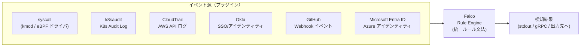
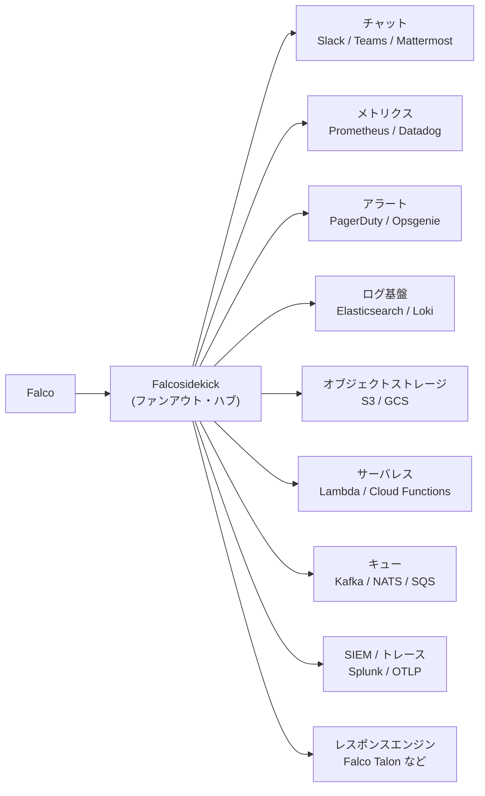
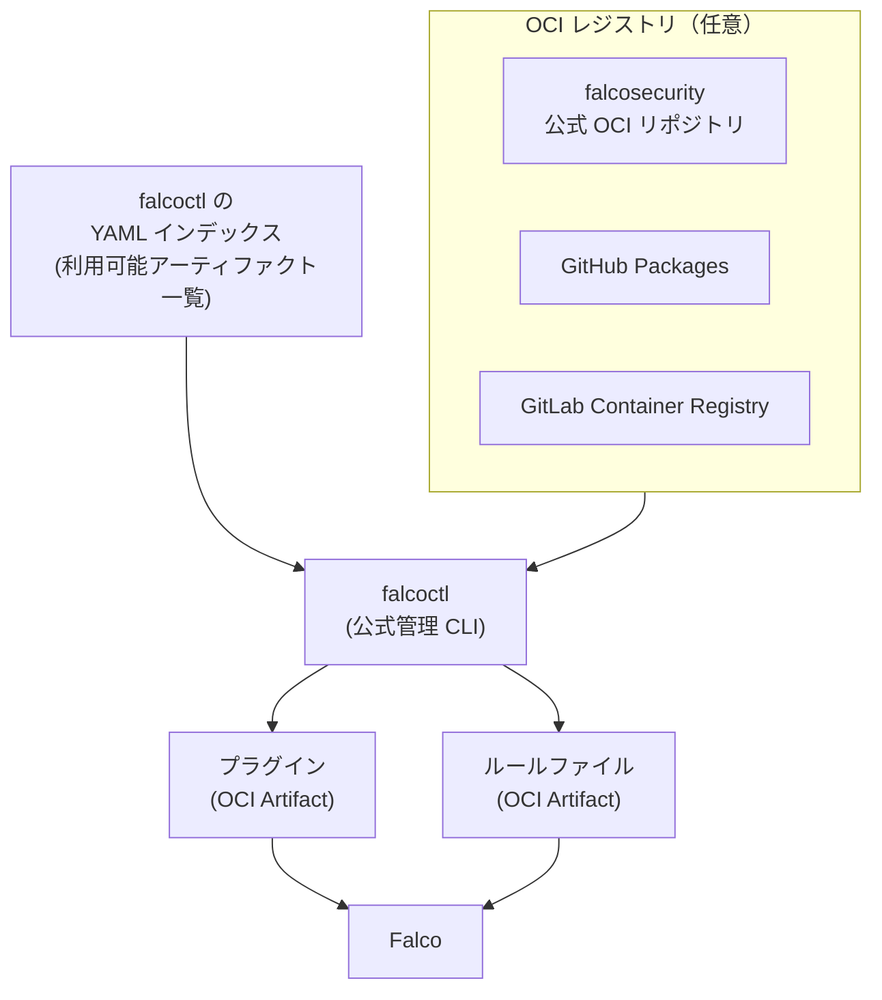
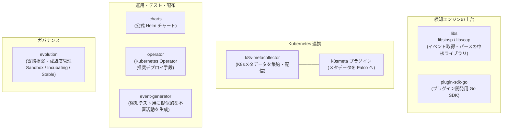

# 第2章：エコシステムの拡張 — 点から面へ

第1章では、Falcoがカーネルモジュールから modern eBPF へ、そしてCNCF卒業プロジェクトへと至る「進化史」を追いました。しかし、Falcoの本当の面白さは、検知エンジンそのものの進化だけではありません。**「syscallを監視する単機能のツール」から、「あらゆるイベント源を一つのルール文法で扱い、検知結果をどこへでも届け、OCIで配布する」という"面"の仕組みへと広がった**ことにあります。本章では、この拡張を支える3本の柱 — プラグインフレームワーク、Falcosidekick、OCI Artifacts — を中心に、Falcoエコシステムを地図化していきます。

## この章で学ぶこと

- プラグインフレームワークがもたらした「Falcoはもうカーネル専用ではない」という転換点
- K8s audit / CloudTrail / Okta / GitHub / Entra ID を**同じルール文法**で扱う意味
- Falcosidekick による検知結果のファンアウトと、「core ではなく Ecosystem」という正確な位置づけ
- falcoctl と OCI Artifacts による配布・署名・検証 — サプライチェーンセキュリティの観点
- OSSコミュニティ資産と商用キュレーション（Falco Feeds by Sysdig）の線引き

## 1. プラグインフレームワーク — Falcoはもうカーネル専用ではない

Falcoの出発点は明快でした。Linuxカーネルから syscall を取り込み、「コンテナの中で誰がシェルを起動したか」「想定外のファイルを書き込んだか」といった、**実行時（ランタイム）の振る舞い**を検知する。これがFalcoの原点であり、第1章で見たドライバ（kmod / eBPF）はまさにこのsyscall取得のためのものでした。

しかし現実のクラウドネイティブ環境で「怪しい動き」が起きる場所は、カーネルの中だけではありません。Kubernetes APIサーバへの不審なリクエスト、AWSアカウントでの権限昇格、SSOプロバイダ（Okta）での異常なログイン、GitHubリポジトリへの想定外のpush — これらは**syscallには一切現れない**イベントです。

ここで登場するのが**プラグインフレームワーク**です。プラグインは、syscall以外のイベント源をFalcoに供給する仕組みであり、その最大の価値は「異なるイベント源を、Falcoの**統一されたルール文法**で扱える」点にあります。



歴史的に見ると、ここには一つ象徴的な出来事があります。かつてFalco本体（core）に組み込まれていた**Kubernetes Audit Log のサポートは、`k8saudit` プラグインとして再実装され、coreの外に切り出された**のです。「重要な機能をcoreから抜いてプラグイン化する」という決断は、プラグインフレームワークが単なるアドオンではなく、Falcoのアーキテクチャの根幹として位置づけられていることを物語っています。

公式にメンテナンスされている主なプラグインには、以下のようなものがあります。

| プラグイン | 取り込むイベント源 | 守備範囲 |
| --- | --- | --- |
| `k8saudit` | Kubernetes Audit Log | K8s API操作の監査 |
| `k8saudit-eks` | Amazon CloudWatch（EKS） | マネージドK8sの監査 |
| `cloudtrail` | AWS CloudTrail（ファイル / S3） | AWS API操作・クラウド資産 |
| `github` | GitHub Webhook | リポジトリ／組織のイベント |
| `okta` | Okta System Log | SSO／アイデンティティ |
| `docker` | Docker events | コンテナエンジンのイベント |
| `json` | 任意のJSONデータ | 汎用 |
| Microsoft Entra ID | Azure AD（Entra ID） | クラウドアイデンティティ |

> 出典：Falco プラグインカタログ [github.com/falcosecurity/plugins](https://github.com/falcosecurity/plugins)。コミュニティからコントリビュートされるプラグインは Apache-2.0 ライセンスであることが求められます。

この一覧を眺めると、ある気づきが得られます。**Falcoはもはや「カーネルを見るツール」ではなく、「ランタイムからアイデンティティ、クラウドログまでを横断して見るツール」へと守備範囲を広げている**のです。コンテナ内のシェル起動も、AWSでの権限昇格も、Oktaでの不審ログインも、すべて同じFalcoルール（`condition` / `output` / `priority`）の語彙で記述できる。これは運用者にとって、検知ロジックの学習コストとメンテナンスコストを一本化できることを意味します。

プラグインフレームワークのもう一つの重要なマイルストーンが、**プラグインAPIが v1.0.0 に到達した**ことです。APIが安定版に達したことで、サードパーティが安心して独自プラグインを開発・配布できる土台が整いました。実際、Falcoのプラグインエコシステムは**CNCF卒業以降、約40%成長**したと報告されています。なお、プラグイン機構が最初に導入されたFalcoのバージョンはおおむね 0.31 あたりとよく言及されますが、これは正確な値として断定するより「初期の0.3x系で導入された」と捉えるのが安全でしょう。

### 考察：検知の「文法」を一つにすることの戦略的意味

なぜ「統一ルール文法」がこれほど重要なのでしょうか。クラウドネイティブのセキュリティ運用では、ランタイム（CWP）、クラウド設定（CSPM）、アイデンティティ（CIEM）といった領域が、しばしば**別々のツール・別々のクエリ言語・別々のアラート形式**で分断されています。Falcoのプラグインフレームワークは、これらを「Falcoルール」という一つの文法に収束させる試みです。検知の対象は点（syscall）から面（マルチイベント源）へ広がりましたが、それを記述する言語は一つに保たれている — この「広げつつ束ねる」設計こそが、プラグインフレームワークの本質的な価値だと言えます。

## 2. Falcosidekick — 検知を「組織のエコシステム」に接続するファンアウト

イベント源を広げたなら、次に問われるのは「検知した結果をどこへ届けるか」です。Falco本体の出力は、突き詰めればJSONをstdoutやgRPCに出すところまで。そこから先、Slackに飛ばすのか、Elasticsearchに貯めるのか、PagerDutyを叩くのか、S3にアーカイブするのか — それを担うのが**Falcosidekick**です。

Falcosidekickは、Falcoのイベントを受け取り、**60以上（現在は80以上）の出力先**へ"ファンアウト"する中継役です。出力先のカテゴリは多岐にわたります。



### 正確な位置づけ — 「core」ではなく「Ecosystem（Stable）」

ここで一つ、正確に押さえておきたい点があります。**Falcosidekickは、Falco本体（coreバイナリ）の一部ではありません。** falcosecurity org 配下の**Ecosystemリポジトリであり、成熟度は "Stable"** に分類されています。もともと Thomas Labarussias 氏（@Issif）によって開発され、後にfalcosecurity orgへ移管されたプロジェクトです。

この区別は地味に見えて重要です。「Falcoをインストールすれば自動的にSlack通知が飛ぶ」のではなく、「Falcoという検知エンジンに、Falcosidekickという別の公式コンポーネントを組み合わせる」という関係性だからです。実際にはHelmチャートで一緒にデプロイされることが多いため一体に見えますが、アーキテクチャ上は**疎結合な別プロジェクト**である点を理解しておくと、トラブルシュートや設計の自由度が変わってきます。

最新版は **2.34.1（2026-06-04リリース）** で、活発にメンテナンスが続いています。

### Falcosidekick UI

Falcosidekickには、付属のシンプルなWebUI（**Falcosidekick UI**）もあります。これはFalcosidekickの「出力先の一つ」として動作し、直近のイベントを一覧表示します。イベントは **Redis + RediSearch** に保存され、検索可能になります。専用のSIEMを導入する前の小規模環境や、デモ・検証用途で「とりあえず検知結果を画面で見たい」というニーズに応えるコンポーネントです。

### 考察：検知を組織の神経系につなぐ

60以上、80以上という出力先の数は、単なる「対応サービスが多い」という話ではありません。本質は、**Falcoの検知を、その組織がすでに持っている運用エコシステム（ChatOps、SIEM、オンコール、データレイク）に"接続"する**という思想です。検知は、それが誰かのワークフローに届いて初めて価値になります。Falcosidekickは、Falcoという「点の検知」を、組織の神経系へ配線するハブなのです。そして本章の後半で触れる第3章の主役 **Falco Talon** も、このファンアウトの出力先の一つ（レスポンスエンジン）として接続される、という点を覚えておいてください。

## 3. 配布の進化 — falcoctl と OCI Artifacts

検知ロジック（ルール）とイベント源（プラグイン）が増えれば、当然「それらをどう配布・更新・管理するか」が問題になります。ここで登場するのが公式の管理CLI、**falcoctl** です。

falcoctlは、**ルールとプラグインのライフサイクル全体**（取得・インストール・更新）を管理します。その鍵となるのが、Falcoの2種類のアーティファクト — **プラグイン**と**ルールファイル** — を、**OCI Artifacts** としてパッケージングし配布する仕組みです。



ポイントは、**コンテナイメージとまったく同じOCIの仕組み**でルールやプラグインを扱える点です。これにより、任意のOCIレジストリ（公式のfalcosecurityリポジトリだけでなく、GitHub Packages、GitLab Container Registry など）が、そのままFalcoアーティファクトの配布チャネルになります。falcoctlは利用可能なアーティファクトを**YAMLのインデックス**で管理し、そこから必要なものを取得します。

```bash
# falcoctl でインデックスを参照し、ルールやプラグインを取得・更新する（概念例）
falcoctl index list
falcoctl artifact install k8saudit-rules:latest
falcoctl artifact info cloudtrail
```

### 署名と検証 — サプライチェーンセキュリティの視点

OCI化のもう一つの大きな進展が、**プラグイン／ルールの署名（signing）と検証**です。これはおおむね **Falco 0.36.0 / falcoctl 0.6.1 / Helmチャート 0.7.0** あたりで導入され、アーティファクトに署名し、それを検証可能にする仕組みが整いました。

なぜこれが重要なのでしょうか。考えてみてください。**ルールやプラグインは、Falcoという"番人"そのものの振る舞いを定義します。** もし悪意ある第三者が、検知をすり抜けるよう細工されたルールや、バックドア入りのプラグインを配布チャネルに紛れ込ませたら、それは「セキュリティツール自身が攻撃の侵入口になる」という最悪のシナリオです。これはまさに、SolarWinds事件以降、業界全体が向き合ってきた**ソフトウェアサプライチェーン攻撃**の構図と同じです。

OCI Artifactsと署名・検証の仕組みは、この問題に対する明確な回答です。「どこから来たアーティファクトか」「改ざんされていないか」を暗号学的に保証する。セキュリティを守るツールこそ、自らの配布経路を堅牢にしなければならない — この自己整合性こそ、配布の進化が示す思想です。

## 4. 商用との境界 — Falco Feeds by Sysdig を例に

ここまで見てきたプラグイン、ルール、Falcosidekick、falcoctlは、すべて**OSSコミュニティの資産**です。一方で、Falcoの周辺には**商用のキュレーションサービス**も存在します。本書は「OSSと商用を混同しない」ことを一貫して約束しているので、その線引きを最も分かりやすい例 — **Falco Feeds by Sysdig** — で示しておきます。

Falco Feeds by Sysdigは、**Sysdig社が提供する商用の、キュレーションされたルールフィード**です。Sysdigの脅威リサーチチーム（Sysdig Threat Research Team）が継続的に更新するルールセットを、前述の **falcoctl（OCI）** 経由で配布します。2024年11月12日（KubeCon NA）に発表されました。

| 観点 | コミュニティルールセット（OSS） | Falco Feeds by Sysdig（商用） |
| --- | --- | --- |
| 提供元 | falcosecurity コミュニティ | Sysdig（商用） |
| キュレーション | コミュニティベース | Sysdig 脅威リサーチチーム |
| 配布 | falcoctl / OCI | falcoctl / OCI |
| カバレッジ訴求 | — | MITRE ATT&CK コンテナ約95% / Linux 約89%（※ベンダー主張） |
| コンプライアンスタグ | — | NIST / NIS2 / DORA / SOC2 / HIPAA / FedRAMP |
| 位置づけ | 無償・OSS資産 | 有償・商用オファリング |

ここで明記しておきます。表中の「MITRE ATT&CK コンテナ約95% / Linux 約89%」といったカバレッジ数値は、**Sysdig社によるベンダー主張**であり、独立検証された絶対値ではありません。また Falco Feeds は**無償のコミュニティルールセットではなく、Sysdigの商用提供物**です。

### 考察：境界が「同じ配管」を共有していることの意味

興味深いのは、OSSのコミュニティルールも商用のFalco Feedsも、**まったく同じ配管（falcoctl + OCI Artifacts）**で配布される点です。これは前節で見たOCI化の設計が、コミュニティと商用の両方にとって標準的な配布基盤になったことを示しています。利用者から見れば、「無償のコミュニティルールから始めて、必要に応じて商用のキュレーションフィードに切り替える／併用する」という選択が、同じツールチェーンの上で滑らかに行えるわけです。

大切なのは、この境界を曖昧にしないことです。「Falcoを使えば自動的にMITRE 95%カバーできる」のではありません。**OSSのFalcoエンジン＋コミュニティルール**と、**商用のキュレーションフィード**は別物であり、後者には対価が伴います。技術選定や提案の場面で、この区別を正確に伝えることが、エンジニアの誠実さだと考えます。

## 5. 周辺プロジェクト群の地図

最後に、Falcoエコシステムを構成するその他の主要サブプロジェクトを、簡潔に地図化しておきます。これらを知っておくと、「Falcoとは単一のバイナリではなく、複数の公式プロジェクトの集合体である」という全体像がつかめます。



各プロジェクトの役割を一覧にまとめます。

| プロジェクト | 役割 |
| --- | --- |
| `libs`（libsinsp / libscap） | イベントの取得・パースを担う中核ライブラリ群。Falcoエンジンの土台 |
| `plugin-sdk-go` | プラグインを開発するためのGo SDK。第1節のプラグイン拡張を支える |
| `k8s-metacollector` | Kubernetesメタデータを一箇所に集約・配信。`k8smeta` プラグインと対で動作し、**APIサーバへの負荷を軽減** |
| `k8smeta` プラグイン | 各ノードのFalcoに対し、`k8s-metacollector`が集約したメタデータを配信するプラグイン |
| `charts` | 公式Helmチャート。Falco本体やFalcosidekickの導入を標準化 |
| `operator` | Kubernetes Operator。CRDでFalcoのデプロイ・設定・ルール配布をKubernetesネイティブに管理する |
| `event-generator` | ルールの動作検証のため、擬似的な悪性アクティビティを生成するツール。広く使われている（深い主張をする際は最新仕様を要確認） |
| `evolution` | プロジェクトのガバナンス／寄贈提案を扱うリポジトリ。Sandbox / Incubating / Stable の成熟度レベルを定義 |

特に `k8s-metacollector` は実運用上の知恵が詰まった存在です。多数のFalcoインスタンスがそれぞれKubernetes APIサーバに問い合わせると、APIサーバが過負荷になりかねません。そこでメタデータの収集を一箇所（metacollector）に集約し、各ノードのFalcoには `k8smeta` プラグイン経由で配信する — スケーラビリティへの配慮が設計に組み込まれているわけです。

もう一つ、**デプロイ手段そのものの世代交代**も押さえておきたい動きです。長らく Helm チャート（`charts`）が事実上の標準デプロイ方法でしたが、**Falco Operator 0.2.0**（2026-03-23リリース）で、Operatorが**Kubernetes上でFalcoをデプロイ・管理する推奨手段**と明言されました。Falco本体だけでなく、Falcosidekick・Falcosidekick UI・k8s-metacollectorまで単一のComponentコントローラでまとめて管理でき、ルールやconfigはOCIアーティファクトに加えてConfigMapからも取り込めます（v0.1.1からの58コミット、10件のバグ修正を含む大型リリース。既存カスタムリソースのマイグレーションを伴う破壊的変更あり）。Helmチャートが消えるわけではありませんが、「どちらを使うか」の既定値が動きつつある、という事実は押さえておく価値があります（出典: https://falco.org/blog/falco-operator-0-2-0/）。

また `evolution` リポジトリが定義する **Sandbox / Incubating / Stable** という成熟度レベルは、第2節で触れた「Falcosidekickは Stable のEcosystemプロジェクト」という位置づけの根拠でもあります。エコシステムが拡大するほど、「どのプロジェクトがどれだけ成熟しているか」を明示するガバナンスが重要になる — これもまた、点から面へ広がったFalcoが向き合う課題です。

## まとめ

本章では、Falcoが「syscallを見る単機能のツール」から、「**あらゆるイベント源を一つのルール文法で扱い（プラグイン）、検知結果をどこへでも届け（Falcosidekick）、OCIで配布・署名・検証する（falcoctl + OCI Artifacts）**」という"面"の仕組みへ広がった過程を見てきました。

- **プラグイン**は、検知の対象をカーネルからクラウド・アイデンティティへ広げつつ、ルール文法を一つに束ねた
- **Falcosidekick**は、検知を組織のエコシステムへ配線するファンアウトハブであり、coreではなくEcosystem（Stable）の公式プロジェクト
- **falcoctl + OCI Artifacts**は、ルール／プラグインの配布をコンテナと同じ仕組みに乗せ、署名・検証でサプライチェーンを守る
- **Falco Feeds by Sysdig**は、同じ配管を使う一方で、OSS資産とは明確に区別すべき商用キュレーション

そして、ここまで広げてきた検知の「面」は、一つの問いを残します。**検知した先で、Falcoは何をするのか？** 通知を飛ばすだけでなく、不審なコンテナを隔離し、Podを止め、攻撃を能動的に押し返すことはできないのか。Falcosidekickのファンアウト先に「レスポンスエンジン」というカテゴリがあったことを思い出してください。次の第3章では、その代表格である **Falco Talon** を取り上げ、Falcoが「検知」から「自動レスポンス」へと踏み出す姿を見ていきます。
