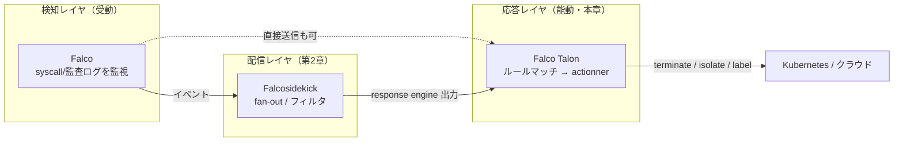
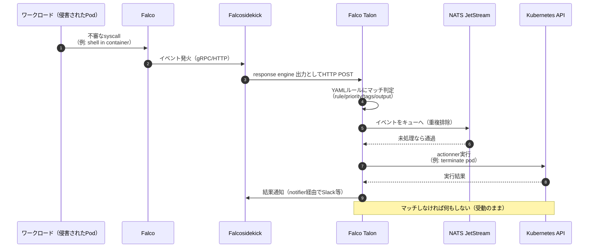
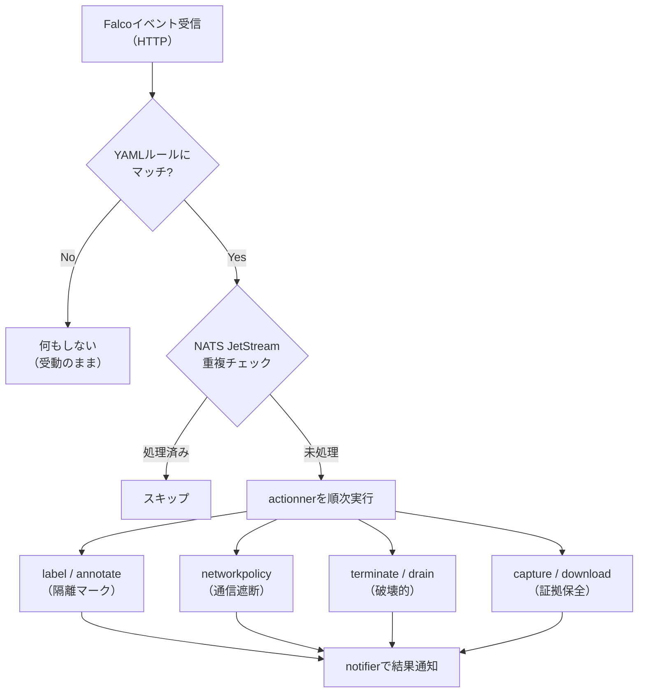

# 第3章：受動から能動へ — Falco Talon と自動レスポンス

Falco は長らく「見張り役」でした。怪しい挙動を検知し、アラートを上げる。しかしアラートが鳴ったあと、実際にコンテナを止め、ノードを隔離し、ネットワークを遮断するのは人間の仕事でした。第2章で見た Falcosidekick がアラートを「どこに届けるか」を解決したとすれば、本章で扱う **Falco Talon** は「届いた脅威に、誰がどう手を打つか」を解決します。これは Falco エコシステムが **検知（Detection）から応答（Response）へ** 踏み出した、決定的な一歩です。

ただし、自動で手を打つということは、自動で間違える余地を抱えることでもあります。本章では Talon の仕組みと実例を解説しつつ、「自動応答という諸刃の剣」をどう安全に扱うかを考察します。

## この章で学ぶこと

- なぜ「検知だけ」では運用が回らないのか（MTTR・夜間休日・アラート疲れ）
- Falco Talon のアーキテクチャ（HTTP 受信 → ルールマッチ → actionner 実行、NATS JetStream による重複排除）
- ノーコードな Talon ルールと actionner の実例（terminate pod / label / network policy）
- 自動応答のリスク（誤 kill・ブラスト半径）と安全弁（スコープ・dry-run・段階導入・人の承認）
- Talon が示す「受動から能動へ」の進化と、第7章「AI による応答」への橋渡し

## 1. なぜ検知だけでは足りないのか

Falco は脅威を「検知」します。ですが検知は、それ自体では何も止めません。攻撃者がコンテナ内でシェルを起動した瞬間に Falco が鳴っても、そのアラートが Slack に流れ、オンコール担当者が気づき、kubectl を叩いてポッドを消すまでには時間がかかります。この時間こそが **MTTR（Mean Time To Respond / Remediate、平均応答時間）** であり、攻撃者にとっては横展開や永続化のための猶予時間です。

検知だけでは足りない理由を整理すると、次の3点に集約されます。

| 課題 | 検知のみの世界 | 応答を加えた世界 |
| --- | --- | --- |
| MTTR | 人が気づいて手を動かすまで分〜時間単位 | マッチした瞬間にアクション、秒単位 |
| 夜間・休日 | オンコールの起床・接続待ち | 無人でも一次対応が走る |
| アラート疲れ | 大量のアラートに人が麻痺、見逃す | 定型対応を機械に任せ、人は判断に集中 |

特に「アラート疲れ（alert fatigue）」は深刻です。低優先度のアラートが日に数百件流れる環境では、人間は次第にそれを無視するようになり、その中に紛れた本物の侵害を見逃します。**定型的な一次対応を自動化し、人間を「判断」に専念させる** ことが、応答レイヤを足す本質的な動機です。

ここで重要なのは、Detection と Response は別レイヤだという認識です。Falco（検知）→ Falcosidekick（配信・ファンアウト）→ Talon（応答）という役割分担で、各レイヤが疎結合に積み上がっています。



Talon は **Falco から直接イベントを受け取る** ことも、**Falcosidekick の出力（output / handler）として受け取る** こともできます。Falcosidekick はその出力カテゴリの一つとして「response engines」を持ち、Talon はそこに位置づけられます（Falcosidekick 2.29.0 以降で統合）。第2章で見たファンアウトのハブの先に、応答エンジンがぶら下がるイメージです。

## 2. Falco Talon とは何か

**Falco Talon** は、Kubernetes における脅威への対応を管理する **ノーコードの Response Engine（応答エンジン）** です。公式の言葉を借りれば、「Falco コミュニティの検知を、コードを書かずにテイラーメイドな応答で強化する（enhances the Falco community's detection with a no-code tailor-made response）」ものです。

- 作者・メンテナ：Thomas Labarussias（@Issif）。Falcosidekick の作者でもあり、エコシステムの一貫した設計思想が流れています。
- v0.1.0 が 2024-09-09 にアナウンスされました（[falco.org/blog/falco-talon-v0-1-0](https://falco.org/blog/falco-talon-v0-1-0/)）。
- その後 falcosecurity org に **Incubation レベル** で寄贈されました（提案 [falcosecurity/evolution#403](https://github.com/falcosecurity/evolution/issues/403)、2024-09-06 起票）。成熟度バッジは **Incubating** です。
- 現在のリポジトリは [github.com/falcosecurity/falco-talon](https://github.com/falcosecurity/falco-talon) です（旧 `github.com/falco-talon/falco-talon` はこちらへリダイレクトされます）。
- 最新バージョンは **0.3.0**（2025-02-05）。

「ノーコード」がキーワードです。応答ロジックを Go や Python で書くのではなく、**YAML のルールとアクションの宣言** だけで「この検知が来たらこう動く」を定義できます。これにより、セキュリティ担当者がプログラマでなくても応答を設計・調整できる、という運用上の利点が生まれます。

### 動作の仕組み

Talon の処理は、おおむね次の流れです。

1. **HTTP でイベントを受信**：Falco または Falcosidekick から JSON 形式の Falco イベントを HTTP で受け取ります。
2. **ルールにマッチ**：ユーザー定義の YAML ルールに照合します。マッチ条件は **ルール名（rule）・優先度（priority）・タグ（tags）・出力フィールド（output fields）** など。
3. **actionner を順次実行**：マッチしたルールに紐づくアクション（actionner）を、定義順に実行します。
4. **重複排除**：内部に **NATS JetStream** のキューを持ち、同じイベントの重複処理を防ぎます（同じポッドに対して terminate を何度も走らせない、など）。



このループ全体が **detect → respond ループ** です。Falco が「見つける」、Talon が「手を打つ」。両者の間に Falcosidekick を挟むかどうかは構成次第ですが、いずれにせよイベントが HTTP で流れ込み、ルールにマッチした分だけアクションが走る、というのが核です。

## 3. ルールと actionner の実例

Talon の設定は大きく「ルール（rules）」と「アクション（actionners）」で構成されます。まずは最小のルール例を見てみましょう。

```yaml
# rules.yaml — 「Terminal shell in container」ルールにマッチしたらPodを削除
- name: Terminate suspicious shell
  match:
    rules:
      - Terminal shell in container
  actions:
    - name: terminate the pod
      actionner: kubernetes:terminate
      parameters:
        grace_period_seconds: 5
```

`match` セクションでマッチ条件を、`actions` セクションで実行する actionner を宣言します。これだけで「`Terminal shell in container` という Falco ルールが発火したら、対象 Pod を 5 秒の猶予つきで削除する」という応答が完成します。コードは一行も書いていません。

優先度やタグでスコープを絞り、複数アクションを連鎖させる例も見てみましょう。

```yaml
- name: Isolate and label on high severity
  match:
    priority: ">=Critical"      # Critical以上の優先度のみ
    tags:
      - network                  # networkタグを持つ検知に限定
    namespaces:
      - production               # productionネームスペースだけを対象
  actions:
    # 1) まず証拠保全：ラベルを付けて隔離対象とマーク
    - name: label the pod
      actionner: kubernetes:label
      parameters:
        labels:
          suspicious: "true"
          quarantine: "pending"
    # 2) ネットワークを遮断（NetworkPolicyで通信を止める）
    - name: cut network
      actionner: kubernetes:networkpolicy
  notifiers:
    - slack                      # 実行結果をSlackへ通知
```

ここでは **Critical 以上 × network タグ × production ネームスペース** という三重のスコープで対象を絞り込み、「ラベル付け → ネットワーク遮断」という二段のアクションを順に実行し、結果を Slack に通知しています。「いきなり kill せず、まず隔離する」という設計思想がそのまま YAML に表現できる点が Talon の柔軟さです。

### v0.1.0 時点の actionner 一覧（13種）

| カテゴリ | actionner | 何をするか |
| --- | --- | --- |
| Pod 操作 | terminate pod | 対象 Pod を削除する |
| Pod 操作 | label / annotate pod | Pod にラベル/アノテーションを付与（隔離マーク等） |
| Pod 操作 | exec command | Pod 内でコマンドを実行 |
| Pod 操作 | run script | Pod 内でスクリプトを実行 |
| ネットワーク | create network policy | NetworkPolicy を作成し通信を制限 |
| ネットワーク | Calico（network-policy provider） | Calico でネットワークポリシーを適用 |
| ネットワーク | Cilium（network-policy provider） | Cilium でネットワークポリシーを適用 |
| ネットワーク | capture network traffic | 対象のネットワークトラフィックをキャプチャ |
| ログ | log | イベント内容をログ出力する |
| リソース | delete resource | 任意の K8s リソースを削除 |
| ノード | drain node | ノードを drain（退避）する |
| フォレンジック | download file | 対象から証拠ファイルを取得 |
| クラウド | AWS Lambda | AWS Lambda 関数を呼び出す（クラウド側連携） |

actionner は「止める（terminate / drain）」系だけでなく、「隔離する（label / networkpolicy）」「証拠を残す（capture / download）」「外部処理に委ねる（Lambda）」など、対応の粒度を選べるよう揃っています。**必ずしも破壊的なアクションを選ぶ必要はない** という点は、後述する安全運用にとって重要です。



## 4. 設計と運用の考察 — 自動応答は諸刃の剣

ここからが本章の核心です。自動応答は強力ですが、**自動で間違える** リスクを伴います。冷静に考察しておきましょう。

### リスク1：誤検知（False Positive）による誤 kill

Falco のルールは完璧ではありません。正規の運用作業（デバッグのために本番 Pod へ `kubectl exec` した、CI が一時的にシェルを起動した）が「Terminal shell in container」として発火することは珍しくありません。これに `terminate` を自動で紐づけていると、**正常なワークロードを機械が殺します**。検知の偽陽性が、そのまま可用性インシデントに直結するのです。

### リスク2：ブラスト半径（Blast Radius）

`drain node` や `delete resource`、広すぎる NetworkPolicy は、対象を一つ間違えると影響範囲が一気に広がります。攻撃者がこれを逆手に取り、わざと検知を踏ませて **自動応答に DoS を起こさせる**（正常 Pod を次々 kill させる）攻撃すら理屈上は成立します。応答エンジンそのものが攻撃面になりうる、という視点が必要です。

### 安全弁の設計

これらのリスクに対し、Talon の機能と運用設計で次のようなガードレールを敷きます。

| 安全弁 | 具体策 |
| --- | --- |
| スコープを絞る | `priority`（Critical 以上のみ）、`tags`、`namespaces`（本番のみ/開発除外）でマッチ範囲を限定 |
| 破壊的でないアクションから | いきなり `terminate` せず、まず `label`（隔離マーク）や `networkpolicy`（通信遮断）に留める |
| dry-run 的運用 | 最初は通知のみ（actionner を実行せず notifier だけ）で、どのイベントに何が走るはずだったかを観測 |
| 段階導入 | 開発 → ステージング → 本番の順に、低リスクな actionner から有効化 |
| 人の承認を挟む | 破壊的アクションは自動実行せず、Slack 通知 → 人が承認 → 実行、という half-automation にする |
| 重複排除を効かせる | NATS JetStream により、暴発的な連続アクションを防ぐ |

最も実務的な指針は「**まず観測、次に隔離、最後に破壊**」です。導入初期は notifier だけを付けて「もし自動応答が有効だったら何が起きたか」を数週間ログで眺め、誤 kill につながりそうなルールを洗い出す。次に label / networkpolicy のような可逆的アクションを本番に入れ、最後に十分に枯れたルールにだけ terminate / drain を許可する。この段階を飛ばして全 actionner を一気に有効化するのは、運用上もっとも危険な選択です。

> 自動応答の価値は「速さ」にありますが、速さは間違いも増幅します。**何を自動化しないか** を決めることが、何を自動化するかを決めることと同じくらい重要です。

## 5. 位置づけの考察 — 受動から能動へ、そして「AIによる応答」へ

Talon が象徴するのは、Falco エコシステムが **受動的な検知器** から **能動的な防御システム** へ進化したという事実です。第1章で辿った進化史、第2章で見たエコシステムの広がり（Falcosidekick のファンアウト、プラグイン）の延長線上に、「見つけたら手を打つ」レイヤがついに加わりました。Detection（Falco）→ Routing（Falcosidekick）→ Response（Talon）という三層が揃ったことで、Falco は「監視ツール」から「インシデント対応プラットフォーム」へと姿を変えつつあります。

しかし本章で繰り返し述べたとおり、能動性は責任を伴います。Talon のルールは静的な YAML であり、「Critical かつ network タグなら遮断」といった **事前に人が書いた条件分岐** に過ぎません。誤検知の判断も、ブラスト半径の評価も、最終的には人間の設計に依存します。

ここで自然に浮かぶ問いが「**応答の判断そのものを、もっと賢くできないか**」です。静的ルールではなく、イベントの文脈（過去の挙動、ワークロードの重要度、攻撃の連鎖）を踏まえて「これは本当に kill すべきか、それとも隔離で十分か」を判断する応答。これが第7章で扱う **AI による応答** のテーマです。Talon が敷いた「ノーコードで応答を宣言する」レール上に、AI が「応答を判断する」層を重ねていく — その流れを、本書は後半で追っていきます。

## まとめ

- Falco は検知器ですが、検知だけでは MTTR・夜間休日対応・アラート疲れの課題が残ります。**Falco Talon** はそこに「ノーコードの応答レイヤ」を足しました。
- Talon は Falco / Falcosidekick から HTTP でイベントを受け、YAML ルール（rule / priority / tags / output でマッチ）に従って actionner（terminate / label / networkpolicy など13種）を順次実行し、NATS JetStream で重複排除します。
- 自動応答は諸刃の剣です。誤 kill とブラスト半径のリスクに対し、**スコープ限定・非破壊アクション優先・dry-run 的観測・段階導入・人の承認** という安全弁を設計に組み込むことが不可欠です。
- Talon は Falco が「受動から能動へ」進化した象徴であり、その判断を賢くする「AI による応答」は第7章で再登場します。

次章では、いったん「応答」から離れ、**フォレンジックと深掘り分析** に視点を移します。Wireshark の作者らが手がけた、syscall とログをパケット解析の作法で掘り下げる新ツール **Stratoshark** を取り上げます。検知し、応答したあとに「実際に何が起きたのか」を解剖する世界へ進みましょう。
