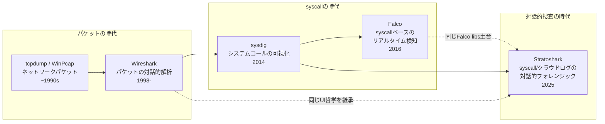
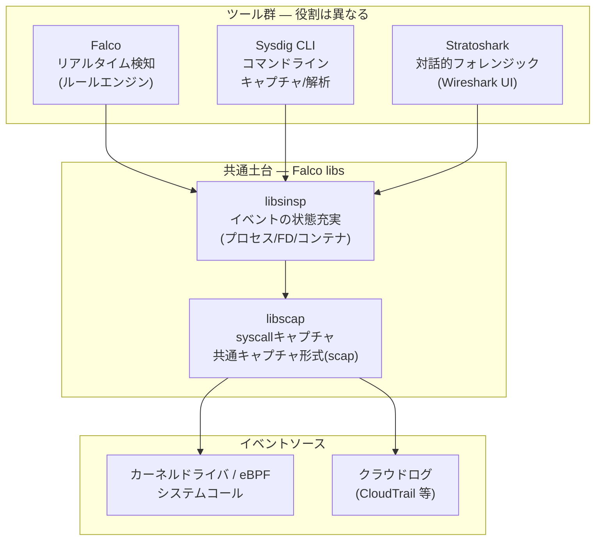
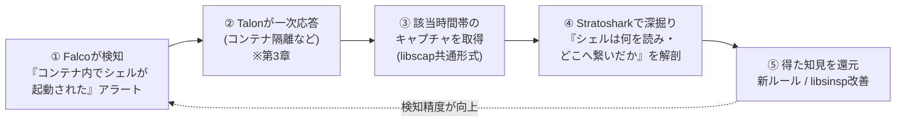

# 第4章：観測の系譜 — Stratoshark と Falco libs、Wireshark哲学の到達点

ここまでの3章で、私たちはFalcoが「ルールエンジン」から「エコシステム」へ、さらに「自動応答」へと進化してきた過程を追ってきました。しかしその進化のすべてを足元で支えていたのは、第1章で提示した **Falco libs（libsinsp / libscap）という共通土台** でした。本章では、その同じ土台から2025年に生まれた新しいツール **Stratoshark** を取り上げます。これは「syscallのWireshark」と呼ぶべき対話的なフォレンジックツールであり、検知（Falco）と捜査（Stratoshark）が同じ根を持つ「車の両輪」であることを、最も鮮やかに示してくれる事例です。

## この章で学ぶこと

- パケット → syscall → 検知 → 対話的捜査と続く「観測の系譜」と、Gerald Combs と Loris Degioanni の再タッグ
- Stratoshark とは何か：Wireshark の成熟したUIでsyscall・クラウドログを開いて事後解析する仕組み
- 技術的な核心：Falco libs を介してWiresharkとsyscallを接続し、Falco・Sysdig CLI・Stratoshark がキャプチャ形式を共有していること
- Falco（リアルタイム・ルールベース検知）と Stratoshark（対話的フォレンジック）の役割分担と補完関係
- 検知駆動の自動キャプチャとStratosharkの統合、その先に見える「KDR（Kubernetes Detection and Response）」という方向性
- Part 1「Falcoの進化」の総括と、Part 2「AI時代の新しい攻撃面」への橋渡し

## 1. 観測の系譜 ― パケットから対話的捜査へ

第1章で、私たちはFalcoの源流をたどりました。Loris Degioanni は Wireshark の中核であるパケットキャプチャライブラリ **WinPcap** の作者であり、その経験を「ネットワークパケット」から「システムコール」へと拡張したのが **sysdig** でした。そして sysdig のエンジンを土台に、リアルタイムのセキュリティ検知へ振り切ったのが **Falco** です。

この系譜を貫く一本の思想があります。Loris の一貫したテーゼ――**「低レイヤの可視性こそが真実を明らかにする」**（low-level visibility reveals the truth）――です。アプリケーションのログは嘘をつくかもしれませんが、プロセスが実際に発行したシステムコールは嘘をつきません。tcpdump や Wireshark が「ネットワーク上で実際に何が流れたか」を見せたように、syscall を見れば「プロセスが実際に何をしたか」がわかる。この発想が、ツールの世代を超えて受け継がれてきました。

そして2025年、この系譜にもう一つの分岐が加わります。Wireshark の創設者 **Gerald Combs** と Falco/Sysdig の創設者 **Loris Degioanni** が再びタッグを組み、**Stratoshark** を生み出したのです。Wireshark がパケットに対して提供した「開いて、フィルタして、一つひとつ解剖する」体験を、今度は syscall とクラウドログに対して提供する――それが Stratoshark でした。

注目すべきは、この図の矢印が単純な一本道ではないことです。Wireshark の「UI哲学」と Falco の「libs土台」という**二つの系譜が Stratoshark で合流している**点に、本章の主題が凝縮されています。

## 2. Stratoshark とは何か

Stratoshark は2025年1月22日に Sysdig が発表したオープンソースツールで、しばしば **"Wireshark for the cloud"** と表現されます。その正体を一言で言えば、**Wireshark の成熟したユーザーインターフェースをそのまま使って、ネットワークパケットの代わりにシステムコールやクラウドログを開くツール**です。

Wireshark を使ったことがある人なら、あの特徴的な「三ペイン構成」を思い浮かべるでしょう。

- 上：イベント（パケット）の一覧
- 中：選択したイベントの詳細なフィールド分解（dissection）
- 下：生のバイト列

Stratoshark はこの三ペインUI、そして強力な表示フィルタ（display filter）エンジンを**そっくりそのまま受け継いでいます**。違うのは、各行が「ネットワークパケット」ではなく「システムコール1回」または「クラウドログ1件」である、という点だけです。

### 何ができるのか

Stratoshark で syscall キャプチャを開くと、インシデントの「事後」に、まるでビデオを巻き戻すように、システム上で起きたことを精緻に追跡できます。

| 観測対象 | Stratoshark で見えること |
| --- | --- |
| プロセス実行 | どのプロセスが、いつ、どの引数で `execve` したか。親子関係。 |
| ファイルI/O | `open` / `read` / `write` がどのファイルに対して発行されたか、その内容まで |
| ネットワーク | `connect` / `accept` / `send` / `recv` の宛先・データ |
| IPC・シグナル | プロセス間通信やシグナル送信の事後追跡 |

さらに Stratoshark は **クラウドログの解析**にも対応しています。AWS CloudTrail のようなクラウド監査ログを取り込み、Wireshark のフィルタ文法で「どのIAMプリンシパルが、どのAPIを、いつ叩いたか」を解剖できるのです。これは「オンホストのsyscall」と「クラウドAPI」という二つのレイヤを、同じUI・同じ操作感で行き来できることを意味します。

### Wireshark Foundation への寄贈

Stratoshark の最も重要な出来事は、発表からわずか数か月後の **2025年5月14日**に起きました。Sysdig は Stratoshark を **Wireshark Foundation に寄贈**したのです。寄贈の対象には、ソースコードはもちろん、後述する **Falco libs とのインターフェースコード**、商標、ロゴ、Webサイト（stratoshark.org）まで含まれていました。

これは単なるOSS化ではありません。Stratoshark を「Wireshark の正統な後継・兄弟プロジェクト」として、Wireshark のコミュニティとガバナンスの傘下に正式に置く、という宣言でした。Gerald Combs と Loris Degioanni の再タッグが、組織レベルでも結実した瞬間だったと言えます。

導入も急速に進みました。2025年半ばまでに **40,000ダウンロードを突破**し、最新版は **0.10.1** 系（ソースは GitLab、インストーラは Windows x64/Arm64・macOS Universal を提供）として配布されています。

## 3. 技術的な核心 ― Falco libs がWiresharkとsyscallを繋ぐ

ここからが本章の核心であり、Stratoshark を「ただのクールなツール」から「Falcoの進化の到達点」へと格上げする論点です。

Wireshark はパケットを解釈するエンジンを持っていますが、**システムコールを取得・解釈する能力は持っていません**。では Stratoshark はどうやって syscall を扱うのでしょうか。答えは、第1章で繰り返し強調した **Falco libs（libsinsp / libscap）** にあります。

Sysdig が Stratoshark に対して行った貢献は、明示的に **「Wireshark を Falco libraries とインターフェースさせるコード」**（the code to interface Wireshark with the Falco libraries）でした。つまり Stratoshark は、

- **libscap**：syscall をキャプチャし、ファイル（scap形式）として保存・読み出しする
- **libsinsp**：生のsyscallイベントを「プロセス」「ファイルディスクリプタ」「コンテナ」といった意味のある状態へと充実（enrich）させる

という Falco と**まったく同じライブラリ**を内部で使っているのです。Wireshark の役割は「解釈された syscall イベントを、あの美しい三ペインUIに表示する」ことに専念しています。

この図が示すのは、Falco・Sysdig CLI・Stratoshark の3つが**同じ libsinsp/libscap の上に乗っている**という事実です。そしてここから、極めて実用的な帰結が生まれます。

### キャプチャ形式の共有 ― 「捕る」と「見る」の分離

3つのツールは libscap を共有しているため、**同じキャプチャファイル形式**を使います。これが意味するのは、**あるツールで捕ったキャプチャを、別のツールで開ける**ということです。

たとえば、本番環境のサーバで Sysdig CLI を使って `.scap` ファイルを採取し、それを解析担当者のラップトップに転送して Stratoshark で開く――といったワークフローが自然に成立します。Falco が検知の根拠とした同じイベントストリームを、Stratoshark で一つひとつ手作業で解剖し直すこともできるのです。「捕る場所」と「見る場所」を分離できることは、フォレンジックにおいて決定的に重要です。

### 考察 ― なぜ「共通libs」がこれほど効くのか

ここで一歩引いて考えてみます。なぜ Sysdig は、Stratoshark のためにわざわざ新しいキャプチャエンジンを書かず、Falco libs を流用したのでしょうか。技術的な省力化だけが理由ではありません。共通土台には、**知見が双方向に還流する**という構造的な利点があるのです。

- **検知 → 捜査への還流**：Falco がルールを書くために積み上げてきた「syscall をどう意味づけるか」という知見（どのフィールドが攻撃の兆候になるか、コンテナ文脈をどう紐づけるか）が、libsinsp を通じてそのまま Stratoshark の解析能力になります。Stratoshark のユーザーは、Falco が長年磨いてきた「syscallの読み方」を無料で手にしているとも言えます。
- **捜査 → 検知への還流**：逆に、Stratoshark で人間がキャプチャを深掘りして発見した新しい攻撃パターンや、見落としていたsyscallの組み合わせは、libsinsp の改善や新しいFalcoルールとしてフィードバックされます。捜査の現場で得た「生の気づき」が、自動検知の精度向上に戻っていくのです。

つまり Falco libs は、単なるコードの再利用先ではなく、**検知と捜査の知見が出会い、循環する中枢**として機能しています。第1章で「Falco libs こそが進化の土台だ」と述べた主張は、Stratoshark の登場によって最も具体的な形で証明されたと言えるでしょう。

## 4. 役割分担の考察 ― 検知と捜査は車の両輪

Falco と Stratoshark は同じ土台に乗っていますが、**役割は明確に異なります**。この違いを理解することが、両者を正しく使い分ける鍵になります。

| 観点 | Falco | Stratoshark |
| --- | --- | --- |
| 基本性格 | リアルタイム・ルールベース検知 | 対話的フォレンジック / 深掘り解析 |
| 時間軸 | 「今まさに起きていること」を即座に判定 | 「過去に起きたこと」を巻き戻して精査 |
| 駆動方式 | あらかじめ書いたルールが自動でマッチ | 人間がフィルタを書き、仮説を立てて探索 |
| 主なUI | ルールYAML・アラート出力（Talon等が応答） | Wireshark三ペインUI・対話的操作 |
| 出力 | アラート（イベント発火） | 解釈済みイベントの精緻な可視化 |
| 適した問い | 「悪いことが起きていないか？」 | 「何が、どういう順序で起きたのか？」 |
| 共通基盤 | Falco libs（libsinsp / libscap） | Falco libs（libsinsp / libscap） |

Falco は「24時間眠らない監視員」です。ルールに従って、危険な兆候を見つけた瞬間にアラートを上げます（そして第3章で見たように Talon が自動応答します）。しかしFalcoは、アラートの**前後で何が起きていたか**を人間が腰を据えて追跡するためのツールではありません。

Stratoshark は「事件後に現場へ入る鑑識官」です。リアルタイム性はありませんが、その代わりに人間が仮説を立て、フィルタを書き換えながら、syscall の一つひとつを納得いくまで解剖できます。

### インシデント対応ワークフローの例

両者の補完関係は、実際のインシデント対応の流れに置くと最も鮮明になります。

Falco がアラートを鳴らすところから捜査が始まり、Stratoshark での深掘りで得た知見が新しいFalcoルールとして還元され、次の検知精度を高める――この**ループ全体が、Falco libs という共通土台の上で閉じている**点に注目してください。検知と捜査は対立するものでも、独立したものでもなく、文字どおり同じ車を前に進める両輪なのです。

## 5. 「手動キャプチャ」から「検知駆動の自動キャプチャ」へ

ここまでの説明は、Sysdig CLIなどで**人間が能動的に `.scap` を採取する**ワークフローを前提にしていました。しかしFalco本体にも、この手順を自動化する機能がすでに組み込まれています。

Falcoは**0.42.0でcapture recording機能をsandbox成熟度として導入**し、0.43.0で安定化、0.44.0では生成される `.scap` ファイルに上限サイズを設ける `capture.max_file_size_mb` が追加されました。これは**ルールが発火した瞬間、Falco自身がその前後のsyscallトレースを `.scap` として自動的に記録する**機能です。記録対象はグローバルに有効化することも、`mode: rules` で特定のルールにだけ `capture: true`（必要なら `capture_duration` も）を付けて絞り込むこともできます（出典: https://github.com/falcosecurity/falco/issues/3595、https://github.com/falcosecurity/falco/pull/3645）。

この自動キャプチャが向かう先が、まさに本章で見てきたStratosharkです。2025年11月10日、CNCFは「Falco Links Real-Time Detection with Forensic-Level Analysis in the Cloud Native Stack」として、Falcoが検知時に自動生成した `.scap` をそのままStratosharkで開き、Wireshark流にリプレイ・精査できる統合を発表しました。加えて、プラグインAPI側にも**フィールドのバイトオフセットをマッピングする仕組み**が入り、Kubernetes監査ログやAWS CloudTrailのような構造化ログの「どのバイト範囲がどのフィールドに対応するか」をStratoshark上で視覚的にハイライトできるようになっています（出典: https://www.cncf.io/announcements/2025/11/10/falco-links-real-time-detection-with-forensic-level-analysis-in-the-cloud-native-stack/）。

言い換えれば、§3で「手動で実現可能」と説明したワークフロー図の③（該当時間帯のキャプチャ取得）は、もはや**人間が覚えておいて実行する手順ではなく、検知と同時にFalcoが自動で済ませておいてくれる前処理**になりつつあります。人間の仕事は「キャプチャを取る」ことから「Stratoshark上で、もう手元にあるキャプチャを読み解く」ことへとシフトする――これが、FalcoとStratosharkが揃って見据える**Kubernetes Detection and Response（KDR）**という方向性です。検知・隔離（Talon）・証跡保全（自動キャプチャ）・解析（Stratoshark）までを一つのライフサイクルとして閉じ、孤立した点のツールの寄せ集めから脱する――という構想であり、現時点では個々の機能はすでに実装済みである一方、「KDR」という統合コンセプト自体は発表されたばかりの方向性（まだ成熟しきってはいない）だと捉えておくのが正確です。

## まとめ

本章では、Falcoの進化を支えてきた **Falco libs という共通土台**が、2025年に **Stratoshark** という新しい結実を生んだことを見てきました。

- 観測の系譜は、パケット（Wireshark）→ syscall（sysdig）→ 検知（Falco）→ 対話的捜査（Stratoshark）と連なり、Gerald Combs と Loris Degioanni の再タッグで合流した
- Stratoshark は Wireshark の成熟したUIで syscall・クラウドログを開く「syscallのWireshark」であり、2025年5月14日に Wireshark Foundation へ寄贈された
- その技術的核心は、Wireshark と syscall を **Falco libs（libsinsp/libscap）で接続**したこと。Falco・Sysdig CLI・Stratoshark はキャプチャ形式を共有し、検知と捜査の知見が双方向に還流する
- Falco（リアルタイム検知）と Stratoshark（対話的フォレンジック）は、同じ根を持つ車の両輪である
- 検知駆動の自動キャプチャ（Falco 0.42〜0.44）とStratosharkの統合（2025-11-10発表）により、「キャプチャを取る」手順そのものが自動化されつつあり、その先に**KDR（Kubernetes Detection and Response）**という統合ライフサイクルの構想がある

ここで Part 1「Falcoの進化」を締めくくります。第1章から本章まで、私たちが一貫して追ってきたのは「**Linuxプロセスが実際に何をしているか**を、低レイヤの真実から見る」という観測の進化でした。検知も応答も捜査も、その対象は突き詰めれば「syscallを発行するプロセス」だったのです。

しかし、ここから世界が変わります。次の **Part 2** で扱う観測対象は、もはや行儀のよいLinuxプロセスではありません。**AIワークロード**――確率的に振る舞い、自然言語の指示で動き、その「意図」がコードに書かれていないという、まったく未知の挙動を持つ存在です。第5章では、この **AI時代の新しい攻撃面** に踏み込み、これまで磨いてきた「観測の哲学」がそこでどこまで通用し、何を新たに考え直さねばならないのかを問い直していきます。

### 参考リンク

- Stratoshark 公式サイト: https://stratoshark.org
- Falco capture recording機能のissue/PR: https://github.com/falcosecurity/falco/issues/3595 / https://github.com/falcosecurity/falco/pull/3645
- CNCF発表「Falco Links Real-Time Detection with Forensic-Level Analysis in the Cloud Native Stack」（2025-11-10）: https://www.cncf.io/announcements/2025/11/10/falco-links-real-time-detection-with-forensic-level-analysis-in-the-cloud-native-stack/
- Sysdig Blog「Stratoshark: Extending Wireshark's Legacy into the Cloud」: https://sysdig.com/blog/stratoshark-extending-wiresharks-legacy-into-the-cloud
- Sysdig プレスリリース / Wireshark Foundation への寄贈に関する発表: https://sysdig.com/press-releases/
- Falco libs（libsinsp / libscap）: https://github.com/falcosecurity/libs
