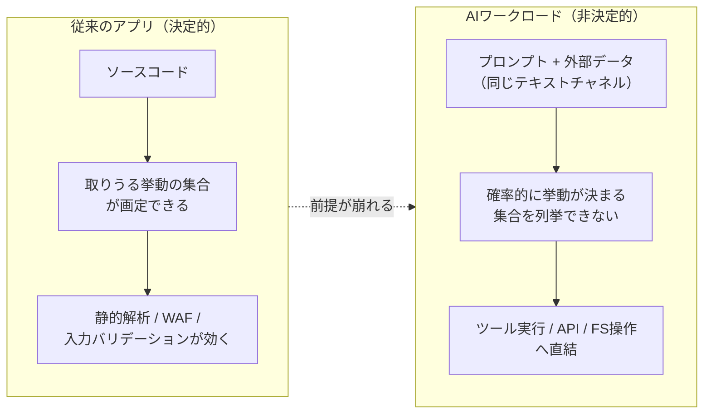
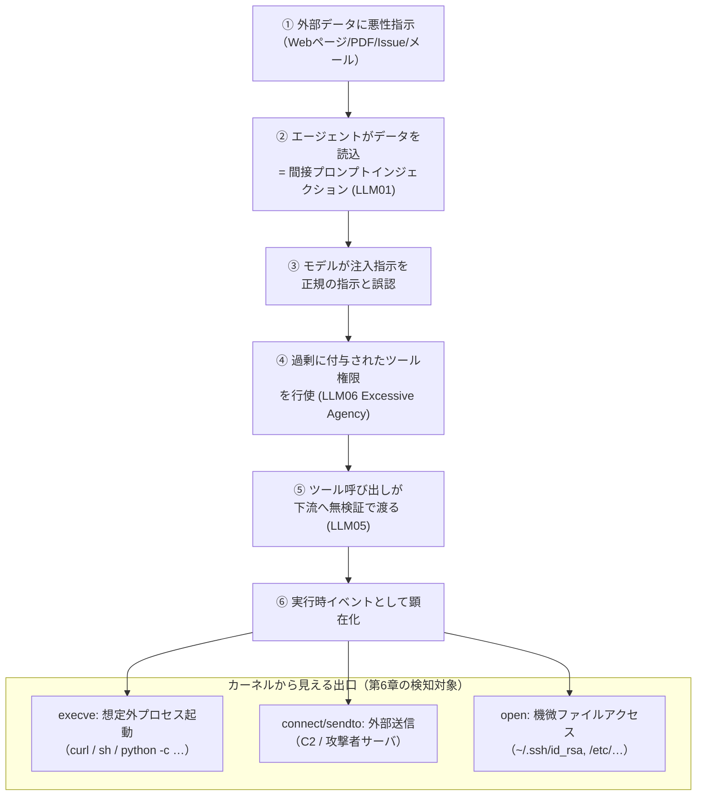
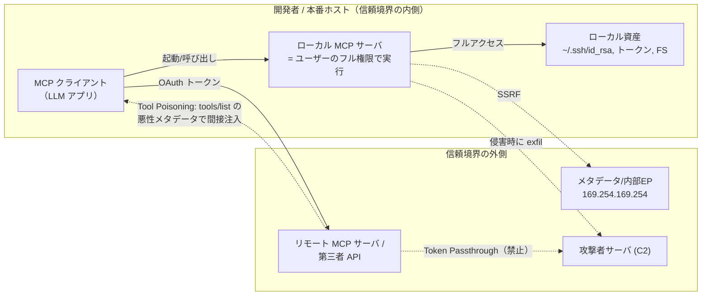

# 第5章：AI時代の新しい攻撃面 — LLM / エージェント / MCP / GPU

ここから本書はPart2に入ります。第1章から第4章まで、私たちはFalcoという「ランタイムを観測する仕組み」がどう進化してきたかを追ってきました。本章ではいったん視点を変えて、その観測対象——つまり**いま守るべきワークロード**——がこの2、3年でどう変質したのかを見ていきます。

結論を先に言えば、AIワークロードは「確率的に動く新種のプロセス」です。コードではなくプロンプトで挙動が決まり、振る舞いが非決定的になった結果、従来の静的な防御では捉えにくい新しい攻撃面が一気に開きました。プロンプトインジェクションからツール実行への連鎖、モデルや重みの窃取、MCPという新しい信頼境界、そして高価なGPUインフラの脆弱性。本章はこの「攻撃面」を整理することに徹し、それをどう検知するかは次章（第6章）に譲ります。

## この章で学ぶこと

- AIワークロードがなぜ従来のアプリと根本的に違うのか（コードでなくプロンプトで挙動が決まる＝非決定的）、そしてアプリ層の制御が当てにならない理由
- OWASP Top 10 for LLM Applications (2025) のうち、ランタイムに直接効く項目（LLM01/02/03/05/06）と、プロンプトインジェクション→Excessive Agency→ツール実行という kill chain
- エージェントとMCPがもたらす新しい信頼境界——OWASP Agentic Top 10 (ASI)、MCP Security Best Practices、Tool Poisoning と CVE-2025-49596
- GPU / アクセラレータ基盤の攻撃面——NVIDIA Container Toolkit CVE-2024-0132 と NVIDIAScape CVE-2025-23266 が示す「3行のDockerfileでホストroot」
- 2024〜2026年の実インシデント・カタログと、それらを横串で貫く「Shadow AI」というテーマ

## 5.1 なぜAIワークロードは「違う」のか

従来のアプリケーションは、良くも悪くも決定的でした。同じ入力には同じ出力を返し、コードを読めば取りうる挙動の集合が分かる。だからこそ静的解析やWAFのシグネチャ、入力バリデーションといった「アプリ層の制御」が効きました。挙動の境界が、開発者が書いたコードによって画定されていたからです。

LLMを組み込んだワークロードは、この前提を崩します。

第一に、**挙動を決めるのがコードではなくプロンプト（自然言語）**です。モデルへの指示と、外部から流れ込むデータ（ユーザー入力、Webページ、ドキュメント、他システムからのレスポンス）が同じテキストチャネルに混ざり、その混合物が次の行動を決めます。コードとデータの分離という、セキュリティの基本原則が構造的に成立しにくい。

第二に、**出力が確率的（非決定的）**です。同じ入力でも応答は揺れ、「許可された挙動の集合」を事前に列挙できません。アプリ層で「この入力は弾く」というルールを書こうにも、攻撃の表現は無限にパラフレーズ可能で、フィルタは原理的に後追いになります。プロンプトインジェクション対策が「完全には解けない」と言われるのはこのためです。

第三に、**LLMは単に喋るだけでなく「行動する」**ようになりました。ツール呼び出し（function calling）やエージェントフレームワーク、そしてMCPによって、モデルの出力がコマンド実行・API呼び出し・ファイル操作に直結します。ここで「AIのちょっとした奇妙な振る舞い」が「実行時のコンパイズ（侵害）」に化けます。



ここに本章の主張を重ねます。アプリ層の制御が原理的に当てにならないなら、**最後の砦は「実際に何をしたか」を見るランタイム観測**になります。どんなに巧妙にモデルを騙しても、それがプロセス起動・ネットワーク送信・ファイルアクセスとして現れた瞬間、カーネルレベルでは普通のsyscallです。攻撃の入口は自然言語で多様化しても、出口は収斂する——この視点を本章の通奏低音として持っておいてください。

## 5.2 OWASP Top 10 for LLM Applications (2025)

LLMアプリの脅威を体系化したのが、OWASP GenAI Security Project による **Top 10 for LLM Applications**（"2025" 版、2024-11-17 公開）です。まず全体像を表で示します。

| ID | 項目 | 概要 | ランタイムへの効き |
|----|------|------|------|
| LLM01 | Prompt Injection | 指示とデータの混在を突き、モデルの挙動を乗っ取る | ◎ |
| LLM02 | Sensitive Information Disclosure | 学習データ・システム情報・機密の漏えい | ○ |
| LLM03 | Supply Chain | モデル・データセット・依存の供給網汚染 | ○ |
| LLM04 | Data and Model Poisoning | 学習/微調整データや重みの汚染 | △ |
| LLM05 | Improper Output Handling | モデル出力を無検証で下流に渡す（XSS/SSRF/RCE誘発） | ◎ |
| LLM06 | Excessive Agency | 権限・自律性・機能の過剰付与 | ◎ |
| LLM07 | System Prompt Leakage | システムプロンプトの漏えい | △ |
| LLM08 | Vector and Embedding Weaknesses | RAGのベクトル/埋め込みの悪用 | △ |
| LLM09 | Misinformation | 誤情報・幻覚の生成 | × |
| LLM10 | Unbounded Consumption | 無制限なリソース消費（DoS/コスト爆発） | ○ |

出典: https://genai.owasp.org/llm-top-10/

このうち、ランタイム（実行時のsyscall/ネットワーク挙動）に直接効くのは **LLM01 / LLM02 / LLM03 / LLM05 / LLM06** です。

- **LLM01 プロンプトインジェクション**は全ての起点です。直接（ユーザーがそのまま注入）と間接（Webページやドキュメントなど外部データに仕込まれ、モデルが読み込んだ瞬間に発火）があり、後者はユーザー本人が攻撃に加担していることに気づかないのが厄介です。
- **LLM05 不適切な出力ハンドリング**は、モデルの出力を信頼して下流（シェル、SQL、ブラウザ、別API）に流す設計の罪です。`os.system(llm_output)` のようなコードがあれば、これは直接RCEに化けます。
- **LLM06 Excessive Agency**は、エージェントに過剰な権限・ツール・自律性を与えてしまう問題。「メールを読む」だけのつもりが「メールを送る」「ファイルを消す」権限まで持っていれば、注入された指示の被害が一気に広がります。

### プロンプトインジェクション → Excessive Agency → ツール実行の kill chain

本章で最も重要な連鎖がこれです。LLM01とLLM06の組み合わせこそが、「AIの奇妙な振る舞い」を「実行時の侵害」へ変える橋になります。



注目すべきは図の下半分です。攻撃の上流（①〜⑤）はアプリ層・自然言語の領域で、フィルタも回避され得ます。しかし⑥に至った瞬間、それは `execve`、`connect`、`open` という、ごく普通のシステムコールになります。**攻撃の入口がいかに新しくても、出口は古典的なランタイムイベント**——ここがFalcoの出番であり、第6章で具体的に実装します。本章ではこの「収斂」を頭に置くだけで十分です。

## 5.3 エージェントとMCP — 新しい信頼境界

LLMが「行動する」段になると、脅威モデルは単体のLLMアプリを超えます。複数のエージェントが連携し、ツールを介して外部とつながり、互いに委任し合う——この世界を体系化したのが、2025年12月に公開された **OWASP Top 10 for Agentic Applications** です。LLM版とは別物で、`ASI01`〜`ASI10` の接頭辞を持ちます。

| ID | 項目 |
|----|------|
| ASI01 | Goal hijacking via prompt injection（プロンプトインジェクションによる目標乗っ取り） |
| ASI02 | Tool misuse via unsafe delegation（安全でない委任によるツール誤用） |
| ASI03 | Identity & privilege abuse in delegation chains（委任連鎖における権限濫用） |
| ASI04 | Runtime supply-chain vulns（ランタイム供給網の脆弱性） |
| ASI05 | Unexpected remote code execution（想定外のリモートコード実行） |
| ASI06 | Memory & context poisoning（メモリ/コンテキストの汚染） |
| ASI07 | Insecure inter-agent communication（エージェント間通信の不備） |
| ASI08 | Cascading failures（連鎖障害） |
| ASI09 | Human-agent trust exploitation（人間とエージェント間の信頼の悪用） |
| ASI10 | Rogue agent / misalignment（暴走エージェント / ミスアライメント） |

出典: https://genai.owasp.org/

ASI01がLLM01の延長線上にあり、ASI05が「想定外のリモートコード実行」として明示的に立っているのは示唆的です。エージェント化は、プロンプトインジェクションの被害をコード実行へと地続きにします。

### MCP の信頼境界

このエージェント時代の配管を担うのが **MCP (Model Context Protocol)** です。Anthropicが2024年後半に公開したオープン標準で、LLMクライアントと「ツール／データソースを提供するサーバ」をつなぎます。便利な反面、新しい信頼境界を持ち込みました。公式の **MCP Security Best Practices**（https://modelcontextprotocol.io/docs/tutorials/security/security_best_practices ）が挙げる主な脅威を整理します。

| 脅威 | 内容 | 要点 |
|------|------|------|
| Confused Deputy | サーバが第三者APIのプロキシとして振る舞い、権限を取り違える | 認可の取り違え |
| Token Passthrough | サーバが自分宛でないトークンをそのまま下流に流す | **明示的に禁止**："MCP servers MUST NOT accept tokens not issued for them" |
| SSRF | discovery URL等を内部/メタデータエンドポイントに向ける | 例: `169.254.169.254` への到達 |
| Session Hijacking | セッションIDを認証代わりに使う | "MUST NOT use sessions for authentication" |
| Local MCP Server Compromise | ローカルサーバはクライアントのフル権限で動く | 悪性起動コマンド = 任意コード実行 |
| Scope（最小化） | `files:*` や `admin:*` のような広すぎる権限 | スコープを絞れ |

特に「ローカルMCPサーバの侵害」はランタイムの観点で重要です。ローカルで起動するMCPサーバは、起動したユーザーのフル権限で動きます。つまり悪性の起動コマンド——たとえば `~/.ssh/id_rsa` を読んで外部へ送るような一行——が紛れ込めば、それはそのまま任意コード実行です。これもまた、5.2で見た「出口は古典的syscall」に帰着します。



### MCP Tool Poisoning と CVE-2025-49596

実例を二つ挙げます。

**MCP Tool Poisoning** は、Invariant Labs が開示した手口で、OWASPコミュニティにもエントリ化されています。MCPサーバが `tools/list` で返すツールの説明（メタデータ）に悪性の指示を仕込むもので、本質的には**間接プロンプトインジェクション**です。ユーザーには無害なツール名しか見えませんが、モデルはその説明文を読み、隠された指示に従ってしまう。信頼しているはずの「ツールの定義」自体が攻撃ベクトルになる、という構図です。

**CVE-2025-49596** は、Anthropic製の **MCP Inspector**（MCPサーバのデバッグ用ツール）におけるRCEです。CVSS 9.4。プロキシがデフォルトで認証なしだったことが根因で、ブラウザの "0.0.0.0 Day" や CSRF / DNSリバインディングと連鎖させることで、開発者のホスト上で任意コード実行に至り得ました。MCP Inspector < 0.14.1 が影響を受け、0.14.1 で修正。Oligo Security が2025年7月に報告しています。開発ツールが攻撃面になるという、エージェント時代らしい一件です。

## 5.4 GPU / インフラの攻撃面

AIワークロードは、計算基盤の面でも特異です。学習・推論には高価なGPUが必要で、それを共有・コンテナ化して使う。この**GPUノードという高価な標的**を巡って、深刻なコンテナエスケープが立て続けに見つかりました。

**CVE-2024-0132** は NVIDIA Container Toolkit のコンテナエスケープ脆弱性です。CVSS 9.0、Wizが発見し、NVIDIAが2024-09-25にアドバイザリを公開しました。コンテナからホストへ抜け出せるもので、GPUを使う環境の多くが対象になり得ました。さらに Trend Micro が2025年4月に、初期パッチが不完全だったと指摘しています。

**NVIDIAScape (CVE-2025-23266)** はさらに象徴的です。CVSS 9.0、OCIフックの設定不備に起因し、**わずか3行のDockerfileで完全なホストroot**を奪取できました。NVIDIA Container Toolkit ≤1.17.7 および GPU Operator ≤25.3.0 が対象で、Wizは**クラウド環境の約37%が影響を受け得る**と推定しています。

```text
# NVIDIAScape (CVE-2025-23266) の概念例（3行で host root に至る）
FROM scratch
COPY poc /poc
ENV LD_PRELOAD=/poc      # OCI フック経由でホスト側に評価され特権昇格
```

ここでのポイントは二つ。第一に、これらは「AIの脆弱性」というより**AI基盤を支える共通レイヤ（GPUランタイム）の脆弱性**であり、影響範囲がノード全体・ホスト全体に及びます。第二に、エスケープが成功した後の挙動——ホスト上での予期せぬプロセス起動、特権操作、横展開——は、やはりランタイムで観測可能なイベントとして現れます。「3行のDockerfile」という入口は防ぎきれなくても、エスケープ後の振る舞いには別の観測点がある、ということです。

## 5.5 実インシデントのカタログ — そして Shadow AI

ここまでの脅威は、机上の話ではありません。2024〜2026年にかけて、実際に観測された主なインシデントを並べます。

| インシデント | 何が起きたか | 出典 |
|------|------|------|
| ShadowRay 2.0 | 露出したRayクラスタ（CVE-2023-48022: 認証なしのDashboard/Jobs API）で暗号通貨マイニング。XMRig + Rigel を約60%に制限して検知回避、認証情報・ソース・AIモデルを窃取 | Oligo |
| 露出 Ollama | 約175,000台が130カ国で公開状態。LLMjacking キャンペーン "Operation Bizarre Bazaar" に関連 | SentinelLABS + Censys（2026-01） |
| MLflow | ≤2.10.0 の認証なしトラッキングサーバにパストラバーサル。公開インスタンスが約3,000 | — |
| Hugging Face "nullifAI" | 悪性pickleバイト列を7z圧縮してPicklescanを回避、プラットフォーム判定付きリバースシェル。別途JFrogがpickleバックドア入りの悪性モデル約100件を発見 | ReversingLabs（2025-02）/ JFrog |
| DeepSeek ClickHouse 漏洩 | 認証なしの公開DBから100万行超のログ（平文のチャット履歴・APIキーを含む）が漏えい | Wiz（2025-01-30頃） |

これらを並べると、攻撃面の広さに目眩がします。ML実験基盤（Ray, MLflow）、ローカル推論（Ollama）、モデル供給網（Hugging Face）、そしてAIサービスのバックエンドDB（DeepSeek）——どれもAIブームの中で急ごしらえに立ち上げられたコンポーネントです。

横串に貫くテーマが **「Shadow AI」** です。これは、セキュリティの監督下にないAIツール・基盤——勝手に立てた推論サーバ、認証なしで公開されたダッシュボード、無検証で取り込んだ公開モデル——を指します。上記のインシデントの多くは、高度な攻撃というより「本来外に出してはいけないものが、監督なく外に出ていた」結果です。なお「Shadow AIが組織の何%」といった具体的な普及率の数字は、名前のある調査に紐づかない限り未検証として扱うべきですが、傾向としての存在感は上記の実例が雄弁に物語っています。

そしてここでも、Shadow AIの厄介さはランタイムの観点に行き着きます。CMDBにも構成管理にも載っていない「影のワークロード」は、静的な棚卸しでは見つかりません。しかし、それが**実際に通信し、プロセスを起動し、ファイルに触れた瞬間**には、カーネルから観測できます。「台帳に無いが、動いている」ものを捉えるのが、ランタイム観測の本質的な強みです。

## まとめ

本章では、AI時代に開いた新しい攻撃面を整理しました。要点を振り返ります。

- AIワークロードは確率的に動く新種のプロセスであり、コードでなくプロンプトで挙動が決まるため、アプリ層の静的な制御が原理的に当てにならない。
- OWASP LLM Top 10 (2025) のうち LLM01/02/03/05/06 がランタイムに効き、特に**プロンプトインジェクション (LLM01) → Excessive Agency (LLM06) → ツール実行 (LLM05)** が「AIの奇妙さ」を「実行時の侵害」に変える橋になる。
- エージェントとMCPは新しい信頼境界をもたらし、Tool Poisoning や CVE-2025-49596、Token Passthrough・SSRF・ローカルサーバ侵害といった具体的脅威が現実化している。
- GPU基盤も CVE-2024-0132 / NVIDIAScape (CVE-2025-23266) のように、3行のDockerfileでホストrootに至る深刻なエスケープを抱える。
- ShadowRay・露出Ollama・MLflow・悪性モデル・DeepSeek漏洩といった実インシデントは、「Shadow AI」——監督なきAI基盤——という横串で読める。

そして本章を通じて繰り返した最も重要な洞察はこれです。**これらの攻撃面は多様に見えて、実行時には「想定外のプロセス起動・外部送信・機微ファイルアクセス」という少数の挙動に収斂する**。攻撃の入口が自然言語やモデルメタデータへと多様化しても、出口は `execve` / `connect` / `open` という古典的なシステムコールに帰ってきます。だからこそ、アプリ層の制御をすり抜けた攻撃を最後に捉えるのは、**カーネルレベルのランタイム観測**なのです。

次の **第6章「AIワークロードをFalcoで守る」** では、いよいよこの収斂点に対して、Falco と eBPF を使った具体的な検知をどう組み立てるかを見ていきます。本章で描いた kill chain や信頼境界の図を、実際のルールとイベントに対応づけていきましょう。
