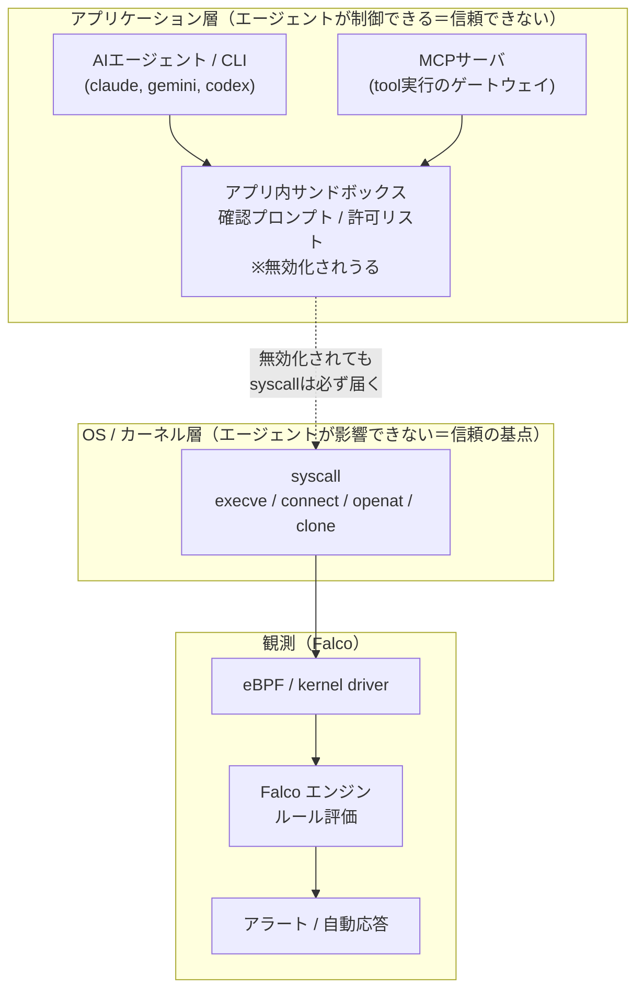
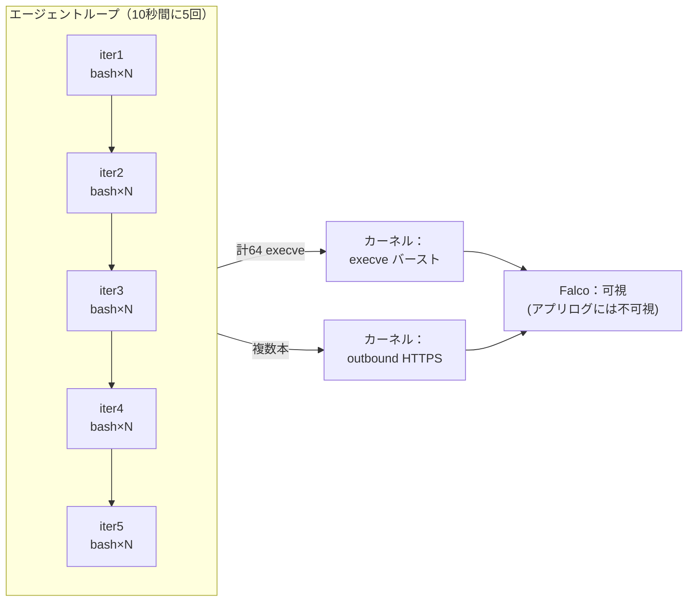
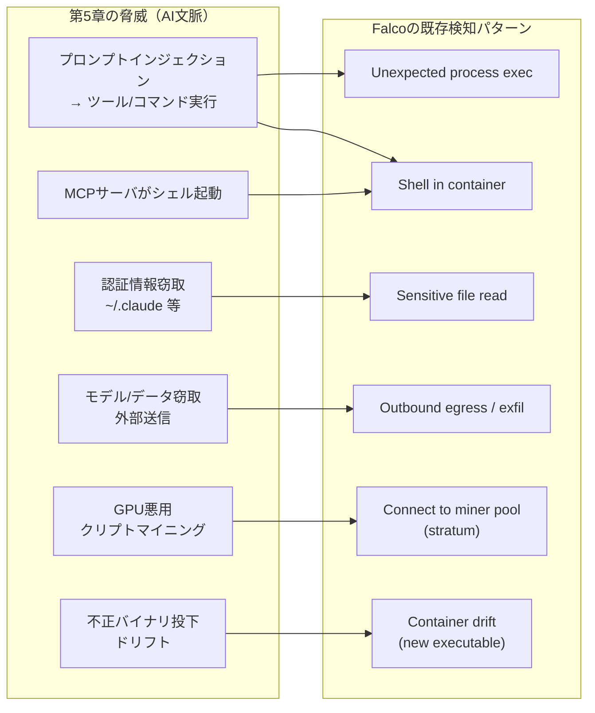
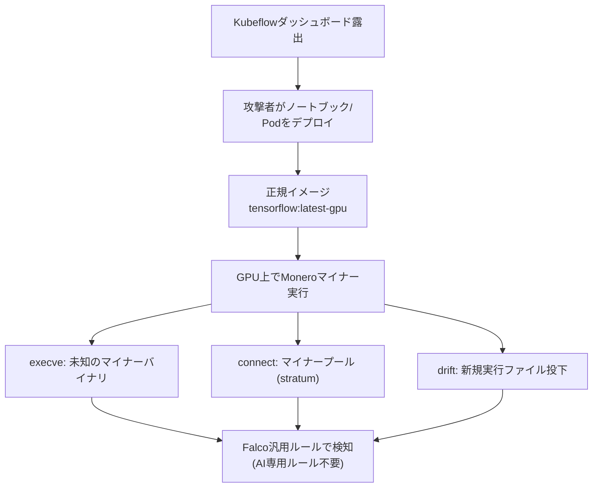

# 第6章：AIワークロードをFalcoで守る — syscallで見るAIランタイム

第5章では、AIワークロードがどんな攻撃面を持つのかをカタログ化しました。プロンプトインジェクション、MCPサーバ経由のシェル起動、認証情報の窃取、GPUを狙ったクリプトマイニング——多彩に見えるこれらの脅威も、実行段階では結局「プロセスが起動し、ファイルが読まれ、ネットワークが繋がる」という古典的な振る舞いに収束します。本章の主張はシンプルです。**AIワークロードを守るために新しいツールは要らない。Falcoの既存のカーネルレベル観測を"AIに向ける"だけで効く。ただし、その限界も正しく理解しておく必要がある**、ということです。

## この章で学ぶこと

- なぜアプリ層のサンドボックスは信頼できず、エージェントが触れられないカーネル層での観測が必要なのか
- 第5章の脅威カタログを、Falcoの既存検知パターンへどう一対一でマッピングするか
- 推論／エージェントコンテナを守る具体的なFalcoルール例（捉えるもの・捉えないものの注釈つき）
- 2021年のKubeflow/TensorFlow GPUクリプトマイニング事件を、AI専用ルールなしで汎用ルールがどう捉えたか
- Falcoの限界（挙動は見えるが意図は見えない、living-off-the-land、FPチューニング）と商用ML検知との役割分担

## 1. 中心命題：アプリ層サンドボックスは信頼できない

AIコーディングエージェントやMCPサーバの多くは、自前の「安全装置」を持っています。ファイル書き込み前の確認プロンプト、コマンド実行のホワイトリスト、サンドボックスモード。これらはアプリケーション層、つまりエージェントのプロセス自身が実装する制御です。

問題は、これらの制御が**エージェント自身の制御下にある**ことです。エージェントの挙動はプロンプト駆動で非決定的であり、悪意あるプロンプト（リポジトリ内のファイル、エラーメッセージ、MCPレスポンスに仕込まれたもの）によって誘導されうる。Sysdig Threat Researchの調査 "AI coding agents are running on your machines"（2026-03-23公開）が端的に指摘するのは、**操作されたエージェントは自分自身の安全制御を無効化しうる**という点です。確認プロンプトを飛ばすCLIフラグ、サンドボックスを切るオプション——これらが攻撃ベクターそのものになります。

> 自分で自分を縛る鍵を持っている見張りは、説得されれば鍵を開ける。

だからこそ、**エージェントが影響を及ぼせない層で観測する**必要があります。それがカーネルです。プロセスがexecveを呼べば、ネットワークに繋げばconnectを呼び、ファイルを開けばopenatを呼ぶ。これらのsyscallは、アプリ層でどれだけ「安全装置を無効化」されようと、カーネルに必ず到達します。エージェントはプロンプトで自分の振る舞いを変えられても、syscallの発行そのものを隠すことはできません。

### 観測点：AIワークロードの真下にカーネルがある



### 「64 execve in 10s」——アプリログに見えず、カーネルには見える

Sysdigの調査が示した具体例が示唆的です。あるエージェントが使い捨てのbashシェルをループ内で起動するパターンを観測したところ、**5イテレーションで64回のexecveイベントと複数の外向きHTTPS接続が10秒間に発生**しました。エージェントのアプリログ上は「タスクを実行中」としか見えませんが、カーネルレベルでは異常に密なプロセス生成と外部通信のバーストとして明確に観測できます。



この「アプリ層では見えないが、カーネル層では見える」というギャップこそが、Falcoを使う根拠です。Sysdigの調査は4つの攻撃ベクターを記録しています——(1) 悪意あるリポジトリファイル／エラーメッセージ／MCPレスポンス経由のプロンプトインジェクション、(2) 予測可能なエージェントディレクトリ（`~/.claude/`、`~/.gemini/`、`~/.codex/`）からの認証情報窃取、(3) 確認プロンプトやサンドボックスを切るCLIフラグによる安全制御バイパス、(4) 認可されていないエージェントのインストール検知。実インシデントとしては、盗まれたエージェント認証情報をLLM API経由のC2に悪用した**SesameOp**マルウェア、MCPサーバへのプロンプトインジェクションからシェルコマンド実行・`curl`での認証情報持ち出しに至った**Cursor IDE攻撃**が参照されています。これらは最終的にすべてsyscallの足跡を残します。

(出典: https://sysdig.com/blog/ai-coding-agents-are-running-on-your-machines/)

## 2. 脅威 → 検知のマッピング

ここが本章の核です。第5章で並べた脅威は、Falcoの**既存の**検知パターンに素直に対応づきます。新しい検知概念を発明する必要はありません。



表にすると対応関係が一望できます。重要なのは右列が**AI専用ではない**こと——どれも従来のコンテナ／ホスト防御で使われてきたパターンです。

| 第5章の脅威（AI文脈） | 実行時に現れる振る舞い | Falcoの既存検知パターン | MITRE ATLAS / OWASP LLM |
|---|---|---|---|
| プロンプトインジェクション → ツール実行 | 推論コンテナ内で予期せぬプロセスが起動 | Unexpected process exec | LLM01 / ATLAS Execution |
| MCPサーバがシェルを起動 | サーバプロセスから `bash`/`sh` がspawn | Shell spawned in container | LLM06 (過剰なエージェンシー) |
| 認証情報窃取（`~/.claude` 等） | 予測可能なディレクトリの read／コピー | Sensitive file read / access | LLM02 / ATLAS Credential Access |
| モデル・学習データの窃取 | 大容量ファイルの外向き送信 | Outbound egress / data exfil | ATLAS Exfiltration |
| GPU悪用クリプトマイニング | stratum / マイナープールへの connect | Outbound to miner pool | ATLAS Impact / Resource Hijacking |
| 不正バイナリ投下・改ざん | コンテナ内での新規実行ファイル作成 | Container drift | LLM05 / ATLAS Persistence |

## 3. 実例：AIワークロード向けにチューニングしたFalcoルール

以下は、推論／エージェントコンテナを念頭に置いたルール例です。いずれも既存のFalcoルール言語そのままで書けます。各ルールに**「何を捉え、何を捉えないか」**を必ず添えます——これがチューニングの起点になります。

### 3-1. 推論／エージェントコンテナ内での予期せぬシェル起動

```yaml
- macro: ai_workload_container
  condition: >
    (container.image.repository contains "vllm"
     or container.image.repository contains "triton"
     or container.image.repository contains "mcp"
     or k8s.ns.name = "ai-inference")

- rule: Shell Spawned in AI Workload Container
  desc: >
    推論/エージェント/MCPコンテナ内で対話シェルが起動した。
    プロンプトインジェクションやMCP経由のコマンド実行の典型的な下流効果。
  condition: >
    spawned_process
    and ai_workload_container
    and proc.name in (shell_binaries)
    and not proc.pname in (allowed_ai_entrypoints)
  output: >
    Shell spawned in AI workload (user=%user.name shell=%proc.name
    parent=%proc.pname cmdline=%proc.cmdline container=%container.name
    image=%container.image.repository)
  priority: WARNING
  tags: [ai, mitre_execution, container]
```

- **捉える**：推論サーバやMCPサーバが、本来起動しないはずの `bash`/`sh` を子プロセスとして起こした瞬間。第5章のCursor IDE型攻撃（MCP→シェル）の下流効果に直撃します。
- **捉えない**：エージェントが**意図的に**正規ワークフローでシェルを使う設計（コーディングエージェントは正にこれ）。その場合は誤検知の山になるため、`allowed_ai_entrypoints` での親プロセス許可リスト化が前提です。そして「プロンプトの中身が悪意あるか」は当然分かりません——分かるのは「シェルが起きた」事実だけです。

### 3-2. エージェント認証情報ディレクトリへのアクセス

```yaml
- macro: agent_secret_dirs
  condition: >
    (fd.name startswith "/root/.claude"
     or fd.name startswith "/root/.gemini"
     or fd.name startswith "/root/.codex"
     or fd.name contains "/.config/claude")

- rule: Read Agent Credential Directory by Unexpected Process
  desc: >
    予測可能なエージェント認証情報ディレクトリを、当該エージェント以外の
    プロセスが読んだ。SesameOp型の認証情報窃取の足跡。
  condition: >
    open_read
    and agent_secret_dirs
    and not proc.name in (claude, gemini, codex)
  output: >
    Agent credentials accessed by unexpected process
    (file=%fd.name proc=%proc.name pcmdline=%proc.pcmdline
    user=%user.name container=%container.name)
  priority: CRITICAL
  tags: [ai, mitre_credential_access]
```

- **捉える**：`~/.claude/` などをエージェント本体以外（`curl`、`cat`、別スクリプト）が読みに来る挙動。Sysdig調査の攻撃ベクター(2)に正対します。
- **捉えない**：エージェント本体が自分の認証情報を読む正常動作（だから除外している）。逆に、攻撃者がプロセス名を `claude` に偽装すれば回避されうる——プロセス名ベースの除外は万能ではなく、本来は実行ファイルパスやコンテナの来歴と組み合わせるべきです。

### 3-3. stratum／マイナープールへの外部接続

```yaml
- list: miner_ports
  items: [3333, 4444, 5555, 7777, 8333, 14444, 45560, 45700]

- rule: Outbound Connection to Mining Pool from AI Workload
  desc: >
    GPUを抱えるAIワークロードからマイナープール特有のポート/プロトコルへ
    外向き接続。GPUリソース乗っ取り（クリプトマイニング）の典型。
  condition: >
    outbound
    and ai_workload_container
    and (fd.sport in (miner_ports) or fd.rport in (miner_ports))
    and not fd.sip in (allowed_endpoints)
  output: >
    Outbound to suspected mining pool (conn=%fd.name
    proc=%proc.name image=%container.image.repository
    rport=%fd.rport)
  priority: CRITICAL
  tags: [ai, gpu, mitre_impact, cryptomining]
```

- **捉える**：GPUノードのワークロードがstratumらしきポートへ繋ぐ挙動。後述の2021 Kubeflow事件と同じ系統。
- **捉えない**：ポート番号は回避が容易（マイニングは任意ポート・TLS化が可能）。ポート列挙だけでは取りこぼすため、後段では「外向き帯域の異常」「未知の宛先IPへの長時間接続」など振る舞い側の指標や、商用のML検知（第7章）で補完すべきです。

### 3-4. モデルファイルの大量外部送信の疑い

```yaml
- macro: model_artifacts
  condition: >
    (fd.name endswith ".safetensors"
     or fd.name endswith ".gguf"
     or fd.name endswith ".ckpt"
     or fd.name endswith ".bin"
     or fd.name contains "/models/")

- rule: Model Artifact Read Then External Egress
  desc: >
    モデル成果物を読んだプロセスが、許可されていない外部宛先へ送信している。
    モデル/重みの窃取（ATLAS Exfiltration）の疑い。
  condition: >
    outbound
    and ai_workload_container
    and proc.name in (curl, wget, python3, rclone, aws, gsutil)
    and evt.dir = "<"
    and not fd.sip in (allowed_endpoints)
  output: >
    Possible model exfiltration (proc=%proc.name conn=%fd.name
    container=%container.name image=%container.image.repository)
  priority: WARNING
  tags: [ai, mitre_exfiltration]
```

- **捉える**：転送系プロセスが未許可宛先へ外部送信する、窃取の代理シグナル。
- **捉えない**：Falcoはこのルール単体では「読んだファイルが本当にモデルか」「送信内容が重みか」までは追えません。`read→egress`の因果はsyscall列の相関で近似しているにすぎず、宛先許可リスト（`allowed_endpoints`）の整備が誤検知を抑える生命線です。**挙動の相関であって、意図の証明ではない**点に注意してください。

## 4. 既存事例で実証：2021 Kubeflow/TensorFlow GPUクリプトマイニング

「AI専用ルールがなくても汎用ルールで捉えられる」ことを、実際の事件が証明しています。2021年、Microsoftが発見したKubeflow/TensorFlowを標的としたMonероクリプトマイニングキャンペーン（Sysdig解説、2021-06-30）です。攻撃者は**正規の `tensorflow/tensorflow:latest-gpu` イメージ**を使い、Kubeflowで露出したダッシュボード経由でGPUノードにマイナーをデプロイしました。怪しいカスタムイメージではなく、合法なAIイメージを悪用した点がポイントです。



ここで効いたのは、まさに§3で示した類のルール——**マイナープールへのoutbound**、**コンテナ内での未知バイナリのexec**、**ドリフト**です。「`tensorflow:latest-gpu`」というイメージ名は正規でも、その中で起こる振る舞いは正規ではない。Falcoはイメージのラベルではなく**実行時の振る舞い**を見るため、合法イメージの悪用でも捉えられます。これは「AIだから新ツール」ではなく、「カーネルレベル観測をAIワークロードに向ける」というだけで充分に効くことの好例です。

(出典: https://sysdig.com/blog/crypto-mining-kubeflow-tensorflow-falco/)

なお、ルールベースのFalco OSSを補完する形で、Sysdigは2022年8月にML駆動のクリプトジャッキング検知（「99%精度」——これはベンダー主張です）を追加しています。これはFalco OSSの機能ではなく**Sysdig Secureの追加機能**であり、役割分担として理解すべきものです（詳細は第7章）。

## 5. 限界と運用の現実

Falcoは強力ですが、万能ではありません。ここを誤解すると「Falcoを入れたから安全」という危険な錯覚に陥ります。

**Falcoは挙動を見るが、意図は分からない。** Falcoがプロンプトを「理解」することはありません。捉えるのはあくまで下流効果——exec／network／fileのsyscall列です。「悪意あるプロンプトが注入された」ことそのものは見えず、「その結果シェルが起き、外部に繋がった」ことが見える。これは弱点ではなく設計思想ですが、混同してはいけません。

**ドリフト検知のliving-off-the-land限界。** §3-1や§4で使うドリフト検知は「新しい実行ファイルが作られた」ことを捉えますが、攻撃者がベースイメージに**既に存在する**バイナリ（`bash`、`curl`、`python`）だけで攻撃を完結させる living-off-the-land の場合、新規ファイルが作られないため取りこぼします。これはSysdigも文書化している既知の限界です。だからこそ§3-1のような「既存バイナリの予期せぬ起動」検知と多層で組む必要があります。

**FPチューニングは現実の作業。** §3の各ルールの「捉えないもの」注記が示す通り、許可リスト（`allowed_ai_entrypoints`、`allowed_endpoints`）の整備なしには誤検知が溢れます。特にコーディングエージェントは「正規にシェルを多用する」ため、汎用ルールをそのまま当てると警報疲れを起こします。これは本シリーズの前日譚および第2章で論じた「ルール成熟度」の話そのもの——AIワークロードでも逃れられません。

**コミュニティ／サードパーティの動き：FalcoClaw。** Falcoのsyscall検知をAIエージェント向けに拡張し、自動応答（プロセスkill、IPブロック、ファイル隔離）とAIエージェント向けにチューニングしたルールを提供する **FalcoClaw**（https://github.com/thnkbig/falcoclaw）というオープンソースプロジェクトがあります。**これは公式Falcoプロジェクトではなく、コミュニティ／サードパーティ製**である点を明確にしておきます。記載されている自動応答能力はあくまで作者の主張であり、本番投入時は自分で検証すべきものです。

**商用ML検知との役割分担。** ルールベースのFalcoは「明示的に書いた振る舞い」を確実に捉えますが、§3-3で触れたようなポート回避・TLS化されたマイニングや、未知パターンには弱い。ここをSysdigのようなML駆動検知が「異常な振る舞いの統計的逸脱」として補完します——ルールが「既知の悪」を、MLが「未知の異常」を担う構図です。この「AIで守る」側の話は次章で深掘りします。（なお、より能動的・予防的なアプローチであるPremptiは第8章で扱います。）

## まとめ

本章の主張を改めて整理します。AIワークロードの脅威は、プロンプトインジェクションだろうとMCP経由のシェル起動だろうと、**最終的に実行時のsyscall・プロセス・ネットワークとして現れます**。エージェントのアプリ層サンドボックスは自分自身で無効化されうるため信頼できず、エージェントが触れられないカーネル層での観測が必要です。そしてその観測は、Falcoの既存のeBPF／カーネルドライバ計装を**無改造のまま**AIワークロードに向けるだけで成立します。2021年のKubeflow事件が示すように、AI専用ルールを作らずとも汎用ルールが効く。

同時に、限界も直視しました。Falcoは挙動を見るが意図は見えない。living-off-the-landは取りこぼす。FPチューニングは避けられない現実の作業であり、許可リストの整備が生命線です。FalcoClawのようなコミュニティ拡張や、Sysdigの商用ML検知は、これらの隙間を埋める補完として位置づけられます。

ここまでは「**AIを守る**」——AIワークロードという守るべき対象に、既存のカーネルレベル防御を向ける話でした。次の第7章では逆側、「**AIで守る**」を扱います。Sysdig Sageのようなアシスタント、ML駆動の異常検知、そしてMCPを使ったSOC自動化——Falcoが吐き出す大量のシグナルを、今度はAI自身がトリアージ・解釈・応答する側に回る世界です。守る対象だったAIが、守る道具になる転回点を見ていきましょう。
