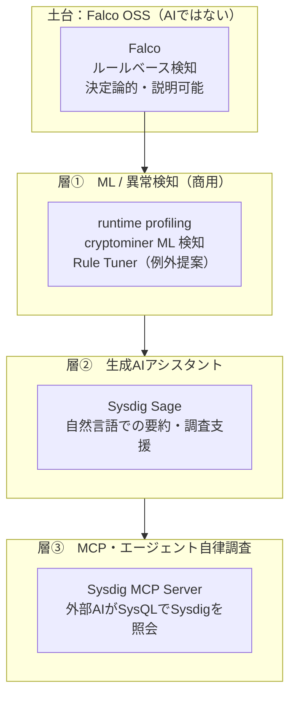
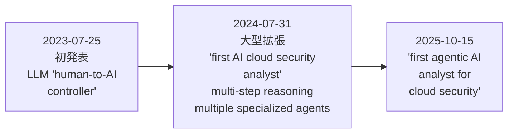
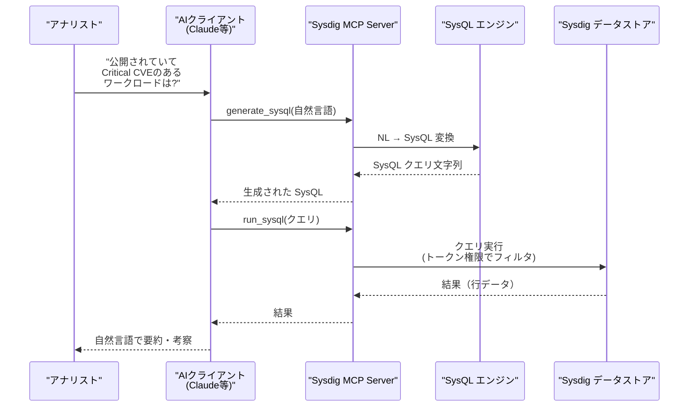
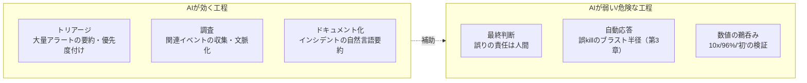

# 第7章：AIで守る — Sysdig Sage、ML検知、MCP・エージェントSOC

前章までは「AIを守る」側の話でした。本章は視点を反転させ、「AIで守る」、つまり機械学習や生成AIをランタイムセキュリティの検知・調査に使う話を扱います。ただし最初に強く釘を刺しておきます。**Falco OSS はルールエンジンであり、AI ではありません。** 「AIで守る」とは、Falco の外側、主に Sysdig Secure のような商用レイヤや、近年の MCP・エージェント技術が担う、別の話です。

そしてこの領域は、技術的事実とベンダーのマーケティング表現が最も混ざりやすい場所でもあります。本章は本書が掲げた3つの約束のひとつ「検証可能な事実と誇張を分ける」を、最も意識して書きます。「世界初」「10倍速」「誤検知96%削減」といった言葉を、そのまま受け取らずに分解していきましょう。

## この章で学ぶこと

- 「AIで守る」を3層に分けて理解する（①ML異常検知 ②生成AIアシスタント ③MCP・エージェント自律調査）
- 層①：Sysdig Secure の ML 検知（runtime profiling、cryptominer ML）と、Drift Detection が「差分」であって ML ではないという正確な区別
- 層②：Sysdig Sage の変遷（2023 LLMコントローラ → 2024 multi-step/multi-agent → 2025 "agentic" ブランディング）と「世界初/最深」というマーケ表現の見極め
- 層③：Sysdig MCP Server（OSS、SysQL の生成・実行、トークン権限フィルタ）と、AIクライアントが Sysdig を調査する流れ
- AI SOC カテゴリの誇張と現実のギャップ、「AIは増幅器であって代替ではない」という冷静な視点

## 1. 前提の整理：Falco OSS は AI ではない

まず、本書がここまで扱ってきた Falco OSS の正体を再確認します。Falco は、システムコールや監査ログのストリームに対して、人間が書いた**ルール**をマッチさせる決定論的なエンジンです。`spawned_process` が `/etc/shadow` を読んだ、という条件に合致すればアラートを出す。学習も推論もしません。同じ入力には常に同じ出力を返します。これは弱点ではなく、説明可能性（なぜ鳴ったかがルールを読めば分かる）という強い長所です。

ですから、ベンダーや記事が「AI 搭載の Falco」と書いていたら、それはほぼ確実に Falco OSS そのものではなく、その上に乗った商用機能や別レイヤの話だと疑ってください。「AIで守る」を語るには、何が Falco で何がそうでないかを、層として分けて見る必要があります。本章では次の3層モデルで整理します。



重要なのは、**下の層ほど「事実」が固く、上の層ほど「誇張」が混ざりやすい**ということです。ML検知は数値で評価できますが、エージェント自律調査の「自律」は定義が曖昧で、マーケティングの自由度が大きい。この温度差を意識しながら、下から見ていきます。

## 2. 層①：ML / 異常検知（Sysdig Secure 商用）

### runtime profiling（2019）

Sysdig が ML による異常検知を打ち出したのは古く、2019年8月にさかのぼります。仕組みはこうです。コンテナや環境ごとに「正常時にどんなプロセス・ファイルアクセス・ネットワーク通信をするか」の**振る舞いプロファイル**を約24時間かけて自動学習し、そこから逸脱した挙動を異常として検知します。検知には confidence level（確信度）が付き、生成されたプロファイルはポリシーに変換して恒久ルール化できます。

これは Falco の「ルールで書きにくい逸脱」を補う発想です。「このコンテナは普段 `curl` を外部に投げない」といった環境固有の正常像は、人間がルールとして全環境分書くのは非現実的です。そこを機械学習が肩代わりします。

### cryptominer の ML 検知（2022）

より具体的な応用が、暗号通貨マイナー検知です。Sysdig Secure の Runtime Policies には Machine Learning Policy という種別があり、ML ベースの cryptominer 検知を提供します。ここでベンダーは「**99% precision（99% の精度）**」を謳いますが、これは **ベンダー主張（vendor claim）** であって、第三者検証された数値ではありません。99% という数字を見たら、「どのデータセットで、どう測ったのか」を必ず問うべきです。

### Drift Detection は「差分」であって ML ではない

ここで頻繁に混同されるのが **Drift Detection** です。これは ML ではありません。ビルドされたコンテナイメージに含まれる実行ファイルと、ランタイムで実際に実行されたバイナリを**比較（差分）**し、「イメージに無かったものが実行された＝drift」を検知する仕組みです。学習も確信度もない、決定論的な差分検出です。

Sysdig 自身が文書化している限界も正確に押さえましょう。

- **living-off-the-land を取りこぼす**：ベースイメージに元から含まれるバイナリ（`bash`、`curl` など）を攻撃に悪用された場合、それは「イメージに有った」ので drift とは見なされず、見逃します。
- **永続ボリュームからの実行は drift にカウントされない**：persistent volume 上のバイナリ実行は差分対象外です。

「Drift は ML だ」と説明する記事があれば、それは不正確です。

### Falco Rule Tuner（2021）

2021年6月に発表された Falco Rule Tuner も誤解されやすい機能です。これは大量のアラートからノイズを減らすため、ルールに追加すべき**例外（exception）を自動提案**します。ML ベースではありますが、**human-in-the-loop**（人間が提案を承認する）であり、**LLM や生成 AI は使っていません**。「生成AIがルールを書く」のではなく、「統計的にノイズになっている条件を見つけて、人間に除外を提案する」ツールです。生成 AI と呼ぶのは誤りです。

| 機能 | 種別 | AI/MLか | 誤解されやすい点 |
| --- | --- | --- | --- |
| runtime profiling | 異常検知 | ML（確信度あり） | Falco OSS の機能ではない |
| cryptominer 検知 | 専用ML | ML（99%はベンダー主張） | 99% を実測値と誤認 |
| Drift Detection | 差分検出 | **ML ではない** | 「MLだ」と誤説明されがち |
| Falco Rule Tuner | 例外提案 | ML（生成AIではない） | 「生成AIがルールを書く」と誤認 |

### 考察：ML は万能ではない

ML 検知は、ルールで書ききれない環境固有の逸脱に効きます。一方で、24時間の学習期間中に攻撃が起きていればそれを「正常」として取り込んでしまう（poisoning）、正常な変化（デプロイ更新）を異常と誤検知する、確信度の解釈が運用者に委ねられる、といった弱点があります。**ML は「ルールの補完」であって「ルールの代替」ではない**——層①の結論はこれに尽きます。

## 3. 層②：生成AIアシスタント — Sysdig Sage

### ブランディングの変遷

Sysdig Sage は、Sysdig の生成 AI セキュリティアナリストです。注目すべきは、その**フレーミングが年ごとに進化（誇張？）してきた**ことです。



- **2023-07-25 初発表**：LLM を「human-to-AI controller（人間と AI をつなぐ操作系）」として位置づけ。自然言語で問いかける UI、という比較的控えめな打ち出しでした。
- **2024-07-31 大型拡張**：「**first AI cloud security analyst capable of multi-step reasoning**（多段推論ができる初のAIクラウドセキュリティアナリスト）」と銘打ち、「autonomous agents approach（自律エージェント方式）」「multiple specialized AI agents（複数の専門AIエージェント）」を強調。80以上の言語に対応し、UI 上のどこにいるか（context-aware）を踏まえた応答をすると説明されました。
- **2025-10-15**：「**first agentic AI analyst for cloud security**（クラウドセキュリティ初のエージェント型AIアナリスト）」と、いよいよ "agentic" を前面に。

ここで明確にしておきます。「**first（世界初）**」「**deepest（最深）**」といった最上級表現は、**マーケティング表現**です。AI クラウドセキュリティアナリストを名乗る競合は同時期に複数存在し、「初」を客観的に検証する手段はありません。読者として「初という言葉に技術的内実はない」と割り切るのが健全です。

### 何が便利で、何が未検証か

事実として便利なのは、生成 AI アシスタント一般が得意とすること——大量のイベントやポリシーを自然言語で要約する、専門用語を平易に言い換える、調査の取っかかりを提示する——です。Sage もこの方向の価値を持つでしょう。

一方で未検証・要注意な点もあります。2024 のリリースでは「CNAPP 顧客は Sage を **for free with a high usage cap（高い利用上限つきで無料）** で使える」とされましたが、これがプレビュー段階なのか GA（一般提供）なのか、成熟度は**明示されていません（UNVERIFIED）**。「multi-step reasoning」「autonomous agents」がどこまで実運用で機能するかも、ベンダーのデモと実環境では差が出やすい領域です。

## 4. 層③：MCP・エージェントによる自律調査

### Sysdig MCP Server（2025-10）

層③で最も「事実が固い」のが Sysdig MCP Server です。これは実在し、**オープンソース（Apache-2.0）**で公開されています（[github.com/sysdiglabs/sysdig-mcp-server](https://github.com/sysdiglabs/sysdig-mcp-server)）。2025年10月15日に発表されました。

MCP（Model Context Protocol）は、AI クライアント（ChatGPT / Claude / Gemini など）に外部ツールを「使わせる」ための標準プロトコルです。Sysdig MCP Server は、Sysdig Monitor の各種ツール（クラスタ、ノード、ワークロード/ポッド、CPU/メモリ、HTTP/ネットワークエラーの一覧）に加え、**横断的な SysQL ツール**を公開します。

- `generate_sysql`：自然言語を SysQL（Sysdig のグラフクエリ言語）に変換する
- `run_sysql`：生成された SysQL を実行し、Sysdig のデータストアに問い合わせる

つまり外部の AI クライアントが、推論の一部として Sysdig に直接問い合わせられるようになります。重要な仕様上の注意点が2つあります。

1. **公開されるツールは API トークンの権限でフィルタされる**：トークンに権限のない操作は AI にも見えません。最小権限の原則が効きます。
2. **`generate_sysql` は Service Account トークンでは動作しない**：Sysdig が文書化している制約で、**通常のユーザー API トークン**が必要です。自動化で SA トークンを使っていると、ここでつまずきます。

### AIクライアントが Sysdig を調査する流れ

実際にどう動くかを sequenceDiagram で示します。



生成される SysQL のイメージはこんな具合です（概念例）。

```text
MATCH Workload as w
  -> exposedTo Internet,
  w -> runs Image as i
  -> has Vulnerability as v
WHERE v.severity = "Critical"
RETURN w.name, i.name, v.cve
```

AI が自然言語の問いを SysQL に落とし、実行し、行データを人間に読める要約へ戻す——これが層③の核です。便利な反面、「`generate_sysql` が意図と違うクエリを作る」「結果の解釈を AI が誤る」リスクは残り、出力の検算は人間の仕事です。

### "agentic SOC" は Sysdig 製品ではない

ここで誤解を防ぐ重要な指摘です。2025年10月のリリースで言及される「**agentic SOC**」は、**パートナーである Torq の HyperSOC**（Torq の製品）と、Partner Integration Hub を指します。**Sysdig 自身の製品として "agentic SOC" があるわけではありません。** 「Sysdig がエージェント型 SOC を出した」と書いてある記事は、パートナー製品を Sysdig 製品と取り違えている可能性が高いです。

### Headless Cloud Security platform（2026）

2026年に Sysdig が打ち出した「**Headless Cloud Security platform designed for AI agents**」は、UI を前提とせず、バックエンドのセキュリティ機能を API / CLI / MCP 経由で AI エージェントから呼べるようにする、という方向性です。MCP Server がその一部を構成します。これも「AI エージェント時代に合わせた呼び出し口の整備」と捉えるのが正確で、それ自体が自律的に守ってくれる魔法ではありません。

## 5. 業界の現実と冷静な考察

層③まで見たうえで、AI SOC というカテゴリ全体を俯瞰します。2025〜2026年、これは極めて混雑したカテゴリで、Dropzone AI、Intezer、D3、Torq など多数のベンダーがひしめいています。Sysdig もその一角です。

### 誇張された数値を疑う

このカテゴリで頻出するのが「**10x faster（10倍速い）**」「**96% fewer false positives（誤検知96%削減）**」といった主張です。これらはほぼ例外なく**未検証（unvalidated）**です。比較対象（何と比べて10倍か）、測定環境、サンプル数が示されないまま数字だけが踊ります。

### 「activation = adoption」問題

さらに現場で報告される現実のギャップがあります。

- ベンダーは「activation（有効化）」や「exploring（試用）」を「adoption（実運用採用）」としてカウントしがちで、導入実績が水増しされる。
- 評価のために有効化された機能が、いざ本物のインシデントでは無視される、という事例。
- 実務者の証言として、**文脈の薄いベンダーツールより、社内ドキュメントへのアクセスを与えて丁寧にプロンプトした汎用 LLM の方が良い結果を出す**ことがある。

最後の点は示唆的です。AI の価値の多くは「モデルの賢さ」より「与えた文脈の質」に由来します。だからこそ層③の MCP——AI に正しいデータ参照経路を与える仕組み——が、派手な "agentic" ブランディングより本質的かもしれません。

### 中立的な参照

この領域を冷静に学ぶには、ベンダー資料だけでなく学術的レビューが有用です。MDPI が2025年に公開したサーベイ「**AI-Augmented SOC: LLMs and Agents for Security Automation**」（[mdpi.com/2624-800X/5/4/95](https://www.mdpi.com/2624-800X/5/4/95)）は、LLM・エージェントを SOC に使う際の可能性と限界を中立的に整理しており、ベンダーの主張を相対化する物差しになります。



### 「AIは増幅器であって代替ではない」

第3章で見た Falco Talon が「ルールに基づく自動応答（非AIのベースライン）」だったことを思い出してください。Talon は決定論的で、何が起きるか予測できます。一方、本章の層②③は確率的で、便利だが予測しきれない。だからこそ AI は、人間アナリストの**増幅器（amplifier）**として使うのが正しく、**代替（replacement）**として丸投げするのは危険です。トリアージ・調査・ドキュメント化を加速させ、最終判断と応答の引き金は人間が握る——これが現時点での健全な姿です。

## まとめ

本章では「AIで守る」を3層に分解しました。

- **層①ML検知**：runtime profiling（2019）や cryptominer ML（99%はベンダー主張）。Drift Detection は ML ではなく差分検出で、living-off-the-land を取りこぼす限界がある。Rule Tuner は human-in-the-loop で生成AIではない。**Falco OSS 自体は一貫して AI ではない。**
- **層②生成AIアシスタント**：Sysdig Sage の「2023→2024→2025」のブランディング進化と、「世界初/最深」がマーケ表現にすぎないこと。無料提供の成熟度は未検証。
- **層③MCP・エージェント**：Sysdig MCP Server（OSS、SysQL の生成・実行、トークン権限フィルタ、SA トークン不可）は事実として有用。ただし "agentic SOC" はパートナー Torq の製品であり Sysdig 製品ではない。
- **業界の現実**：10x/96%/「初」は未検証、activation=adoption の水増し、文脈を与えた汎用 LLM が勝ることもある。**AIは増幅器であって代替ではない。**

ここまでは、AI 時代のランタイムセキュリティを**商用ベンダー**の視点から見てきました。では、OSS コミュニティはこの時代にどう応えるのか。最終章では、コミュニティが自前で生み出した AI 時代の答え——**Prempti**——と、Falco エコシステムの未来へ向かいます。
