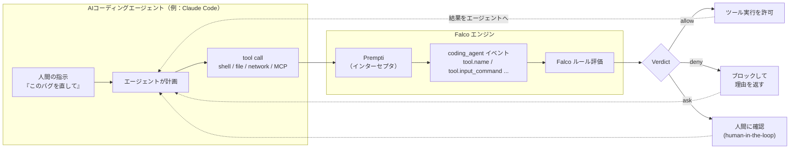
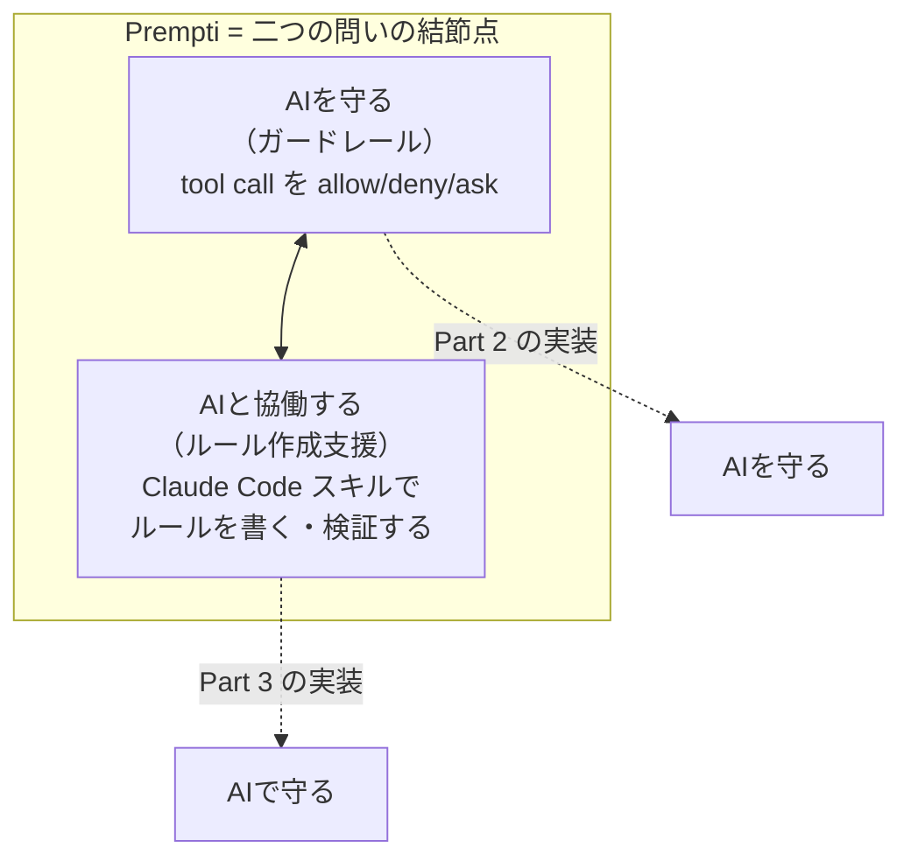
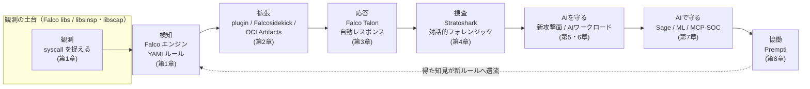
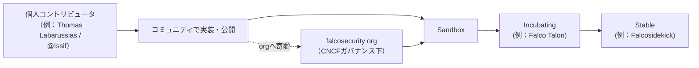

# 第8章：コミュニティと未来 — Prempti、CNCF、そして次世代Runtime

本書はここまで、二つの問いを別々の半分として扱ってきました。「**AIを守る**」（Part 2）と「**AIで守る**」（Part 3）です。最終章では、この二つが一点で交わる場所を見ます。2026年5月に falcosecurity が発表した **Prempti** は、AIコーディングエージェントのツール呼び出しをFalcoルールで `allow / deny / ask` に裁き、しかもそのルールを書く作業をAI（Claude Codeスキル）が手伝うという、まさに二つの問いの結節点でした。

Premptiは単なる新ツールではありません。OSSコミュニティが「AIを脅威として守りつつ、AIを道具として取り込む」という両構えを、ひとつのプロジェクトで体現してみせた象徴です。本章では、この交差点を起点に、本書全体の地図をもう一度1枚に畳み、Falcoの次の10年の輪郭を——存在するものと、考察にすぎないものを正直に分けながら——描きます。

## この章で学ぶこと

- **Prempti** が何であるか：`coding_agent` という新イベント源、ツール呼び出しへの `allow/deny/ask` 判定、そしてClaude Codeスキルによるルール作成支援
- なぜPremptiが「AIを守る」と「AIと協働する」の融合の象徴なのか
- 本書がたどった進化の総括——観測→検知→拡張→応答→捜査→AIを守る→AIで守る→協働——を1枚の図にする
- CNCFガバナンスとマルチベンダー・コミュニティが、AI時代になぜ強みを持つのか
- 次世代Runtimeの輪郭：今あるもの、妥当な近未来の軌道（予測）、そして抗うべき誇張の切り分け

---

## 1. Premptiという交差点

### 1-1. Premptiとは何か

**Prempti** は、2026年5月12日に Falco 公式ブログで発表され、CNCF の falcosecurity org（`github.com/falcosecurity/prempti`）が維持するプロジェクトです。一言でいえば、**AIコーディングエージェント向けの、Falco製ガードレール／可視化レイヤ**です。

ここで「AIコーディングエージェント」とは、Claude Code に代表される、自然言語の指示を受けてシェルを叩き、ファイルを書き換え、ネットワークへアクセスし、MCPサーバを呼び出す自律的なエージェントを指します。第5章で見たとおり、これらは「意図がコードに書かれていない」確率的な存在であり、従来のアプリとは別種の攻撃面を持ちます。

Premptiは、このエージェントの**ツール呼び出し（tool call）を横取り（intercept）**します。そして「いまエージェントが何をしようとしているか」をFalcoルールに照らし、三つの返事のいずれかを返します。

| Verdict | 意味 | 振る舞い |
|---------|------|----------|
| `allow` | 許可 | ツール呼び出しをそのまま通す |
| `deny`  | 拒否 | 呼び出しをブロックし、エージェントに拒否理由を返す |
| `ask`   | 確認 | 人間に判断を仰ぐ（ヒューマン・イン・ザ・ループ） |

重要なのは、これが第3章の Talon（検知**後**の自動レスポンス）とは時間軸が違う点です。Talonが「起きてしまった事象への一次応答」だったのに対し、Premptiは**事前のガードレール**——危険なツール呼び出しが実行される前に止める、あるいは人に問う仕組みです。

### 1-2. 新イベント源 `coding_agent`

第2章で、Falcoのプラグインフレームワークが対応イベント源を syscall の外へ広げていく流れを見ました。Premptiはその系譜の最新形です。`coding_agent` という**新しいイベント源**を導入し、エージェントのツール呼び出しをFalcoのフィールドとして表現します。



`coding_agent` 源は、`tool.name`（呼ばれたツールの種類）や `tool.input_command`（シェルツールに渡された実コマンド文字列）といったフィールドを公開します。これにより、私たちがこれまでsyscallに対して書いてきたのと同じFalcoルールのDSLで、**エージェントの意図そのもの**を条件式にできるようになりました。

### 1-3. 実例ルール：エージェントの「危険な手」を止める

たとえば、コーディングエージェントが認証情報を読み取って外部へ送ろうとする、いわゆる exfiltration 的なシェル呼び出しを `ask`（人間確認）に落とすルールは次のように書けます。

```yaml
- rule: Coding agent reads credentials and pipes to network
  desc: >
    コーディングエージェントが ~/.aws や .ssh などの認証情報を読み出し、
    その出力を curl/wget などでネットワークへ流そうとする組み合わせを検知する。
  condition: >
    coding_agent.tool.name = "shell"
    and (coding_agent.tool.input_command contains ".aws/credentials"
         or coding_agent.tool.input_command contains ".ssh/id_"
         or coding_agent.tool.input_command contains "/etc/shadow")
    and (coding_agent.tool.input_command contains "curl"
         or coding_agent.tool.input_command contains "wget"
         or coding_agent.tool.input_command contains "nc ")
  output: >
    エージェントが認証情報を外部へ送信しようとしています
    (command=%coding_agent.tool.input_command)
  priority: CRITICAL
  # Prempti はこの一致をもとに ask（人間確認）あるいは deny を返す
  source: coding_agent
```

`source: coding_agent` という一行に注目してください。Falcoルールの構造（`rule` / `condition` / `output` / `priority`）はそのままに、対象だけが「syscallを出すプロセス」から「ツールを呼ぶエージェント」へ差し替わっています。**観測の哲学は同じまま、観測対象が一段抽象化された**のです。これは本書がずっと追ってきたテーマの自然な延長線上にあります。

### 1-4. なぜPremptiは「象徴」なのか

Premptiが本書のクライマックスにふさわしいのは、二つの側面を**同時に**持つからです。

1. **AIを守る（ガードレール側）**：上のルールのように、エージェントの危険な手を事前に止める。これはPart 2「AIを守る」の直接の実装です。
2. **AIと協働する（ルール作成支援側）**：Premptiは **Claude Code 用のスキル**を同梱し、Falcoルールを対話的に書き・検証する作業をAIに手伝わせます。これはPart 3「AIで守る」——AIを防御の道具として使う——の具体形です。



ここで誤解を避けるために強調しておきます。Premptiのルール作成支援は「**AIが本番検知ルールを無人で勝手に生成する**」ものでは**ありません**。あくまで人間がルールを書く・チューニングする作業を、Claude Codeが対話的に補助し、検証を回しやすくするものです。第7章で論じた「AIで守る、ただし全自動を信じない」という冷静な姿勢が、ここでも貫かれています。

> 出典：Falco公式ブログ（2026年5月12日）https://falco.org/blog/ ／ CNCFブログ（2026年5月20日）https://www.cncf.io/blog/ ／ Sysdigブログ https://sysdig.com/blog/ ／ リポジトリ https://github.com/falcosecurity/prempti

---

## 2. 進化の総括 — 本書の地図を1枚に

Premptiという到達点から振り返ると、本書がたどってきた道のりが一本の線につながります。それは「**Linuxプロセスが実際に何をしているか**を、低レイヤの真実から見る」という観測の哲学が、対象を広げながら、検知・応答・捜査・そしてAIへと拡張していく物語でした。



| パート | 章 | 問い | Falcoの姿 |
|--------|----|------|-----------|
| Part 1 | 1 | どう進化したか | kmod → modern eBPF（0.38+標準／0.44+でlegacy除去）、2024-02-29 CNCF卒業 |
| Part 1 | 2 | どこまで広がったか | プラグインで対応イベント源拡張、Falcosidekick（Stable）でファンアウト、OCI配布 |
| Part 1 | 3 | 受動から能動へ | Falco Talon（Incubating）で検知後の自動レスポンス |
| Part 1 | 4 | 観測の系譜 | Stratoshark（2025、Falco libs基盤、2025-05-14にWireshark Foundationへ寄贈） |
| Part 2 | 5 | 新しい攻撃面 | OWASP LLM Top 10（2025）+ Agentic ASI（2025-12）が示す脅威地図 |
| Part 2 | 6 | AIをどう守るか | LLM/MCP/GPUワークロードをsyscall観測で捉える |
| Part 3 | 7 | AIでどう守るか | Sysdig Sage、ML/異常検知、Sysdig MCP Server（2025-10）経由のエージェントSOC |
| Part 4 | 8 | 次は何か | Prempti——AIを守る×AIと協働の交差点 |

この表の縦軸を貫いているのは、**同じ「観測の土台」**です。Talonの応答も、Stratosharkの捜査も、Premptiのガードレールも、突き詰めれば「何が実際に起きたか／起きようとしているか」を低レイヤで観測する一点に帰着します。対象がプロセスからエージェントへ移っても、この哲学は変わりませんでした。

---

## 3. コミュニティ論 — なぜOSSがAI時代に強いのか

### 3-1. マルチベンダー・CNCFガバナンス

Falcoは特定企業の製品ではありません。**CNCFが統治するマルチベンダーのOSSプロジェクト**であり、2024年2月29日にGraduatedプロジェクトへ昇格しました。誰か一社の都合でロードマップが歪まないこと——この中立性が、セキュリティの基盤としての信頼を支えています。

falcosecurity org には `evolution` リポジトリがあり、各コンポーネントの寄贈と成熟度（Sandbox → Incubating → Stable）が透明に追跡されています。本書で扱ったエコシステムの多くは、この階段を上ってきました。



### 3-2. 個人から組織へ、知が成熟する流れ

Falcoエコシステムの強さは、「個人の鋭いアイデアが、コミュニティで磨かれ、orgのガバナンス下で成熟する」という流れにあります。Falcosidekick（通知のファンアウト、現在Stable）やFalco Talon（自動レスポンス、Incubating）は、Thomas Labarussias（@Issif）をはじめとする個人コントリビュータの貢献が出発点となり、やがてorgの正式コンポーネントへと育ったものです。Premptiもまた、この同じ土壌から芽吹いた最新の事例といえます。

### 3-3. 考察：AI時代にOSSコミュニティが持つ三つの強み

ここからは私（筆者）の考察です。AIがセキュリティの「守る対象」にも「守る道具」にもなる時代に、OSSコミュニティはむしろ強みを増すと考えます。理由は三つあります。

- **透明性**：AIガードレールやAI支援チューニングは、「なぜそう判定したか」が説明できなければ信頼できません。クローズドな製品のブラックボックスと違い、OSSはルールも判定ロジックも誰でも読めます。Premptiのルールが平易なYAMLである——これは検証可能性そのものです。
- **カーネル層の中立的観測**：AIワークロードがどう振る舞おうと、最終的にはsyscallを発行します。アプリやモデルの実装に依存しない、カーネル層という中立的な観測点を持つことは、確率的で不透明なAI時代においてむしろ価値を増します。
- **集合知**：新しい攻撃面（MCP、エージェント、GPU）に対するルールは、一社では網羅できません。多数の現場の知見がルールセットとして共有・改善される速度こそ、OSSの本質的な競争力です。

---

## 4. 次世代Runtimeの輪郭 — 存在・軌道・誇張を分けて

最終節として、Falcoの「次」を考察します。ただし、ここでは**(i)今あるもの**、**(ii)妥当な近未来の軌道（予測）**、**(iii)抗うべき誇張**を厳密に分けます。捏造したバージョンやロードマップは書きません。

### (i) いま、確かに存在するもの（事実）

- Falcoは2024-02-29にCNCF Graduated、最新は0.45.0（2026年9月）。modern eBPFが標準、legacy eBPFは0.44+で除去済み。
- プラグインフレームワークによる対応イベント源の拡張、Falcosidekick（Stable）、Falco Talon（Incubating）、Stratoshark（2025、Wireshark Foundation寄贈）。デプロイ面でもFalco Operator 0.2.0（2026-03-23）がKubernetes上の推奨手段に。
- **Prempti**（2026-05-12発表、falcosecurity org）：`coding_agent` 源、`allow/deny/ask`、Claude Codeスキル。
- 防御を加速する側：Sysdig Sage、Sysdig MCP Server（sysdiglabs/sysdig-mcp-server、2025-10）。
- 脅威地図：OWASP LLM Top 10（2025）、Agentic ASI（2025-12）。

### (ii) 妥当な近未来の軌道（これは予測・考察です）

以下は確定したロードマップではなく、これまでの流れから自然に伸ばした**筆者の予測**です。

- **AIワークロード向けルールの標準化**：いまは各現場が手書きしているLLM/MCP/エージェント向けルールが、コミュニティのルールセットとして整理・共有されていく可能性。
- **エージェント観測の一級市民化**：`coding_agent` のような「エージェント源」が、syscall源と並ぶ標準的な観測対象として定着していく方向。
- **検知↔応答↔捜査の統合の深化**：Falco（検知）→ Talon（応答）→ Stratoshark（捜査）のループが、共通の Falco libs 土台の上でさらに密に結ばれていく。
- **AI支援チューニングの一般化**：Premptiが示した「人間が書くルールをAIが補助する」スタイルが、チューニングの障壁を下げる標準的な作法になっていく。

これらは「起こりうる」話であって、「決まっている」話ではありません。

### (iii) 抗うべき誇張

- **「全自動SOC」**：AIがアラートを完全無人でトリアージ・対応し人間が不要になる、という語り。第7章で論じたとおり、AIは加速装置であって判断の最終責任者ではありません。Premptiが `ask`（人間確認）という選択肢を一級市民として持つことは、この立場の表明です。
- **「AIが本番検知ルールを勝手に量産する」**：Premptiのスキルは作成**支援**であり、無人生成ではありません。
- **架空のバージョンやマイルストーン**：本書では Falco の「1.0」のような未発表の日付やロードマップには一切言及しません。確かなのは、コミュニティが透明に進化を続けているという事実だけです。

誇張を退け、確かなものの上に考察を積む——これは本書全体を貫く態度であり、最後まで崩しません。

---

## おわりに

ここまで読み進めてくださって、ありがとうございました。

本書『Falcoの進化と次世代Runtime』は、ハンズオン書ではなく「**Falcoがどこへ向かうのか（Where）**」を考える読み物として書きました。私たちは、単一バイナリのツールがプラットフォームへと育つ進化史（Part 1）から始め、AIという新しい攻撃面をどう守るか（Part 2）、AIをどう守る道具として使うか（Part 3）を経て、その二つが交わる**Prempti**という象徴（Part 4）に到達しました。

最終章のタイトルは「YOU」でした。次世代Runtimeを描くのは、ベンダーでも、AIでもありません。ルールを一行書き、現場の異常を一件報告し、Issueを一つ立てる——その積み重ねを担うコミュニティの一員、つまり**あなた**です。Falcoが10年かけてここまで来られたのは、@Issif のような個人の貢献が、orgのガバナンスの下で成熟していく流れがあったからでした。AI時代も、その構図は変わりません。

もし本書を読んで「で、実際にどう動かすのか」を知りたくなったなら、姉妹編をどうぞ。

- 前作『**Falco実践シリーズ**』——「Falcoを**どう使うか（How）**」を扱うハンズオン編。導入・運用・実際のルール記述はこちらに詳しくあります。
- 『**ルールチューニングガイド**』——誤検知（False Positive）と戦い、自分の環境に合わせてルールを磨く、実務の核心。本書で繰り返し触れた「チューニングこそが運用」を実地で学べます。

本書（Where）と姉妹編（How）は、両輪です。考えてから動くのも、動いてから考えるのも、行き着く先は同じ——**自分の環境で、何が実際に起きているかを、低レイヤの真実から見る**ことです。

最後に、本書を貫いた一つの哲学で締めくくります。Wireshark がパケットを、sysdig が syscall を、Falco が異常を、Stratoshark が捜査を、そしてPremptiがエージェントの意図を可視化してきました。対象は変わっても、信念は一つでした。

> **低レイヤの可視化こそが、真実を明らかにする。**

この系譜の先を描くのは、あなたです。よいRuntime Securityの旅を。

### 参考リンク

- Falco公式ブログ「Prempti」発表（2026-05-12）: https://falco.org/blog/
- CNCFブログ（2026-05-20）: https://www.cncf.io/blog/
- Sysdigブログ: https://sysdig.com/blog/
- Prempti リポジトリ: https://github.com/falcosecurity/prempti
- falcosecurity evolution リポジトリ（コンポーネント成熟度）: https://github.com/falcosecurity/evolution
- Falco 公式サイト: https://falco.org
- Sysdig MCP Server: https://github.com/sysdiglabs/sysdig-mcp-server
- OWASP Top 10 for LLM Applications（2025）: https://genai.owasp.org
