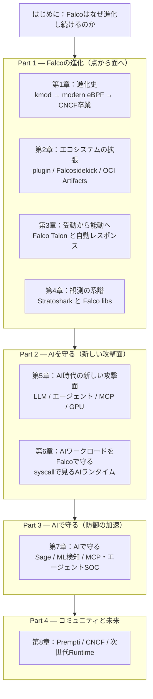

# はじめに：Falcoはなぜ『進化』し続けるのか

2016年に登場したとき、Falcoは「Linuxのシステムコールを監視し、YAMLルールに照らして異常を検知する」単一バイナリのツールでした。それから約10年。Falcoは **2024年2月29日にCNCFを卒業（Graduated）** し、ドライバはカーネルモジュールからmodern eBPFへと世代交代し、検知だけでなく**通知・自動レスポンス・観測**までを担うエコシステムへと姿を変えました。

そしていま、ランタイムセキュリティは新しい問いに直面しています。

> **AIが「守る対象」にも「守る道具」にもなる時代に、ランタイムセキュリティはどう変わるのか。**

LLM推論サーバ、GPUワークロード、MCPサーバ、自律的に動くAIエージェント——これらは従来のWebアプリとは異なる挙動をし、新しい攻撃面を生みます。一方で、AIは検知・トリアージ・レスポンスを加速する道具にもなります。この二面性こそが「AI時代のRuntime Security」の核心です。

本書は、前作『Falco実践シリーズ』が「Falcoをどう使うか（How）」を扱ったのに対し、**「Falcoがどこへ向かうのか（Where）」** を扱います。ハンズオンよりも、**進化の流れを解説し、次に何が来るのかを考察する**ことに重きを置きます。要所では実際のルール例・設定例・実インシデントを引きますが、手順書ではなく「読み物」として設計しています。

## この本の地図

本書は大きく4つのパートで構成されます。

- **Part 1（第1〜4章）— Falcoの進化**：単一バイナリがどのようにして「プラットフォーム」になったのか。ドライバの世代交代、プラグインによる対応イベントの拡張、Talonによる自動レスポンス、Stratosharkに至る「可視化の哲学」を辿ります。
- **Part 2（第5〜6章）— AIを守る**：OWASP LLM Top 10（2025）やAgentic Top 10（2025）が示す新しい脅威、MCPサーバやGPUワークロードの攻撃面、そしてそれらを**カーネルレベルのsyscall観測**でどう捉えるかを扱います。
- **Part 3（第7章）— AIで守る**：Sysdig Sage、ML/異常検知、ルールチューニング、MCPサーバ経由のエージェントSOC。AIが防御側に立つときの可能性と「誇張」を冷静に切り分けます。
- **Part 4（第8章）— コミュニティと未来**：AIコーディングエージェントのガードレール **Prempti**（falcosecurity、2026年）を起点に、OSSコミュニティとAIの交差点、そして「次世代Runtime」の輪郭を考察します。

## 本書のスタンス（3つの約束）

1. **事実とマーケティングを分ける。** 「世界初」「99%」といったベンダー表現はそのまま受け取らず、何が検証可能な事実で、何が主張なのかを明示します。
2. **OSSと商用を混同しない。** Falco（OSS・ルールベース）と、Sysdig Secureの商用ML機能、Falco Feedsのような商用フィードを、はっきり区別します。
3. **バージョンに敏感であること。** 「modern eBPFがデフォルト」はFalco 0.38以降、「legacy eBPFの削除」は0.44以降——のように、進化を語る本だからこそ、いつの話なのかを添えます（本書執筆時点の最新は **Falco 0.45.0 / 2026年9月**）。

## 想定読者

- 『Falco実践シリーズ』を読み終え、「で、この先は？」と思った方
- Kubernetes／クラウドのランタイムセキュリティに関わるエンジニア・SRE・セキュリティ担当
- 自社でLLM・AIエージェント・MCPサーバを動かし始め、その「実行時の安全」に不安を感じている方

前提知識として、Falcoの基本（syscall検知、ルール、Falcosidekick）を軽く知っていると読みやすいですが、各章で必要な背景は都度補足します。

それでは、Falcoがどこから来て、どこへ向かうのか——その10年の進化と、これからの10年を一緒に見ていきましょう。

---

> 本書の内容は執筆時点（2026年6月）の公開情報・一次情報に基づきます。Falcoおよび関連プロジェクトは活発に進化しているため、実際に導入する際は各プロジェクトの最新ドキュメントを必ず確認してください。
