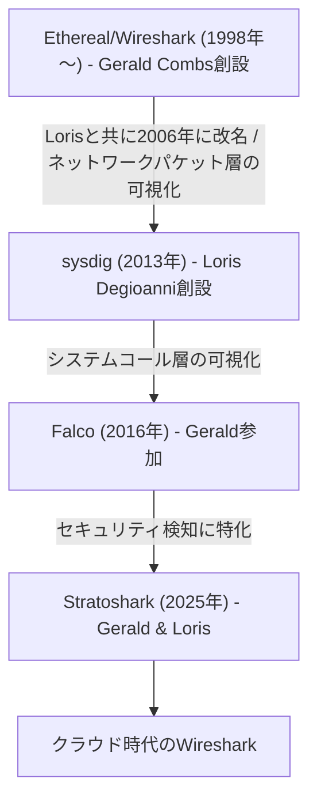
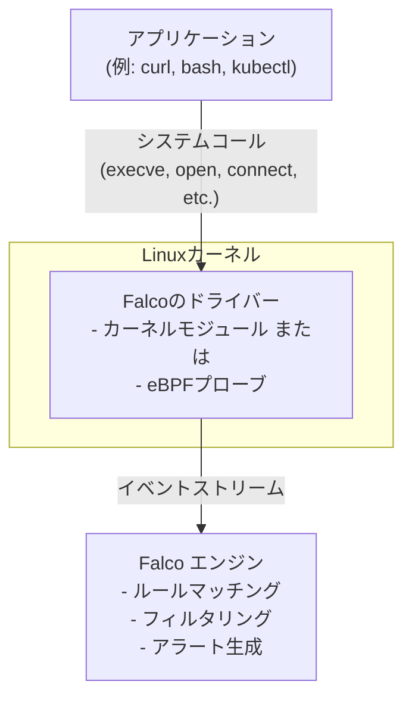
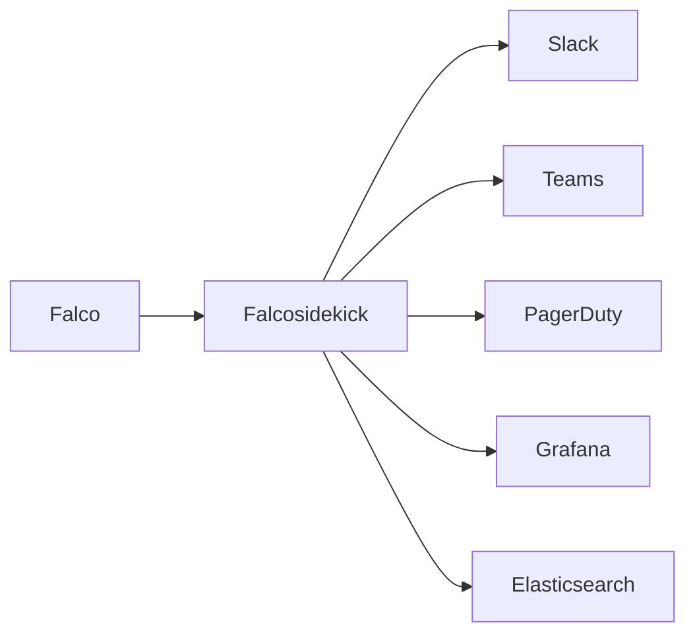

# Falcoとは何か？ - Runtime Securityの本質

コンテナやKubernetesが本番環境で当たり前に使われる時代になりました。しかし、「デプロイ後のコンテナが実際に何をしているのか」を監視できているでしょうか？

イメージスキャンやAdmission Controllerで事前チェックは完璧。でも、**ランタイム（実行時）に攻撃者がシェルを起動したり、機密ファイルにアクセスしたりしていたら？**

この連載では、Kubernetesランタイムセキュリティの決定版ツール「Falco」を、基礎から実運用まで10回に渡って解説します。

## この章で学ぶこと

- Falcoの誕生背景（Sysdig → CNCF）
- カーネルレベルのランタイム検知という唯一性
- Falcoエコシステム（本体 / FalcoCTL / Falcosidekick / Sysdig Secure）の関係
- どういうシナリオで強いのか（権限昇格、Container Escape、Cluster Compromise、異常なプロセス）

---

## Falcoの誕生

### Wiresharkの生みの親が生み出したOSS

Falcoは、**2016年にSysdig社がオープンソースプロジェクトとして公開**したランタイムセキュリティツールです。その起源は2014年に遡り、Falcoドライバーの最初のコードが書かれました。

Sysdig社の創設者である**Loris Degioanni（ロリス・デジョアンニ）**は、実はあの有名なネットワークアナライザー**Wiresharkの生みの親の一人**です。大学生時代に開発したWinPcapがEthereal（Wiresharkの前身）のWindows移植を可能にし、2006年には**Wireshark創設者のGerald Combsと共にEtherealをWiresharkに改名**しました。その後、**Gerald CombsもSysdigチームに参加**し、二人は再びタッグを組んでFalcoやStratosharkの開発を推進しています。Wiresharkは現在、年間2,000万以上のダウンロードを記録し、世界中で使われるツールとなっています。

Loris Degioanni × Gerald Combsの技術的系譜：


Sysdig社は元々、Linuxカーネルのシステムコール（syscall）を監視する診断ツール「sysdig」を開発していました。この技術基盤（Falco libs）を応用し、**セキュリティ検知に特化させたのがFalco**です。

**Wiresharkがネットワークパケット層を監視するように、Falcoはシステムコール層を監視する**。これが、Loris Degioanniの一貫した哲学です。tcpdumpやWiresharkで培った「低レイヤーの可視化こそが真実を明らかにする」という考え方が、クラウドネイティブ時代のランタイムセキュリティに最適なアプローチとなりました。

プロジェクト発足の背景には、コンテナ時代特有のセキュリティ課題がありました：

- **短命なコンテナ**: 数秒〜数分で入れ替わるコンテナをどう監視するか
- **イミュータブルインフラ**: 変更を許さない前提なのに、実行時の異常をどう検知するか
- **マイクロサービスの複雑性**: 何百ものコンテナが動く環境で、どこに脅威があるか見抜けるか

これらの課題に対し、Falcoは**「カーネルレベルでシステムコールを監視し、リアルタイムで異常を検知する」**というアプローチで答えを出しました。

### CNCF卒業プロジェクトとしての地位

Falcoは**2018年10月10日にCNCF Sandboxプロジェクト**として寄贈され、**2020年1月8日にCNCF Incubatingプロジェクト**に昇格しました。**2020年には先駆的にeBPFドライバを導入**し、カーネルモジュールに依存しない実装を実現しました。

そして**2024年2月29日、CNCFの「Graduated Project（卒業プロジェクト）」に昇格**。これは、KubernetesやPrometheusと同じ最高レベルの成熟度評価を受けたことを意味します。特筆すべきは、**Cloud Native Security分野でのOSSとして初のGraduated Project**という快挙です。

**CNCF成熟度の軌跡**：

| 日付 | ステータス | 注釈 |
|------|-----------|------|
| 2018/10/10 | CNCF Sandbox | Sysdig社によって寄贈 |
| 2020/01/08 | CNCF Incubating | 採用実績やガバナンス体制が正式に評価 |
| 2024/02/29 | CNCF Graduated | Cloud Native Security系OSSでは初の最高ステージ |

**Graduated Projectの条件**：
- プロダクショングレードの品質
- 複数の組織による本番環境での採用実績
- 活発なコミュニティ（世界中の開発者による大規模コミュニティ）
- セキュリティ監査の合格

**実績指標（2024年時点）**：
- **GitHub Stars**: 8,000+ ([公式リポジトリ](https://github.com/falcosecurity/falco))
- **コントリビューター**: 200+名（メインリポジトリ）
- **ダウンロード数**: 1億3,000万DL以上 ([Sysdig公式ブログ](https://www.sysdig.com/blog/the-state-of-falco))
- **採用企業**: Adobe, Airbnb, Cloudflare, Yahoo! JAPAN, その他多数 ([採用企業一覧](https://github.com/falcosecurity/falco/blob/master/ADOPTERS.md))

Falcoは**ランタイムセキュリティ分野で事実上の標準**として、世界中のエンタープライズ企業で採用されています。特に、Falco libsとsysdigツールはこの分野の技術基盤として広く使われています。

### なぜRuntime Securityが必要なのか

従来のセキュリティ対策は「事前防御」が中心でした：

| セキュリティ層 | 手法 | 検知タイミング |
|---------------|------|----------------|
| イメージスキャン | Trivy, Grype | ビルド時 |
| Admission Control | OPA Gatekeeper, Kyverno | デプロイ時 |
| **Runtime Security** | **Falco** | **実行時** |

しかし、事前防御だけでは以下のような攻撃を防げません：

1. **ゼロデイ脆弱性**: イメージスキャン時には検知できない脆弱性
2. **正規のコンテナイメージを悪用**: 承認済みイメージ内で攻撃者がシェルを実行
3. **設定ミス**: 本番環境で誤って特権モードで起動してしまった
4. **内部者による攻撃**: 正当な権限を持つユーザーによる不正操作

**Runtime Securityは最後の砦**です。攻撃者が実際に動き出した瞬間を捉え、リアルタイムでアラートを上げます。

---

## カーネルレベルのランタイム検知という唯一性

### Syscallベースの検知の仕組み

Falcoの最大の特徴は、**Linuxカーネルのシステムコール（syscall）をフックして監視する**ことです。



すべてのプロセスは、カーネルを通じて動作します。Falcoはその通信を「盗聴」することで、以下を検知できます：

- **プロセス実行** (`execve`): `/bin/bash` が起動された
- **ファイルアクセス** (`open`, `read`): `/etc/shadow` が読まれた
- **ネットワーク通信** (`connect`): 外部の怪しいIPに接続した
- **権限変更** (`chmod`, `chown`): ファイルの権限が変更された

さらに、Falcoは**モジュール設計により複数のデータソースに対応**しています：

- **Kubernetesログ**: Pod作成、削除、権限変更などのAPI操作
- **AWS CloudTrail**: AWSリソースへのアクセス履歴
- **Okta**: 認証・認可イベント
- **GitHub**: リポジトリへのアクセスや変更

これにより、**インフラ全体で移動する攻撃を検出・追跡**できます。例えば、「コンテナ内で認証情報を窃取 → AWS APIへアクセス → S3バケットからデータ流出」という一連の攻撃を相関分析できます。

### WiresharkとFalcoの共通哲学

Loris Degioanniが一貫して追求してきたのは、**「低レイヤーの可視化こそが真実を明らかにする」**という哲学です。

| | Wireshark | Falco |
|------------|-----------|-------|
| **監視対象** | ネットワークパケット | システムコール |
| **対象レイヤー** | OSI L2-L7 | カーネル層 |
| **ユースケース** | ネットワーク診断 | ランタイムセキュリティ |
| **改ざん可能性** | 不可能（パケットキャプチャ） | 不可能（カーネルフック） |
| **利用状況** | 年間2,000万DL以上 | 累計1億3,000万DL以上 |

Wiresharkでネットワークトラフィックを「盗聴」するように、Falcoはシステムコールを「盗聴」します。どちらも、**アプリケーションが「実際に何をしているか」を隠すことができない層**で監視します。

### なぜカーネルレベルなのか

アプリケーションレベルのログでは、**攻撃者が痕跡を消せます**：

```bash
# 攻撃者がログを削除
rm -f /var/log/app.log

# history も消せる
history -c
```

しかし、**カーネルレベルのイベントは改ざんできません**。Falcoは攻撃者がログを消そうとする`rm`コマンド自体も検知します。

これは、Wiresharkがネットワークカード（NIC）レベルでパケットをキャプチャするため、アプリケーションが通信内容を隠せないのと同じ原理です。

### 他のセキュリティツールとの違い

| ツール | アプローチ | 検知対象 | Falcoとの関係 |
|--------|-----------|---------|---------------|
| **Falco** | Syscall監視 | ランタイムの異常動作 | - |
| Trivy / Grype | イメージスキャン | 既知の脆弱性 | 事前防御（補完） |
| OPA Gatekeeper | Admission | ポリシー違反 | 事前防御（補完） |
| Tetragon | eBPF | Syscall + ネットワーク | 類似（より高機能） |
| Tracee | eBPF | Syscall | 類似（セキュリティ研究向け） |

**Tetragonとの比較**: Tetragonは後発でより高機能ですが、FalcoはCNCF卒業プロジェクトとしての実績とエコシステムが強みです。

---

## Falcoエコシステム

Falcoは単体ではなく、エコシステム全体で価値を発揮します。

### Falco本体（falco）

**役割**: システムコールの監視とルールマッチング

```yaml
# 基本的な検知ルール例
- rule: Shell Spawned in Container
  desc: コンテナ内でシェルが起動された
  condition: >
    container and
    proc.name in (bash, sh, zsh)
  output: >
    Shell spawned (user=%user.name container=%container.name
    command=%proc.cmdline)
  priority: WARNING
```

**インストール方法**:
- DaemonSet（Kubernetes）
- Dockerコンテナ
- システムパッケージ（apt/yum）

### FalcoCTL（falcoctl）

**役割**: Falcoのルール管理ツール（2022年登場）

```bash
# ルールのインストール
falcoctl install falco-rules

# ルールの更新
falcoctl update

# カスタムルールの配布
falcoctl registry push mycompany/custom-rules:1.0.0
```

Falcoルールをバージョン管理し、OCI（Open Container Initiative）レジストリで配布できます。まさに「Infrastructure as Code」ならぬ「**Security Rules as Code**」。

### Falcosidekick（falcosidekick）

**役割**: Falcoのアラートを外部システムに送信



対応する通知先（一部）:
- Slack / Microsoft Teams
- PagerDuty / Opsgenie
- Elasticsearch / Loki
- AWS SNS / Lambda
- Webhook（カスタム）

**Falco単体では通知機能が貧弱**です。実運用では、Falcosidekickとの組み合わせがほぼ必須。

### Sysdig Secure（製品版）

**役割**: Falcoのエンタープライズ版

| 機能 | OSS Falco | Sysdig Secure |
|------|-----------|---------------|
| Runtime検知 | [OK] | [OK] |
| カスタムルール | [OK] | [OK] |
| Web UI | [NG] | [OK] |
| マルチクラスタ管理 | [NG] | [OK] |
| AIによる異常検知 | [NG] | [OK] |
| コンプライアンス | [NG] | [OK] |
| サポート | コミュニティ | 商用 |

**選び方**:
- **OSS Falcoを選ぶべき**: スタートアップ、中小規模、DIY精神が強いチーム
- **Sysdig Secureを選ぶべき**: エンタープライズ、コンプライアンス必須、専任SREがいない

---

## Falcoが強いシナリオ

### 権限昇格の検知

**攻撃シナリオ**: 攻撃者がコンテナ内でroot権限を取得しようとする

```bash
# 攻撃者の操作
kubectl exec -it vulnerable-pod -- bash
$ sudo su -
$ chmod +s /bin/bash  # SUID設定
```

**Falcoの検知**:

```yaml
- rule: Set Setuid or Setgid bit
  desc: SUIDビットが設定された
  condition: >
    chmod and (evt.arg.mode contains "S_ISUID" or
               evt.arg.mode contains "S_ISGID")
  output: >
    SUID/SGID bit set (user=%user.name file=%evt.arg.filename)
  priority: CRITICAL
```

### Container Escapeの検知

**攻撃シナリオ**: コンテナからホストシステムへ脱出する

```bash
# 特権コンテナでホストのファイルシステムにアクセス
docker run --privileged -it alpine
$ mkdir /mnt/host
$ mount /dev/sda1 /mnt/host
$ chroot /mnt/host
```

**Falcoの検知**:

```yaml
- rule: Mount Launched in Privileged Container
  desc: 特権コンテナ内でmountが実行された
  condition: >
    container.privileged=true and
    proc.name=mount
  output: >
    Mount in privileged container (container=%container.name
    command=%proc.cmdline)
  priority: CRITICAL
```

### Cluster Compromiseの検知

**攻撃シナリオ**: Podから脱出してkubeletの認証情報を盗み、クラスタ全体を侵害

```bash
# kubeletのトークンを読み取る
cat /var/lib/kubelet/pki/kubelet-client-current.pem

# ServiceAccountトークンを使ってAPI操作
TOKEN=$(cat /var/run/secrets/kubernetes.io/serviceaccount/token)
curl -k -H "Authorization: Bearer $TOKEN" \
  https://kubernetes.default/api/v1/secrets
```

**Falcoの検知**:

```yaml
- rule: Read Sensitive File in Container
  desc: コンテナ内でkubeletの証明書が読まれた
  condition: >
    container and
    fd.name contains "/var/lib/kubelet/pki" and
    evt.type=open
  output: >
    Sensitive kubelet file accessed (user=%user.name
    file=%fd.name container=%container.name)
  priority: CRITICAL
```

### 異常なプロセス実行の検知

**攻撃シナリオ**: Webサーバーコンテナで攻撃者がシェルを起動

```bash
# 本来はnginxしか動かないはずのコンテナで
$ curl http://vulnerable-app/shell.php?cmd=bash
```

**Falcoの検知**:

```yaml
- rule: Terminal Shell in Container
  desc: Webサーバーコンテナで想定外のシェルが起動
  condition: >
    container and
    container.image.repository = "nginx" and
    proc.name in (bash, sh, zsh)
  output: >
    Unexpected shell in web container (container=%container.name
    user=%user.name command=%proc.cmdline)
  priority: WARNING
```

### なぜFalcoが適しているのか

これらのシナリオに共通するのは、**「正規のコンテナイメージを使っていても攻撃は成立する」**ことです。

- イメージスキャン: [OK] 脆弱性なし
- Admission Control: [OK] ポリシー準拠
- **Runtime Security**: [!] **異常なシェル実行を検知！**

Falcoは**「コンテナが何をしているか」の振る舞いを監視**するため、攻撃手法に依存しない検知が可能です。

---

## まとめ

この章では、Falcoの本質を学びました：

- **誕生背景**: Sysdig社が開発し、CNCF Graduated Projectとして成熟
- **唯一性**: カーネルレベルのsyscall監視で改ざん不可能な検知
- **エコシステム**: Falco本体 + FalcoCTL + Falcosidekick + Sysdig Secure
- **強み**: 権限昇格、Container Escape、Cluster Compromise、異常プロセスの検知

次章では、Falcoの内部アーキテクチャを深掘りし、**カーネルモジュール vs eBPF**の選び方や、システムコールの監視がどのように実装されているかを解説します。

実際に手を動かすのは第3回からなので、まずは理論をしっかり押さえましょう。

---

## 参考資料

### 公式ドキュメント
- [Falco公式サイト](https://falco.org/)
- [CNCF Falcoプロジェクトページ](https://www.cncf.io/projects/falco/)
- [Falco GitHub Repository](https://github.com/falcosecurity/falco) - Stars 8,000+, Contributors 200+
- [Falco Documentation](https://falco.org/docs/)

### CNCF Graduated関連
- [CNCF Announces Falco Graduation](https://www.cncf.io/announcements/2024/02/29/cloud-native-computing-foundation-announces-falco-graduation/) - 公式発表（2024/02/29）
- [Falco CNCF卒業プロジェクト発表（日本語）](https://www.sysdig.com/jp/blog/falco-cncf-graduation)
- [CNCF Graduated Projects一覧](https://www.cncf.io/projects/)

### 技術背景・開発者情報
- [Creator of Wireshark Joins Sysdig](https://www.businesswire.com/news/home/20220113005266/en/Creator-of-Wireshark-Joins-Sysdig-to-Extend-the-Open-Source-Project-for-Cloud-Security)
- [How Falco and Wireshark paved the way for Stratoshark](https://www.sysdig.com/blog/how-falco-and-wireshark-paved-the-way-for-stratoshark)
- [Loris Degioanni Interview - Unite.AI](https://www.unite.ai/loris-degioanni-chief-technology-officer-founder-at-sysdig-interview-series/)

### 採用事例・統計
- [Falco Adopters](https://github.com/falcosecurity/falco/blob/master/ADOPTERS.md) - Adobe, Airbnb, Cloudflare, Yahoo! JAPANなどの採用企業一覧
- [Falco Statistics - DevStats](https://falco.devstats.cncf.io/d/8/dashboards?orgId=1) - CNCF公式の開発統計
