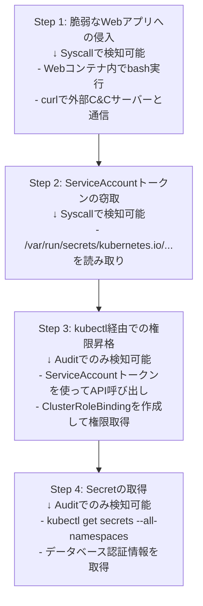
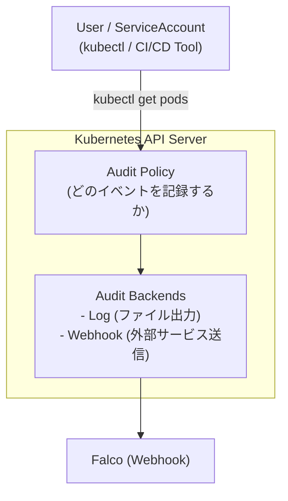
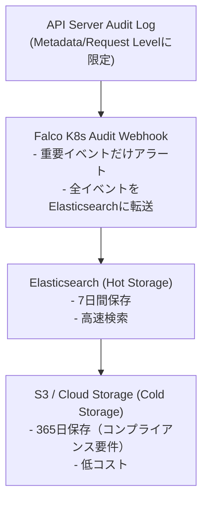

# K8s Audit Log × Falcoの連携

前回（第6回）までで、Falcoのsyscall監視とFalcosidekickによる可視化を学びました。しかし、syscall監視だけでは次のような**Kubernetes固有の操作**を検知できません。

- **kubectl操作**（誰が、いつ、何を実行したか）
- **RBAC変更**（RoleBinding/ClusterRoleBindingの追加・削除）
- **Secret取得**（機密情報へのアクセス）
- **Pod削除**（意図しないワークロード停止）
- **APIサーバー経由の操作**（kubectlやCI/CDツールからの全ての操作）

この章では、**Kubernetes Audit Log**をFalcoと連携させることで、**Kubernetes APIレベルのセキュリティ監視**を実現します。

## この章で学ぶこと

1. **Syscall vs Audit** - 検知範囲の違いと相互補完性
2. **Kubernetes Audit Log** - 仕組みと監査レベル
3. **Audit Webhookの設定** - Minikube/EKS/GKE/AKS別の設定方法
4. **Falco連携** - Audit EventをFalcoで処理
5. **実践的なAuditルール** - 5つの重要な検知パターン
6. **ハンズオン** - kubectl操作の完全監査
7. **本番運用** - ログ量管理とパフォーマンス最適化

---

## Syscall vs Kubernetes Audit

### 1.1 Syscallイベントの特徴

これまで学んできたFalcoのsyscall監視は、**コンテナ内部の動作**を捉えます。

```yaml
# Syscallで検知できる例
- rule: Shell in Container
  condition: spawned_process and container and proc.name in (shell_binaries)
  # → コンテナ内でbashが実行されたことを検知
```

**検知範囲**：

[OK] コンテナ内でのプロセス実行（bash, ssh, curl等）
[OK] ファイルアクセス（/etc/shadow読み取り、/etc書き込み等）
[OK] ネットワーク接続（外部への通信、ポート待ち受け等）

[NG] **kubectl操作は検知できない**（API経由のため、syscallを通らない）
[NG] **RBAC変更は検知できない**（Kubernetes APIレベルの操作）
[NG] **誰が操作したか不明**（コンテナ内のユーザーは分かるが、kubectl実行者は分からない）

### 1.2 Kubernetes Auditイベントの特徴

Kubernetes Audit Logは、**API Server経由の全ての操作**を記録します。

```yaml
# Auditで検知できる例
- rule: Create Privileged Pod
  condition: ka.verb=create and ka.target.resource=pods and ka.req.pod.containers.privileged=true
  # → 特権Podが作成されたことを検知（kubectl/Helm/CI/CD経由問わず）
```

**検知範囲**：

[OK] kubectl操作（get, create, delete, patch等）
[OK] 操作者の特定（user, serviceAccount情報）
[OK] RBAC変更（Role, RoleBinding, ClusterRole等）
[OK] リソース変更の詳細（変更前後のマニフェスト）

[NG] **コンテナ内部の動作は検知できない**（APIレベルなので、bash実行等は見えない）

### 1.3 両方必要な理由

**シナリオ：攻撃者がクラスタに侵入した場合**



**結論**：

- **Syscall監視**：コンテナ内の異常な動作を検知（Step 1-2）
- **Audit監視**：Kubernetes API経由の悪意ある操作を検知（Step 3-4）
- **両方必要**：完全な防御には両方のレイヤーを監視

---

## Kubernetes Audit Logとは

### 2.1 Audit Logの基本

Kubernetes Audit Logは、**API Serverへの全てのリクエスト**を記録する機能です。



### 2.2 監査レベル

Kubernetes Auditには4つのレベルがあります：

| レベル | 記録内容 | 使用例 |
|--------|----------|--------|
| **None** | 記録しない | ヘルスチェック、メトリクス取得 |
| **Metadata** | リクエストのメタデータのみ（ユーザー、タイムスタンプ、リソース、動詞） | 大量のGET操作（パフォーマンス重視） |
| **Request** | メタデータ + リクエストボディ | CREATE/UPDATE操作（何を作成したか記録） |
| **RequestResponse** | メタデータ + リクエスト + レスポンスボディ | 機密操作（Secretアクセス等） |

### 2.3 Audit Policyの設定

**基本的なAudit Policy例**：

```yaml
apiVersion: audit.k8s.io/v1
kind: Policy
rules:
  # 重要なリソースはRequestResponseレベル
  - level: RequestResponse
    verbs: ["get", "list", "watch"]
    resources:
      - group: ""
        resources: ["secrets", "configmaps"]

  # RBAC変更はRequestレベル
  - level: Request
    verbs: ["create", "update", "patch", "delete"]
    resources:
      - group: "rbac.authorization.k8s.io"
        resources: ["roles", "rolebindings", "clusterroles", "clusterrolebindings"]

  # Pod作成/削除はRequestレベル
  - level: Request
    verbs: ["create", "delete"]
    resources:
      - group: ""
        resources: ["pods"]

  # その他のGET操作はMetadataレベル
  - level: Metadata
    verbs: ["get", "list", "watch"]

  # ヘルスチェックは記録しない
  - level: None
    users: ["system:kube-proxy"]
    verbs: ["watch"]
    resources:
      - group: ""
        resources: ["endpoints", "services"]
```

**パフォーマンスへの影響**：

- **None**: 影響なし
- **Metadata**: 最小限（推奨）
- **Request**: 中程度（重要操作のみに使用）
- **RequestResponse**: 大きい（Secretアクセス等に限定）

---

## Audit Webhookのセットアップ

### 3.1 Minikubeでの設定

**ステップ1: Audit Policyファイルを作成**

```bash
# audit-policy.yamlを作成
cat <<EOF > audit-policy.yaml
apiVersion: audit.k8s.io/v1
kind: Policy
omitStages:
  - RequestReceived
rules:
  - level: RequestResponse
    verbs: ["create", "update", "patch", "delete"]
    resources:
      - group: ""
        resources: ["secrets", "configmaps"]
      - group: "rbac.authorization.k8s.io"

  - level: Request
    verbs: ["create", "delete"]
    resources:
      - group: ""
        resources: ["pods", "services"]

  - level: Metadata
    omitStages:
      - RequestReceived
EOF
```

**ステップ2: Minikubeを起動**

```bash
# Audit Log機能を有効にしてMinikubeを起動
minikube start \
  --extra-config=apiserver.audit-policy-file=/etc/ssl/certs/audit-policy.yaml \
  --extra-config=apiserver.audit-log-path=/var/log/kubernetes/audit.log \
  --extra-config=apiserver.audit-webhook-config-file=/etc/ssl/certs/audit-webhook.yaml \
  --extra-config=apiserver.audit-webhook-batch-max-wait=5s

# Audit Policyをコピー
minikube cp audit-policy.yaml /etc/ssl/certs/audit-policy.yaml
```

**ステップ3: Audit Webhook設定**

```yaml
# audit-webhook.yaml
apiVersion: v1
kind: Config
clusters:
  - name: falco
    cluster:
      server: http://falco-k8saudit-webhook.falco.svc.cluster.local:9765/k8s-audit
users:
  - name: falco
    user:
      username: admin
current-context: webhook
contexts:
  - context:
      cluster: falco
      user: falco
    name: webhook
```

### 3.2 EKS（Amazon EKS）での設定

**EKSはデフォルトでAudit Logを有効化できます**：

```bash
# EKSクラスタ作成時にAudit Log有効化
eksctl create cluster \
  --name my-cluster \
  --region us-west-2 \
  --enable-control-plane-logging audit,api,authenticator

# 既存クラスタで有効化
aws eks update-cluster-config \
  --name my-cluster \
  --region us-west-2 \
  --logging '{"clusterLogging":[{"types":["audit","api","authenticator"],"enabled":true}]}'
```

**EKSのAudit LogをFalcoに送信**：

EKSではWebhookではなく、CloudWatch Logsに送信されます。Falcoで処理するには：

```yaml
# Fluent BitでCloudWatch Logs → Falco K8s Audit Webhook
apiVersion: v1
kind: ConfigMap
metadata:
  name: fluent-bit-config
  namespace: amazon-cloudwatch
data:
  output.conf: |
    [OUTPUT]
        Name   http
        Match  kube.*
        Host   falco-k8saudit-webhook.falco.svc.cluster.local
        Port   9765
        URI    /k8s-audit
        Format json
```

### 3.3 GKE（Google Kubernetes Engine）での設定

**GKEではAudit Logが自動有効化されています**：

```bash
# GKEクラスタ作成
gcloud container clusters create my-cluster \
  --zone us-central1-a \
  --enable-cloud-logging \
  --enable-cloud-monitoring

# Audit Logは自動的にCloud Loggingに送信される
```

**GKEのAudit LogをFalcoに送信**：

```bash
# Cloud Logging → Pub/Sub → Cloud Functionsでカスタム処理
gcloud logging sinks create falco-audit-sink \
  pubsub.googleapis.com/projects/PROJECT_ID/topics/falco-audit \
  --log-filter='protoPayload.serviceName="k8s.io"
                AND protoPayload."@type"="type.googleapis.com/google.cloud.audit.AuditLog"'
```

### 3.4 AKS（Azure Kubernetes Service）での設定

```bash
# AKSクラスタ作成時にAudit Log有効化
az aks create \
  --resource-group myResourceGroup \
  --name myAKSCluster \
  --enable-addons monitoring \
  --enable-audit-log

# Diagnostic Settingsで有効化
az monitor diagnostic-settings create \
  --resource $(az aks show -g myResourceGroup -n myAKSCluster --query id -o tsv) \
  --name audit-logs \
  --logs '[{"category": "kube-audit", "enabled": true}]' \
  --workspace $(az monitor log-analytics workspace show -g myResourceGroup -n myWorkspace --query id -o tsv)
```

### 3.5 シンプルなセットアップ（Kind推奨）

**Kind（Kubernetes in Docker）が最も簡単**です：

```yaml
# kind-config.yaml
kind: Cluster
apiVersion: kind.x-k8s.io/v1alpha4
nodes:
- role: control-plane
  kubeadmConfigPatches:
  - |
    kind: ClusterConfiguration
    apiServer:
      extraArgs:
        audit-policy-file: /etc/kubernetes/audit-policy.yaml
        audit-webhook-config-file: /etc/kubernetes/audit-webhook.yaml
        audit-webhook-batch-max-wait: "5s"
      extraVolumes:
      - name: audit-config
        hostPath: /tmp/audit
        mountPath: /etc/kubernetes
        readOnly: true
  extraMounts:
  - hostPath: ./audit-config
    containerPath: /tmp/audit
```

```bash
# Audit設定ファイルを準備
mkdir -p audit-config
cat > audit-config/audit-policy.yaml <<EOF
apiVersion: audit.k8s.io/v1
kind: Policy
rules:
  - level: Request
EOF

cat > audit-config/audit-webhook.yaml <<EOF
apiVersion: v1
kind: Config
clusters:
- name: falco
  cluster:
    server: http://falco-k8saudit-webhook.falco.svc.cluster.local:9765/k8s-audit
users:
- name: falco
current-context: webhook
contexts:
- context:
    cluster: falco
    user: falco
  name: webhook
EOF

# Kindクラスタ起動
kind create cluster --config kind-config.yaml
```

---

## Falcoとの連携

### 4.1 Falco K8s Audit Webhookのデプロイ

```bash
# Falco with K8s Audit をインストール
helm repo add falcosecurity https://falcosecurity.github.io/charts
helm repo update

cat <<EOF > falco-audit-values.yaml
driver:
  enabled: true
  kind: modern_ebpf

# K8s Audit Webhook を有効化
k8sAudit:
  enabled: true

collectors:
  kubernetes:
    enabled: true

# Audit Webhook Service
service:
  type: ClusterIP
  ports:
    - name: audit
      port: 9765
      targetPort: 9765
      protocol: TCP

falco:
  grpc:
    enabled: true
  grpc_output:
    enabled: true
  json_output: true
  json_include_output_property: true

  # Audit用ルールファイルを読み込み
  rules_file:
    - /etc/falco/falco_rules.yaml
    - /etc/falco/k8s_audit_rules.yaml
    - /etc/falco/rules.d

falcosidekick:
  enabled: true
  config:
    slack:
      webhookurl: ""
      minimumpriority: "warning"
EOF

helm install falco falcosecurity/falco \
  --namespace falco \
  --create-namespace \
  --values falco-audit-values.yaml
```

### 4.2 Falcoの設定確認

```bash
# K8s Audit Webhook Podが起動しているか確認
kubectl get pods -n falco -l app.kubernetes.io/name=falco

# Serviceが公開されているか確認
kubectl get svc -n falco

# 期待される出力:
# NAME                     TYPE        CLUSTER-IP      PORT(S)
# falco                    ClusterIP   10.96.123.45    8765/TCP
# falco-k8saudit-webhook   ClusterIP   10.96.123.46    9765/TCP
```

### 4.3 動作確認

```bash
# テスト用Secretを作成してAuditイベントを発生させる
kubectl create secret generic test-secret --from-literal=password=secret123

# Falcoログでイベントを確認
kubectl logs -n falco -l app.kubernetes.io/name=falco --tail=50 | grep -i audit

# 期待される出力例:
# 2025-01-26T15:30:45.123456789+0000: Warning K8s Secret Created (user=kubernetes-admin verb=create resource=secrets ns=default name=test-secret)
```

---

## 実践的なAuditルールの作成

### 実例1: ClusterRoleBinding変更の検知

**シナリオ**：攻撃者が権限昇格のためにClusterRoleBindingを作成

```yaml
- rule: Create ClusterRoleBinding With Full Cluster Admin Permissions
  desc: Detect creation of ClusterRoleBinding with cluster-admin role
  condition: >
    ka.verb = create and
    ka.target.resource = clusterrolebindings and
    ka.req.binding.role = cluster-admin
  output: >
    ClusterRoleBinding with cluster-admin created
    (user=%ka.user.name
     binding=%ka.target.name
     subject=%ka.req.binding.subjects
     source=%ka.source.ips)
  priority: CRITICAL
  source: k8s_audit
  tags: [k8s, rbac, privilege_escalation, mitre_t1078]
```

**テスト**：

```bash
# 攻撃シミュレーション
kubectl create clusterrolebinding malicious-admin \
  --clusterrole=cluster-admin \
  --user=attacker@example.com

# Falcoアラート確認
kubectl logs -n falco -l app.kubernetes.io/name=falco --tail=20

# 期待されるアラート:
# CRITICAL: ClusterRoleBinding with cluster-admin created
#   (user=kubernetes-admin binding=malicious-admin subject=[attacker@example.com])
```

### 実例2: Secret取得の監査

**シナリオ**：不正なServiceAccountがSecretにアクセス

```yaml
- list: sensitive_namespaces
  items: [kube-system, kube-public, prod, production]

- list: trusted_service_accounts
  items: [
    system:kube-controller-manager,
    system:kube-scheduler,
    external-secrets-operator
  ]

- rule: Secret Accessed By Untrusted ServiceAccount
  desc: Detect when secrets are accessed by unexpected service accounts
  condition: >
    ka.verb in (get, list, watch) and
    ka.target.resource = secrets and
    ka.target.namespace in (sensitive_namespaces) and
    not ka.user.name in (trusted_service_accounts) and
    not ka.user.name startswith "system:"
  output: >
    Secret accessed in sensitive namespace
    (user=%ka.user.name
     verb=%ka.verb
     secret=%ka.target.name
     namespace=%ka.target.namespace
     source=%ka.source.ips
     user_agent=%ka.user_agent)
  priority: WARNING
  source: k8s_audit
  tags: [k8s, secrets, access_control]
```

**テスト**：

```bash
# 通常のServiceAccountを作成
kubectl create sa test-sa -n default

# Secretへのアクセスを付与
kubectl create rolebinding test-sa-secrets \
  --clusterrole=view \
  --serviceaccount=default:test-sa \
  -n kube-system

# ServiceAccountとしてSecretを取得
kubectl --as=system:serviceaccount:default:test-sa \
  get secrets -n kube-system

# アラートが発生
```

### 実例3: 本番Podの削除検知

```yaml
- list: production_namespaces
  items: [production, prod, prod-*]

- list: authorized_users
  items: [admin@example.com, sre-team@example.com]

- rule: Production Pod Deleted
  desc: Detect pod deletion in production namespaces
  condition: >
    ka.verb = delete and
    ka.target.resource = pods and
    ka.target.namespace in (production_namespaces) and
    not ka.user.name in (authorized_users)
  output: >
    Production pod deleted by unauthorized user
    (user=%ka.user.name
     pod=%ka.target.name
     namespace=%ka.target.namespace
     reason=%ka.req.reason
     source=%ka.source.ips)
  priority: ERROR
  source: k8s_audit
  tags: [k8s, production, availability]
```

### 実例4: 特権Pod作成の検知

```yaml
- rule: Create Privileged Pod
  desc: Detect creation of pod with privileged containers
  condition: >
    ka.verb = create and
    ka.target.resource = pods and
    ka.req.pod.containers.privileged intersects (true)
  output: >
    Privileged pod created
    (user=%ka.user.name
     pod=%ka.req.pod.name
     namespace=%ka.target.namespace
     images=%ka.req.pod.containers.image
     privileged_containers=%ka.req.pod.containers.privileged)
  priority: WARNING
  source: k8s_audit
  tags: [k8s, privileged, container_security]
```

**テスト**：

```bash
# 特権Podを作成
kubectl apply -f - <<EOF
apiVersion: v1
kind: Pod
metadata:
  name: privileged-test
spec:
  containers:
  - name: nginx
    image: nginx
    securityContext:
      privileged: true
EOF

# アラート確認
kubectl logs -n falco -l app.kubernetes.io/name=falco | grep "Privileged pod created"
```

### 実例5: ConfigMap機密情報の変更検知

```yaml
- list: sensitive_configmaps
  items: [aws-auth, coredns, kube-proxy]

- rule: Sensitive ConfigMap Modified
  desc: Detect modifications to critical ConfigMaps
  condition: >
    ka.verb in (update, patch, delete) and
    ka.target.resource = configmaps and
    ka.target.name in (sensitive_configmaps)
  output: >
    Sensitive ConfigMap modified
    (user=%ka.user.name
     verb=%ka.verb
     configmap=%ka.target.name
     namespace=%ka.target.namespace
     changes=%ka.req.configmap.data)
  priority: ERROR
  source: k8s_audit
  tags: [k8s, configuration, aws-auth]
```

---

## ハンズオン：kubectl操作を完全監査

### シナリオ：本番環境の全操作を記録・監査

**ステップ1: カスタムAuditルールをデプロイ**

```yaml
# audit-rules.yaml
- macro: production_namespace
  condition: ka.target.namespace in (production, prod)

- rule: All Production Operations
  desc: Audit all operations in production namespace
  condition: >
    production_namespace and
    ka.verb in (create, update, patch, delete)
  output: >
    Production operation detected
    (user=%ka.user.name
     verb=%ka.verb
     resource=%ka.target.resource
     name=%ka.target.name
     namespace=%ka.target.namespace
     source=%ka.source.ips
     user_agent=%ka.user_agent)
  priority: INFO
  source: k8s_audit
  tags: [audit, production]

- rule: Production Secret Access
  desc: All secret access in production
  condition: >
    production_namespace and
    ka.target.resource = secrets and
    ka.verb in (get, list, watch, create, update, patch, delete)
  output: >
    Production secret accessed
    (user=%ka.user.name
     verb=%ka.verb
     secret=%ka.target.name
     namespace=%ka.target.namespace)
  priority: WARNING
  source: k8s_audit
  tags: [audit, secrets, production]

- rule: Production RBAC Changes
  desc: Track all RBAC changes in production
  condition: >
    production_namespace and
    ka.target.resource in (roles, rolebindings) and
    ka.verb in (create, update, patch, delete)
  output: >
    Production RBAC changed
    (user=%ka.user.name
     verb=%ka.verb
     resource=%ka.target.resource
     name=%ka.target.name
     namespace=%ka.target.namespace)
  priority: ERROR
  source: k8s_audit
  tags: [audit, rbac, production]
```

```bash
# ConfigMapとして適用
kubectl create configmap falco-audit-rules \
  --from-file=audit-rules.yaml \
  -n falco

# Falcoに読み込ませる
kubectl edit deployment falco -n falco
# volumeMount に追加:
#   - name: audit-rules
#     mountPath: /etc/falco/rules.d/audit-rules.yaml
#     subPath: audit-rules.yaml
```

**ステップ2: 様々なkubectl操作を実行**

```bash
# production namespaceを作成
kubectl create namespace production

# Pod作成
kubectl run nginx --image=nginx -n production

# Secret作成
kubectl create secret generic db-password \
  --from-literal=password=super-secret \
  -n production

# Secret取得
kubectl get secret db-password -n production -o yaml

# Deployment作成
kubectl create deployment api-server --image=myapp:v1.0 -n production

# RoleBinding作成
kubectl create rolebinding dev-access \
  --clusterrole=edit \
  --user=developer@example.com \
  -n production

# Pod削除
kubectl delete pod nginx -n production
```

**ステップ3: Falcosidekick UIで監査ログを確認**

```bash
# UIにアクセス
kubectl port-forward -n falco svc/falco-falcosidekick-ui 2802:2802

# ブラウザで http://localhost:2802 を開く
```

**期待される結果**：

```text
 Audit Events (Last 5 minutes)

[i]  Production operation detected
    User: kubernetes-admin
    Verb: create
    Resource: pods
    Name: nginx
    Time: 15:30:45

[!]  Production secret accessed
    User: kubernetes-admin
    Verb: create
    Secret: db-password
    Time: 15:31:02

[!]  Production secret accessed
    User: kubernetes-admin
    Verb: get
    Secret: db-password
    Time: 15:31:15

[*] Production RBAC changed
    User: kubernetes-admin
    Verb: create
    Resource: rolebindings
    Name: dev-access
    Time: 15:32:30
```

**ステップ4: Elasticsearch/Kibanaで長期分析**

```bash
# Kibana Discoverで検索
source: "k8s_audit" AND output_fields.ka.target.namespace: "production"

# 可視化例：
# - 誰が最も頻繁に操作しているか（ka.user.name別の集計）
# - どのリソースが最も変更されているか（ka.target.resource別）
# - 時系列グラフ（過去7日間の操作数推移）
```

---

## 本番運用のポイント

### 7.1 ログ量の管理

**問題**：Audit Logは大量になりやすい

```bash
# 典型的なログ量（中規模クラスタ）
# - Metadata Level: 10-50 MB/日
# - Request Level: 100-500 MB/日
# - RequestResponse Level: 500-2000 MB/日
```

**対策1：Audit Policyで不要なイベントを除外**

```yaml
apiVersion: audit.k8s.io/v1
kind: Policy
omitStages:
  - RequestReceived  # リクエスト受信時点は記録不要
rules:
  # ヘルスチェックは記録しない
  - level: None
    users: ["system:kube-probe"]

  # ReadOnlyのGETは軽量なMetadataレベル
  - level: Metadata
    verbs: ["get", "list", "watch"]
    resources:
      - group: ""
        resources: ["pods", "services", "endpoints"]

  # 重要なリソースだけRequestResponse
  - level: RequestResponse
    verbs: ["get", "list"]
    resources:
      - group: ""
        resources: ["secrets"]
```

**対策2：Falcoルールで重要なイベントだけ処理**

```yaml
# 全てのAuditイベントを受け取るが、重要なものだけアラート
- rule: Low Priority Audit Events
  condition: ka.verb = get and not ka.target.resource = secrets
  output: (no output - drop event)
  priority: DEBUG
  enabled: false  # ログに記録しない
```

### 7.2 重要なイベントの優先順位付け

**Priorityの使い分け**：

```yaml
# CRITICAL: 即座に対応が必要
- rule: Cluster Admin Binding Created
  priority: CRITICAL

# ERROR: 早急な調査が必要
- rule: Production Pod Deleted
  priority: ERROR

# WARNING: 監視・記録
- rule: Secret Accessed
  priority: WARNING

# NOTICE: 情報として記録
- rule: ConfigMap Updated
  priority: NOTICE

# INFO: デバッグ・監査証跡
- rule: All Production Operations
  priority: INFO
```

**通知先の分離**：

```yaml
# Falcosidekick設定
falcosidekick:
  config:
    # CRITICAL → PagerDuty（即座に対応）
    pagerduty:
      routingkey: "xxx"
      minimumpriority: "critical"

    # ERROR/WARNING → Slack（チーム通知）
    slack:
      webhookurl: "xxx"
      minimumpriority: "warning"

    # INFO以上 → Elasticsearch（全て保存）
    elasticsearch:
      hostport: "xxx"
      minimumpriority: "info"
```

### 7.3 パフォーマンスチューニング

**API Serverへの影響**：

```yaml
# audit-webhook.yaml
apiVersion: v1
kind: Config
clusters:
  - name: falco
    cluster:
      server: http://falco-k8saudit-webhook.falco.svc.cluster.local:9765/k8s-audit
      # タイムアウト設定（デフォルト30秒は長すぎる）
      timeout: 5s

# API Server設定
--audit-webhook-batch-max-wait=5s
--audit-webhook-batch-max-size=100
--audit-webhook-initial-backoff=1s
```

**Falco Webhook Podのスケーリング**：

```yaml
# HorizontalPodAutoscaler
apiVersion: autoscaling/v2
kind: HorizontalPodAutoscaler
metadata:
  name: falco-k8saudit-webhook
  namespace: falco
spec:
  scaleTargetRef:
    apiVersion: apps/v1
    kind: Deployment
    name: falco-k8saudit-webhook
  minReplicas: 2
  maxReplicas: 10
  metrics:
    - type: Resource
      resource:
        name: cpu
        target:
          type: Utilization
          averageUtilization: 70
```

### 7.4 コスト最適化

**クラウドプロバイダー別の考慮事項**：

| プロバイダー | Audit Log保存先 | コスト要因 | 最適化策 |
|--------------|-----------------|------------|----------|
| **EKS** | CloudWatch Logs | ログ保存量、クエリ実行 | 7日でS3にアーカイブ |
| **GKE** | Cloud Logging | ログ保存量、インデックス | ログルーターでフィルタ |
| **AKS** | Azure Monitor | Log Analytics保存量 | 保存期間を30日に制限 |

**推奨構成**：



---

## まとめ

この章では、Kubernetes Audit LogとFalcoの連携について学びました。

### 学んだこと

[OK] **Syscall vs Audit** - コンテナ内部監視とAPI監視の相互補完性
[OK] **Audit Log設定** - 4つの監査レベルとAudit Policy
[OK] **Webhook設定** - Minikube/EKS/GKE/AKS別の構成方法
[OK] **Falco連携** - K8s Audit Webhookのデプロイと設定
[OK] **実践ルール** - RBAC変更、Secret取得、Pod削除、特権Pod検知
[OK] **本番運用** - ログ量管理、優先順位付け、パフォーマンス最適化

### セキュリティの完全性

```text
完全なKubernetesセキュリティ監視:
1. Syscall監視（Falco） → コンテナ内の異常動作
2. Audit監視（Falco + K8s Audit） → Kubernetes API操作
3. ネットワーク監視（次章以降） → 東西・南北通信
4. コンプライアンス（次章以降） → ポリシー適合性
```

### 次のステップ

- **第8回**：CI/CDパイプラインへのFalco統合
- **第9回**：本番環境への完全デプロイ設計
- **第10回**：OPA Gatekeeper/Kyvernoとの比較

---

## 参考資料

- [Kubernetes Auditing](https://kubernetes.io/docs/tasks/debug/debug-cluster/audit/)
- [Falco K8s Audit Plugin](https://github.com/falcosecurity/plugins/tree/main/plugins/k8saudit)
- [Audit Policy Examples](https://github.com/kubernetes/kubernetes/tree/master/cluster/gce/gci/configure-helper.sh)
- [EKS Control Plane Logging](https://docs.aws.amazon.com/eks/latest/userguide/control-plane-logs.html)
- [GKE Audit Logs](https://cloud.google.com/kubernetes-engine/docs/how-to/audit-logging)
