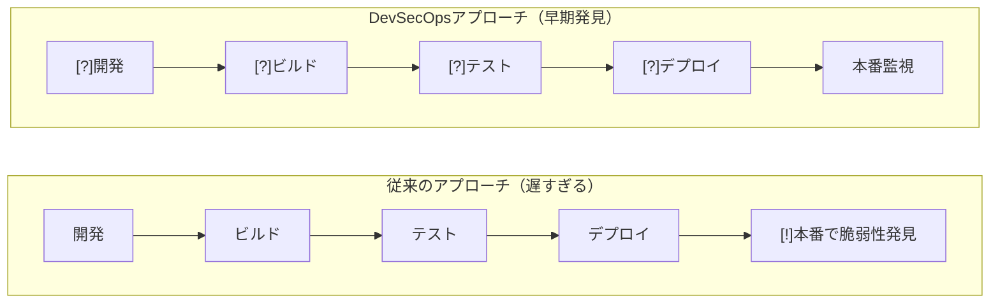
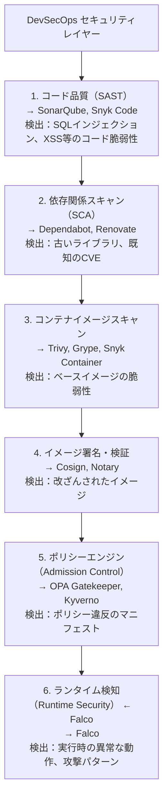
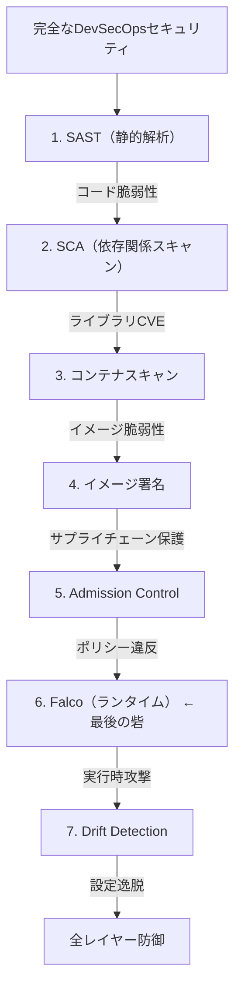

# Falco + CI/CD / DevSecOpsシナリオ

前回（第7回）までで、Falcoによるランタイム監視とKubernetes Audit連携を学びました。しかし、セキュリティを本当に強化するには、**開発・ビルド・テスト・デプロイの全段階**でセキュリティを組み込む必要があります。

この章では、**DevSecOps**の観点から、CI/CDパイプラインにFalcoを統合し、コード化から本番運用まで一貫したセキュリティを実現する方法を学びます。

## この章で学ぶこと

1. **DevSecOpsパイプライン** - Shift Leftとランタイムセキュリティ
2. **CI/CD統合** - GitHub Actions/GitLab CI/Jenkins でのFalco活用
3. **イメージセキュリティ** - Cosign署名とFalco検知の境界線
4. **Policy as Code** - Falcoルールのバージョン管理とテスト
5. **GitOps統合** - Flux/ArgoCDとの連携
6. **Drift Detection** - IaCからの逸脱検知
7. **実践パイプライン** - エンドツーエンドのDevSecOps構築

---

## DevSecOpsパイプラインとセキュリティ

### 1.1 Shift Leftの考え方

**Shift Left** = セキュリティチェックを左側（開発初期）にシフトする



しかし、**Shift Leftだけでは不十分**です：

- [OK] **静的解析**（開発時）：既知の脆弱性を検出
- [OK] **コンテナスキャン**（ビルド時）：イメージの脆弱性を検出
- [NG] **ランタイム攻撃**：実行時の異常な動作は検出できない

### 1.2 ランタイムセキュリティの位置づけ



**Falcoの強み**：

- [OK] 他のツールが検出できない**実行時の攻撃**を検知
- [OK] **ゼロデイ攻撃**（既知の脆弱性DBにない攻撃）も動作で検知
- [OK] **内部犯行**（認証された攻撃者の異常動作）を検知

### 1.3 DevSecOpsパイプラインの全体像

```yaml
# .github/workflows/devsecops-pipeline.yml
name: DevSecOps Pipeline with Falco

on:
  push:
    branches: [main]
  pull_request:

jobs:
  # 1. コード品質チェック
  code-quality:
    runs-on: ubuntu-latest
    steps:
      - uses: actions/checkout@v3
      - name: Run SonarQube
        uses: sonarsource/sonarcloud-github-action@master

  # 2. 依存関係スキャン
  dependency-scan:
    runs-on: ubuntu-latest
    steps:
      - uses: actions/checkout@v3
      - name: Run Snyk
        uses: snyk/actions/node@master

  # 3. コンテナイメージスキャン
  image-scan:
    runs-on: ubuntu-latest
    steps:
      - uses: actions/checkout@v3
      - name: Build image
        run: docker build -t myapp:${{ github.sha }} .
      - name: Run Trivy
        uses: aquasecurity/trivy-action@master
        with:
          image-ref: myapp:${{ github.sha }}
          severity: 'CRITICAL,HIGH'

  # 4. イメージ署名
  image-sign:
    needs: image-scan
    runs-on: ubuntu-latest
    steps:
      - name: Sign image with Cosign
        run: |
          cosign sign --key cosign.key myapp:${{ github.sha }}

  # 5. ポリシーチェック
  policy-check:
    runs-on: ubuntu-latest
    steps:
      - name: Run OPA Conftest
        run: conftest test k8s-manifests/ --policy policy/

  # 6. テスト環境デプロイ + Falco監視
  test-deploy:
    needs: [image-scan, policy-check]
    runs-on: ubuntu-latest
    steps:
      - name: Deploy to test cluster
        run: kubectl apply -f k8s-manifests/
      - name: Run integration tests with Falco
        run: |
          # Falcoでテスト中の異常動作を監視
          ./scripts/run-tests-with-falco.sh
      - name: Check Falco alerts
        run: |
          # テスト中にCRITICALアラートがあれば失敗
          if [ $(kubectl logs -n falco -l app=falco | grep CRITICAL | wc -l) -gt 0 ]; then
            echo "CRITICAL alerts detected during tests"
            exit 1
          fi

  # 7. 本番デプロイ
  production-deploy:
    needs: test-deploy
    runs-on: ubuntu-latest
    environment: production
    steps:
      - name: Deploy to production
        run: kubectl apply -f k8s-manifests/ -n production
```

---

## CI/CDパイプラインへのFalco統合

### 2.1 GitHub Actions での統合

**シナリオ**：PRマージ前に脅威シミュレーションを実行し、Falcoで検知できることを確認

```yaml
# .github/workflows/falco-test.yml
name: Falco Security Test

on:
  pull_request:
    types: [opened, synchronize]

jobs:
  falco-test:
    runs-on: ubuntu-latest
    steps:
      - uses: actions/checkout@v3

      # 1. Kindクラスタを起動
      - name: Create Kind cluster
        uses: helm/kind-action@v1.8.0

      # 2. Falcoをインストール
      - name: Install Falco
        run: |
          helm repo add falcosecurity https://falcosecurity.github.io/charts
          helm install falco falcosecurity/falco \
            --namespace falco \
            --create-namespace \
            --set driver.kind=modern_ebpf \
            --set falco.json_output=true

      # 3. テスト用Podをデプロイ
      - name: Deploy test application
        run: |
          kubectl apply -f k8s-manifests/test/

      # 4. 脅威シミュレーション実行
      - name: Run threat simulation
        run: |
          # シェル実行テスト
          kubectl exec -it test-pod -- bash -c "echo 'Testing shell detection'"

          # 機密ファイルアクセステスト
          kubectl exec -it test-pod -- cat /etc/shadow

          # 外部通信テスト
          kubectl exec -it test-pod -- curl http://malicious-site.example.com

      # 5. Falcoアラートを確認
      - name: Check Falco alerts
        run: |
          sleep 10  # アラートが記録されるまで待機

          kubectl logs -n falco -l app=falco > falco-alerts.json

          # 期待されるアラートが出ているか確認
          if ! grep -q "Shell spawned in container" falco-alerts.json; then
            echo "[NG] Expected alert not found: Shell spawned"
            exit 1
          fi

          if ! grep -q "Read sensitive file" falco-alerts.json; then
            echo "[NG] Expected alert not found: Sensitive file read"
            exit 1
          fi

          echo "[OK] All expected alerts detected by Falco"

      # 6. アラートをアーティファクトとして保存
      - name: Upload Falco alerts
        uses: actions/upload-artifact@v3
        with:
          name: falco-alerts
          path: falco-alerts.json
```

### 2.2 GitLab CI での統合

```yaml
# .gitlab-ci.yml
stages:
  - build
  - scan
  - test
  - deploy

variables:
  IMAGE_NAME: $CI_REGISTRY_IMAGE:$CI_COMMIT_SHA

# コンテナビルド
build:
  stage: build
  script:
    - docker build -t $IMAGE_NAME .
    - docker push $IMAGE_NAME

# Trivyスキャン
trivy-scan:
  stage: scan
  script:
    - trivy image --severity HIGH,CRITICAL $IMAGE_NAME

# Falcoテスト
falco-runtime-test:
  stage: test
  image: alpine/k8s:1.28.0
  script:
    # テスト環境にデプロイ
    - kubectl config use-context test-cluster
    - kubectl apply -f k8s/deployment.yaml -n test

    # Falcoがインストール済みの前提
    - |
      # アプリケーションが起動するまで待機
      kubectl wait --for=condition=ready pod -l app=myapp -n test --timeout=60s

      # テストスクリプト実行（故意に異常動作を含む）
      ./tests/security-tests.sh

      # Falcoアラートを取得
      kubectl logs -n falco -l app=falco --tail=100 > falco-test-alerts.log

      # CRITICALアラートがあれば失敗
      if grep -q "CRITICAL" falco-test-alerts.log; then
        echo "[!] CRITICAL security alerts detected"
        cat falco-test-alerts.log
        exit 1
      fi

      echo "[OK] No critical security issues detected"
  artifacts:
    paths:
      - falco-test-alerts.log
    expire_in: 7 days

# 本番デプロイ
deploy-production:
  stage: deploy
  script:
    - kubectl config use-context prod-cluster
    - kubectl apply -f k8s/deployment.yaml -n production
  only:
    - main
  when: manual
```

### 2.3 Jenkins Pipeline での統合

```groovy
// Jenkinsfile
pipeline {
  agent any

  environment {
    IMAGE_NAME = "myapp"
    IMAGE_TAG  = "${env.BUILD_NUMBER}"
    KUBECONFIG = credentials('kubeconfig-test')
  }

  stages {
    stage('Build') {
      steps {
        script {
          docker.build("${IMAGE_NAME}:${IMAGE_TAG}")
        }
      }
    }

    stage('Trivy Scan') {
      steps {
        sh """
          trivy image --exit-code 1 \
            --severity CRITICAL \
            ${IMAGE_NAME}:${IMAGE_TAG}
        """
      }
    }

    stage('Deploy to Test') {
      steps {
        sh """
          kubectl apply -f k8s/test/ --namespace=test
          kubectl set image deployment/myapp \
            myapp=${IMAGE_NAME}:${IMAGE_TAG} -n test
        """
      }
    }

    stage('Falco Security Test') {
      steps {
        script {
          sh """
            kubectl wait --for=condition=ready \
              pod -l app=myapp -n test --timeout=120s
            ./tests/run-security-tests.sh
            kubectl logs -n falco -l app=falco \
              --since=5m > falco-alerts.log
            python3 scripts/analyze-falco-alerts.py \
              falco-alerts.log
          """

          def alertCount = sh(
            script: "grep -c 'Priority: ERROR\\|Priority: CRITICAL'" +
                    " falco-alerts.log || true",
            returnStdout: true
          ).trim()

          if (alertCount.toInteger() > 0) {
            slackSend(
              color: 'danger',
              message: "[!] Falco detected ${alertCount}" +
                       " security alerts in build ${env.BUILD_NUMBER}"
            )
            error("Security alerts detected by Falco")
          }
        }
      }
    }

    stage('Deploy to Production') {
      when { branch 'main' }
      steps {
        input message: 'Deploy to production?', ok: 'Deploy'
        sh """
          kubectl apply -f k8s/prod/ --namespace=production
          kubectl set image deployment/myapp \
            myapp=${IMAGE_NAME}:${IMAGE_TAG} -n production
        """
      }
    }
  }

  post {
    always {
      archiveArtifacts artifacts: 'falco-alerts.log',
                       allowEmptyArchive: true
    }
  }
}
```

---

## ランタイム検知 vs イメージ署名

### 3.1 それぞれの役割

| 手法 | 検知タイミング | 強み | 弱み | ツール例 |
|------|----------------|------|------|----------|
| **イメージ署名** | デプロイ前 | ・改ざん検出<br>・承認されたイメージのみ実行<br>・サプライチェーン保護 | ・実行時の攻撃は防げない<br>・署名後の脆弱性は検出不可 | Cosign, Notary |
| **ランタイム検知** | 実行中 | ・実際の攻撃動作を検知<br>・ゼロデイ攻撃も検出<br>・内部犯行も検知 | ・事前防止はできない<br>・False Positiveの調整必要 | Falco, Tracee |

### 3.2 具体的なシナリオ比較

**シナリオ1：悪意あるイメージの混入**

```text
攻撃：開発者のアカウントが侵害され、バックドア入りイメージがPushされた

[OK] イメージ署名で防御:
   - 署名されていないイメージはAdmission Webhookでブロック
   - デプロイ前に阻止

[NG] Falcoだけでは:
   - イメージがデプロイされてから検知
   - バックドアが実行されてから気づく（遅い）
```

**シナリオ2：実行時の権限昇格攻撃**

```text
攻撃：正規イメージだが、脆弱性を突いてシェルを取得し、権限昇格

[NG] イメージ署名では防御不可:
   - イメージ自体は正規（署名済み）
   - 実行時の攻撃は署名では検出できない

[OK] Falcoで検知:
   - コンテナ内でのシェル実行を検知
   - /etc/shadow へのアクセスを検知
   - 権限昇格の動作を検知
```

### 3.3 統合的なセキュリティ戦略

**推奨構成**：両方を組み合わせる

```yaml
# 1. Admission Webhook でイメージ署名検証（Cosign）
apiVersion: admissionregistration.k8s.io/v1
kind: ValidatingWebhookConfiguration
metadata:
  name: cosign-image-verification
webhooks:
  - name: verify-images.sigstore.dev
    rules:
      - operations: ["CREATE", "UPDATE"]
        apiGroups: [""]
        apiVersions: ["v1"]
        resources: ["pods"]
    clientConfig:
      service:
        name: cosign-webhook
        namespace: cosign-system

# 2. Falcoでランタイム監視
# （第4-5回で学んだルール）
```

**実装例：GitHub ActionsでCosign + Falco**

```yaml
# .github/workflows/secure-deploy.yml
name: Secure Deployment

jobs:
  build-and-sign:
    runs-on: ubuntu-latest
    steps:
      # イメージビルド
      - name: Build image
        run: docker build -t myapp:${{ github.sha }} .

      # Trivyスキャン
      - name: Scan with Trivy
        run: trivy image --exit-code 1 --severity CRITICAL myapp:${{ github.sha }}

      # Cosignで署名
      - name: Sign image
        run: |
          cosign sign --key cosign.key myapp:${{ github.sha }}

      # イメージをPush
      - name: Push image
        run: docker push myapp:${{ github.sha }}

  deploy-with-verification:
    needs: build-and-sign
    runs-on: ubuntu-latest
    steps:
      # 署名検証付きでデプロイ
      - name: Deploy with signature verification
        run: |
          kubectl apply -f - <<EOF
          apiVersion: v1
          kind: Pod
          metadata:
            name: myapp
            annotations:
              # Cosign Webhookが自動検証
              cosign.sigstore.dev/verify: "true"
          spec:
            containers:
            - name: app
              image: myapp:${{ github.sha }}
          EOF

      # デプロイ後、Falcoで継続監視
      - name: Monitor with Falco
        run: |
          # Falcoは既にクラスタにインストール済み
          # 異常動作があればSlack通知される（Falcosidekick設定済み）
          echo "Deployment complete. Falco is monitoring runtime behavior."
```

---

## Policy as Code - Falcoルールの管理

### 4.1 Gitでのルール管理

```bash
# ルールリポジトリの構成
falco-rules/
├── .github/
│   └── workflows/
│       └── validate-rules.yml    # ルール検証CI
├── rules/
│   ├── base/
│   │   └── k8s-base-rules.yaml   # 基本ルール
│   ├── environments/
│   │   ├── production.yaml       # 本番固有ルール
│   │   ├── staging.yaml
│   │   └── development.yaml
│   └── custom/
│       ├── payment-system.yaml   # アプリ固有ルール
│       └── data-processing.yaml
├── tests/
│   ├── test_shell_detection.yaml
│   └── test_rbac_changes.yaml
└── scripts/
    ├── deploy-rules.sh
    └── validate-rules.sh
```

### 4.2 ルールの自動検証

```yaml
# .github/workflows/validate-rules.yml
name: Validate Falco Rules

on:
  pull_request:
    paths:
      - 'rules/**'

jobs:
  validate:
    runs-on: ubuntu-latest
    steps:
      - uses: actions/checkout@v3

      # Falcoをインストール
      - name: Install Falco
        run: |
          curl -s https://falco.org/repo/falcosecurity-packages.asc | sudo apt-key add -
          echo "deb https://download.falco.org/packages/deb stable main" | \
            sudo tee -a /etc/apt/sources.list.d/falcosecurity.list
          sudo apt-get update
          sudo apt-get install -y falco

      # 構文チェック
      - name: Validate rule syntax
        run: |
          for rule_file in rules/**/*.yaml; do
            echo "Validating $rule_file"
            falco --validate $rule_file --dry-run
          done

      # ルールテスト
      - name: Run rule tests
        run: |
          ./scripts/test-rules.sh

      # ルール複雑度チェック（長すぎるconditionは警告）
      - name: Check rule complexity
        run: |
          python3 scripts/check-rule-complexity.py rules/

  test-in-cluster:
    runs-on: ubuntu-latest
    steps:
      - uses: actions/checkout@v3

      # Kindクラスタ起動
      - uses: helm/kind-action@v1.8.0

      # Falcoインストール
      - name: Install Falco with test rules
        run: |
          helm install falco falcosecurity/falco \
            -n falco --create-namespace \
            --set-file customRules."test-rules\.yaml"=rules/custom/payment-system.yaml

      # テストシナリオ実行
      - name: Run test scenarios
        run: |
          ./tests/run-scenarios.sh

      # アラート検証
      - name: Verify expected alerts
        run: |
          kubectl logs -n falco -l app=falco > alerts.log
          python3 tests/verify-alerts.py alerts.log
```

### 4.3 ルールのバージョン管理とロールアウト

```yaml
# rules/versions.yaml
apiVersion: v1
kind: ConfigMap
metadata:
  name: falco-rules-version
  namespace: falco
data:
  version: "v2.3.0"
  changelog: |
    v2.3.0 (2025-01-26):
    - Added: Payment system specific rules
    - Fixed: False positive in shell detection
    - Updated: RBAC monitoring thresholds

    v2.2.0 (2025-01-15):
    - Added: Cryptocurrency mining detection
    - Improved: Secret access monitoring
```

**Helmでのルールデプロイ**：

```bash
# ルールをGitHubからデプロイ
helm upgrade falco falcosecurity/falco \
  -n falco \
  --set-file customRules."prod-rules\.yaml"=https://raw.githubusercontent.com/myorg/falco-rules/v2.3.0/rules/environments/production.yaml \
  --set customRules."app-rules\.yaml"=https://raw.githubusercontent.com/myorg/falco-rules/v2.3.0/rules/custom/payment-system.yaml
```

---

## GitOpsとの統合

### 5.1 Flux CD との統合

```yaml
# flux-system/falco-helmrelease.yaml
apiVersion: helm.toolkit.fluxcd.io/v2beta1
kind: HelmRelease
metadata:
  name: falco
  namespace: falco
spec:
  interval: 10m
  chart:
    spec:
      chart: falco
      version: 3.8.0
      sourceRef:
        kind: HelmRepository
        name: falcosecurity
        namespace: flux-system

  values:
    driver:
      kind: modern_ebpf

    falco:
      grpc:
        enabled: true
      json_output: true

    customRules:
      # GitリポジトリからルールをPull
      production-rules.yaml: |
        {{ (getFile "rules/environments/production.yaml") | nindent 8 }}

    falcosidekick:
      enabled: true
      config:
        slack:
          webhookurl: ${SLACK_WEBHOOK_URL}  # Sealed Secretsで暗号化

  # 自動更新設定
  upgradeStrategy:
    type: RollingUpdate
    rollingUpdate:
      maxUnavailable: 1

  # ヘルスチェック
  test:
    enable: true

  # Driftを検知
  driftDetection:
    mode: enabled
```

**Fluxによる自動ロールアウト**：

```bash
# ルールをGitにPush
git add rules/environments/production.yaml
git commit -m "Update: Stricter RBAC monitoring"
git push origin main

# Fluxが自動的に検知してデプロイ（約10分以内）
# GitOpsの原則：Git = 信頼できる唯一の情報源
```

### 5.2 ArgoCD との統合

```yaml
# argocd/falco-application.yaml
apiVersion: argoproj.io/v1alpha1
kind: Application
metadata:
  name: falco
  namespace: argocd
spec:
  project: security
  source:
    repoURL: https://github.com/myorg/falco-config
    targetRevision: main
    path: helm

  destination:
    server: https://kubernetes.default.svc
    namespace: falco

  syncPolicy:
    automated:
      prune: true
      selfHeal: true
    syncOptions:
      - CreateNamespace=true

  # Falcoルールの変更を監視
  ignoreDifferences:
    - group: v1
      kind: ConfigMap
      name: falco-rules
      jsonPointers:
        - /data

  # ヘルスチェック
  health:
    enabled: true
```

**ArgoCDダッシュボードでの監視**：

```
┌─────────────────────────────────────────┐
│ ArgoCD - Falco Application              │
├─────────────────────────────────────────┤
│ Status: [OK] Synced (Healthy)             │
│ Revision: abc123 (main)                 │
│                                         │
│ Resources:                              │
│ [OK] DaemonSet/falco (3/3 Ready)          │
│ [OK] ConfigMap/falco-rules (Updated 2m)   │
│ [OK] Service/falco                        │
│ [OK] ServiceMonitor/falco                 │
│                                         │
│ Recent Syncs:                           │
│ - 2025-01-26 15:30 - Rules updated      │
│ - 2025-01-25 10:15 - Version upgrade    │
└─────────────────────────────────────────┘
```

---

## Infrastructure as Code と Drift Detection

### 6.1 IaCにおけるセキュリティ課題

**問題**：Terraform/Pulumi等で管理していても、手動変更でDrift（逸脱）が発生

```text
# Terraform で定義
resource "kubernetes_namespace" "production" {
  metadata {
    name = "production"
    labels = {
      environment = "production"
      security-tier = "high"
    }
  }
}

# しかし、誰かが手動でラベルを削除
$ kubectl label namespace production security-tier-

# → Terraformの状態と実際のクラスタが不一致
# → セキュリティポリシーが適用されない可能性
```

### 6.2 Drift DetectionとFalcoの連携

**driftctl** または **terraform-compliance** との統合：

```bash
# driftctl でDrift検出
driftctl scan --from tfstate://terraform.tfstate \
  --output json > drift-report.json

# Driftがあった場合、Falcoルールでアラート
cat drift-report.json | \
  jq -r '.unmanaged[] | "\(.Type) \(.Id) is not managed by IaC"' | \
  while read line; do
    # Falcoに送信（カスタムWebhook）
    curl -X POST http://falco-webhook:8080/drift \
      -d "{\"message\": \"$line\"}"
  done
```

### 6.3 Kubernetes リソースのDrift検知

**シナリオ**：本番Namespaceに直接リソースが追加された

```yaml
# Falcoカスタムルール: drift-detection-rules.yaml
- rule: Unmanaged Resource Created in Production
  desc: Detect resources created without GitOps approval
  condition: >
    ka.verb = create and
    ka.target.namespace in (production_namespaces) and
    not ka.user.name in (gitops_service_accounts)
  output: >
    Unmanaged resource created (bypassing GitOps)
    (user=%ka.user.name
     resource=%ka.target.resource
     name=%ka.target.name
     namespace=%ka.target.namespace
     source=%ka.source.ips)
  priority: ERROR
  source: k8s_audit
  tags: [gitops, drift, compliance]

- list: gitops_service_accounts
  items: [
    system:serviceaccount:flux-system:helm-controller,
    system:serviceaccount:argocd:argocd-application-controller
  ]
```

**テスト**：

```bash
# GitOps経由（許可される）
git add k8s/new-deployment.yaml
git commit -m "Add new deployment"
git push
# → Fluxが自動デプロイ → アラートなし

# 手動作成（検知される）
kubectl apply -f some-deployment.yaml -n production
# → Falcoアラート: "Unmanaged resource created (bypassing GitOps)"
```

---

## 実践：完全なDevSecOpsパイプライン構築

### シナリオ：決済システムのセキュアなデプロイ

**要件**：

1. コード変更は全てGitHub経由
2. PRマージ前に脅威シミュレーション
3. イメージは署名必須
4. デプロイは本番前に3段階（dev→staging→prod）
5. 各環境でFalco監視

**実装**：

```yaml
# .github/workflows/payment-system-devsecops.yml
name: Payment System DevSecOps Pipeline

on:
  push:
    branches: [main, develop]
  pull_request:

env:
  IMAGE_NAME: payment-system
  COSIGN_KEY: ${{ secrets.COSIGN_PRIVATE_KEY }}

jobs:
  # Stage 1: Code Quality
  code-quality:
    runs-on: ubuntu-latest
    steps:
      - uses: actions/checkout@v3
      - name: SonarQube Scan
        run: sonar-scanner -Dsonar.projectKey=payment-system

  # Stage 2: Dependency Scan
  dependency-scan:
    runs-on: ubuntu-latest
    steps:
      - uses: actions/checkout@v3
      - name: Snyk Test
        run: snyk test --severity-threshold=high

  # Stage 3: Build & Scan
  build-and-scan:
    runs-on: ubuntu-latest
    steps:
      - uses: actions/checkout@v3
      - name: Build image
        run: |
          docker build -t $IMAGE_NAME:${{ github.sha }} .

      - name: Trivy Scan
        run: |
          trivy image --exit-code 1 --severity CRITICAL $IMAGE_NAME:${{ github.sha }}

      - name: Grype Scan (セカンドオピニオン)
        run: |
          grype $IMAGE_NAME:${{ github.sha }} --fail-on high

      # 署名
      - name: Sign with Cosign
        run: |
          echo "$COSIGN_KEY" > cosign.key
          cosign sign --key cosign.key $IMAGE_NAME:${{ github.sha }}

      - name: Push image
        run: docker push $IMAGE_NAME:${{ github.sha }}

  # Stage 4: Policy Check
  policy-check:
    runs-on: ubuntu-latest
    steps:
      - uses: actions/checkout@v3
      - name: OPA Conftest
        run: |
          conftest test k8s/ --policy policies/

  # Stage 5: Dev Environment Test
  deploy-dev:
    needs: [build-and-scan, policy-check]
    runs-on: ubuntu-latest
    environment: development
    steps:
      - name: Deploy to dev
        run: |
          kubectl apply -f k8s/ -n dev
          kubectl set image deployment/payment-system \
            payment-system=$IMAGE_NAME:${{ github.sha }} -n dev

      - name: Run E2E tests
        run: ./tests/e2e-tests.sh dev

      - name: Check Falco alerts (dev)
        run: |
          kubectl logs -n falco -l app=falco --since=10m | \
            grep "payment-system" > falco-dev.log || true

          if grep -q "CRITICAL" falco-dev.log; then
            echo "[!] CRITICAL alerts in dev"
            cat falco-dev.log
            exit 1
          fi

  # Stage 6: Staging Environment
  deploy-staging:
    needs: deploy-dev
    runs-on: ubuntu-latest
    environment: staging
    steps:
      - name: Deploy to staging
        run: |
          kubectl apply -f k8s/ -n staging
          kubectl set image deployment/payment-system \
            payment-system=$IMAGE_NAME:${{ github.sha }} -n staging

      - name: Run security tests
        run: ./tests/security-tests.sh staging

      - name: Run load tests
        run: ./tests/load-tests.sh staging

      - name: Falco monitoring (24h soak test)
        run: |
          # 24時間のSoak Test中のFalcoアラートを監視
          ./scripts/monitor-falco-staging.sh

  # Stage 7: Production Deployment
  deploy-production:
    needs: deploy-staging
    runs-on: ubuntu-latest
    environment: production
    if: github.ref == 'refs/heads/main'
    steps:
      - name: Verify image signature
        run: |
          cosign verify --key cosign.pub $IMAGE_NAME:${{ github.sha }}

      - name: Blue-Green Deployment
        run: |
          # Blueスロット（現行）は稼働中
          # Greenスロット（新バージョン）にデプロイ
          kubectl apply -f k8s/ -l slot=green -n production
          kubectl set image deployment/payment-system-green \
            payment-system=$IMAGE_NAME:${{ github.sha }} -n production

      - name: Smoke tests (Green)
        run: ./tests/smoke-tests.sh production green

      - name: Falco pre-switch check
        run: |
          # Greenスロットで5分間Falco監視
          sleep 300
          kubectl logs -n falco -l app=falco --since=5m | \
            grep "payment-system-green" > falco-green.log

          if grep -q "CRITICAL\\|ERROR" falco-green.log; then
            echo "[!] Security issues detected in Green slot"
            kubectl delete deployment payment-system-green -n production
            exit 1
          fi

      - name: Traffic Switch (Blue → Green)
        run: |
          kubectl patch service payment-system -n production \
            -p '{"spec":{"selector":{"slot":"green"}}}'

      - name: Post-switch monitoring
        run: |
          # 切り替え後10分間の監視
          ./scripts/monitor-production-switch.sh

      - name: Decommission Blue
        run: |
          kubectl delete deployment payment-system-blue -n production

  # Stage 8: Continuous Monitoring
  continuous-monitoring:
    needs: deploy-production
    runs-on: ubuntu-latest
    if: github.ref == 'refs/heads/main'
    steps:
      - name: Setup Falco Dashboard Link
        run: |
          echo " Falco Dashboard: https://falco-ui.example.com"
          echo " Grafana: https://grafana.example.com/d/falco-prod"

      - name: Configure alert escalation
        run: |
          # CRITICALアラートはPagerDuty
          # ERRORアラートはSlack
          # 設定はFalcosidekickで管理済み
          echo "Alert routing configured"
```

---

## まとめ

この章では、CI/CDとDevSecOpsにおけるFalcoの活用方法を学びました。

### 学んだこと

[OK] **DevSecOpsパイプライン** - Shift Leftとランタイムセキュリティの統合
[OK] **CI/CD統合** - GitHub Actions/GitLab CI/Jenkins での実装
[OK] **イメージセキュリティ** - Cosign署名とFalco検知の相互補完
[OK] **Policy as Code** - Falcoルールのバージョン管理とテスト
[OK] **GitOps** - Flux/ArgoCDとの連携
[OK] **Drift Detection** - IaCからの逸脱検知とアラート

### セキュリティの多層防御



### ベストプラクティス

1. **早期検出と継続監視の両立** - Shift Left + Runtime Security
2. **自動化と可視性** - CI/CDパイプライン全体でセキュリティ監視
3. **GitOps原則の遵守** - 全ての変更をGit経由で追跡可能に
4. **段階的ロールアウト** - Dev→Staging→Prodで各段階検証
5. **アラート疲れの防止** - 重要度別の通知先分離

### 次のステップ

- **第9回**：本番環境へのデプロイ設計（高可用性、スケーリング、災害復旧）
- **第10回**：Falcoの発展系とOPA/Kyvernoとの比較

---

## 参考資料

- [Sigstore Cosign](https://github.com/sigstore/cosign)
- [Falco CI/CD Integration](https://falco.org/docs/integrations/)
- [driftctl](https://github.com/snyk/driftctl)
- [GitOps with Flux](https://fluxcd.io/)
- [ArgoCD](https://argoproj.github.io/cd/)
- [GitHub Actions Security Best Practices](https://docs.github.com/en/actions/security-guides/security-hardening-for-github-actions)
