# Falcoの発展系 - エコシステムと未来

9回に渡ってFalcoの基礎から本番運用まで学んできました。最終章では、**Falcoのエコシステム全体を俯瞰**し、他のツールとの組み合わせ方、そして今後の展望について解説します。

Falcoは単体でも強力ですが、OPA Gatekeeper、Kyverno、Tetragonなどの他のツールと組み合わせることで、**多層防御（Defense in Depth）**を実現できます。

## この章で学ぶこと

- Admission ControllerとRuntime Securityの関係性
- OPA Gatekeeper / Kyvernoとの使い分けと統合
- Tetragon / Traceeなどの類似ツールとの比較
- FalcoCTLによるルール管理の効率化
- Falco Pluginsによる拡張性
- Sysdig Secure（商用版）との違い
- CNAPPにおけるFalcoの位置づけ
- コミュニティとFalcoの未来

---

## Admission Controller vs Runtime Security

### それぞれの役割

Kubernetesセキュリティには、**複数の防御層**が必要です。

| | Admission Controller | Runtime Security |
|-------------|----------------------|------------------|
| **代表ツール** | OPA Gatekeeper, Kyverno | Falco, Tetragon |
| **検知タイミング** | デプロイ前（kubectl apply時） | 実行時（コンテナ起動後） |
| **検知対象** | マニフェストの内容 | 実際のプロセスの動作 |
| **強み** | 事前防御、ポリシー違反をブロック | 事後検知、攻撃の実態把握 |
| **弱み** | ランタイムの動作は見えない | デプロイ自体は防げない |
| **誤検知の影響** | デプロイ失敗（業務停止） | アラート発火（調査負荷） |

### 防御層の考え方（Defense in Depth）

**セキュリティは多層防御が基本**です。

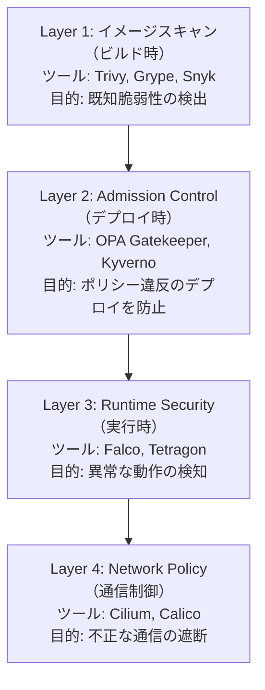

### 両方必要な理由

**具体例：特権コンテナの防御**

#### シナリオ1: Admission Controllerのみ

```yaml
# OPA Gatekeeper ポリシー
apiVersion: constraints.gatekeeper.sh/v1beta1
kind: K8sPSPPrivilegedContainer
metadata:
  name: deny-privileged-containers
spec:
  match:
    kinds:
      - apiGroups: [""]
        kinds: ["Pod"]
```

**結果**：
- [OK] `kubectl apply`時に特権コンテナをブロック
- [NG] 既にデプロイ済みのコンテナが権限昇格しても検知できない
- [NG] Daemonsetなど例外を作ると、その隙を突かれる可能性

#### シナリオ2: Runtime Securityのみ

```yaml
# Falco ルール
- rule: Launch Privileged Container
  condition: container_started and container.privileged=true
  output: Privileged container detected
  priority: CRITICAL
```

**結果**：
- [NG] デプロイ自体は許可されてしまう
- [OK] 起動後に即座にアラート
- [OK] 攻撃者が後から権限昇格しても検知

#### シナリオ3: 両方の組み合わせ（推奨）

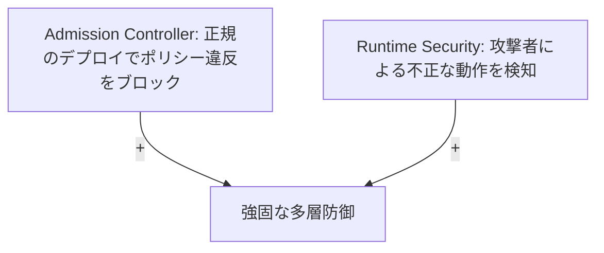

**実践的な使い分け**：

| ケース | Admission | Runtime | 理由 |
|--------|-----------|---------|------|
| 開発環境の特権コンテナ | 許可 | 監視 | 開発の柔軟性 + 異常検知 |
| 本番環境の特権コンテナ | 拒否（例外あり） | 厳重監視 | 最小権限の原則 |
| CI/CDパイプラインのシェル実行 | 許可 | 例外設定 | 正規の動作を妨げない |
| 本番Webサーバーのシェル実行 | - | CRITICAL | 攻撃の可能性が高い |

---

## OPA Gatekeeper

### Gatekeeperとは

**OPA（Open Policy Agent）Gatekeeper**は、Kubernetes Admission Controllerとして動作するポリシーエンジンです。

**主な機能**：
- Regoで記述されたポリシーによる宣言的な制御
- ConstraintTemplateによる再利用可能なポリシー定義
- Dry-run機能による段階的導入
- Audit機能による既存リソースの監査

### Falcoとの組み合わせ

**統合パターン**：

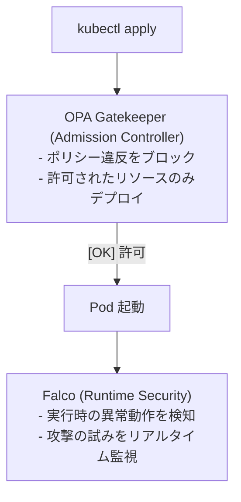

#### 実装例1: 特権コンテナの制御

**Gatekeeper側（Admission Control）**：

```yaml
# constraint-template.yaml
apiVersion: templates.gatekeeper.sh/v1beta1
kind: ConstraintTemplate
metadata:
  name: k8spsprivilegedcontainer
spec:
  crd:
    spec:
      names:
        kind: K8sPSPPrivilegedContainer
  targets:
    - target: admission.k8s.gatekeeper.sh
      rego: |
        package k8spspprivileged

        violation[{"msg": msg}] {
          container := input.review.object.spec.containers[_]
          container.securityContext.privileged
          msg := sprintf("Privileged container is not allowed: %v", [container.name])
        }

---
# constraint.yaml
apiVersion: constraints.gatekeeper.sh/v1beta1
kind: K8sPSPPrivilegedContainer
metadata:
  name: deny-privileged-containers
spec:
  match:
    kinds:
      - apiGroups: [""]
        kinds: ["Pod"]
    excludedNamespaces: ["kube-system", "falco"]  # システム系は除外
```

**Falco側（Runtime Detection）**：

```yaml
# custom-rules.yaml
- rule: Launch Privileged Container
  desc: 特権コンテナの起動を検知（Gatekeeperをバイパスした可能性）
  condition: >
    container_started and
    container.privileged=true and
    not k8s.ns.name in (kube-system, falco)
  output: >
    ALERT: Privileged container launched (bypassed admission control?)
    (pod=%k8s.pod.name ns=%k8s.ns.name image=%container.image.repository)
  priority: CRITICAL
  tags: [admission_bypass, privilege_escalation]
```

**相乗効果**：
- Gatekeeper: 正規フローでのデプロイをブロック
- Falco: Gatekeeperをバイパスする攻撃を検知

#### 実装例2: ホストパスマウントの制御

**Gatekeeper側**：

```yaml
apiVersion: constraints.gatekeeper.sh/v1beta1
kind: K8sPSPHostFilesystem
metadata:
  name: restrict-host-path
spec:
  match:
    kinds:
      - apiGroups: [""]
        kinds: ["Pod"]
  parameters:
    allowedHostPaths:
      - pathPrefix: "/var/log"
        readOnly: true
```

**Falco側**：

```yaml
- rule: Sensitive Host Path Mounted
  desc: 機密ディレクトリがマウントされた
  condition: >
    container_started and
    fd.name startswith "/host/etc" or
    fd.name startswith "/host/root"
  output: >
    Sensitive host path mounted
    (pod=%k8s.pod.name path=%fd.name)
  priority: CRITICAL
```

### ユースケース

| ポリシー | Gatekeeper | Falco | 組み合わせの効果 |
|---------|------------|-------|-----------------|
| **特権コンテナ禁止** | デプロイ時にブロック | 実行時に検知 | バイパス攻撃の検知 |
| **ホストパスマウント制限** | 許可リストで制御 | 不正アクセス検知 | 設定ミスの補完 |
| **イメージレジストリ制限** | 承認済みレジストリのみ | 不審なイメージの実行検知 | サプライチェーン攻撃対策 |
| **リソースクォータ** | CPU/メモリ上限設定 | 異常なリソース消費検知 | クリプトマイニング対策 |

---

## Kyverno

### Kyvernoとは

**Kyverno**は、Kubernetes専用のポリシーエンジンで、**Regoではなく通常のYAMLで記述**できる点が特徴です。

**主な機能**：
- YAMLベースのポリシー記述（学習コストが低い）
- Mutate機能（リソースの自動修正）
- Generate機能（リソースの自動生成）
- Verify Images機能（イメージ署名検証）

### Gatekeeperとの違い

| | OPA Gatekeeper | Kyverno |
|-------------|----------------|---------|
| **ポリシー言語** | Rego（専用言語） | YAML |
| **学習曲線** | 急（Regoの学習が必要） | 緩（YAMLの知識のみ） |
| **汎用性** | 高（K8s以外にも使える） | 低（K8s専用） |
| **Mutate機能** | なし | あり（リソースの自動修正） |
| **Generate機能** | なし | あり（NetworkPolicyなど自動生成） |
| **イメージ検証** | カスタム実装が必要 | 組み込み機能 |
| **成熟度** | 高（CNCF Graduated） | 中（CNCF Incubating） |

### Falcoとの組み合わせ

#### 実装例1: イメージ署名検証 + Runtime監視

**Kyverno側（イメージ検証）**：

```yaml
# verify-images.yaml
apiVersion: kyverno.io/v1
kind: ClusterPolicy
metadata:
  name: verify-image-signature
spec:
  validationFailureAction: Enforce
  rules:
    - name: verify-signature
      match:
        any:
        - resources:
            kinds:
              - Pod
      verifyImages:
      - imageReferences:
        - "myregistry.io/*"
        attestors:
        - count: 1
          entries:
          - keys:
              publicKeys: |-
                -----BEGIN PUBLIC KEY-----
                MFkwEwYHKoZIzj0CAQYIKoZIzj0DAQcDQgAE...
                -----END PUBLIC KEY-----
```

**Falco側（Runtime検証）**：

```yaml
- rule: Unsigned Image Running
  desc: 署名されていないイメージが実行されている（Kyvernoバイパス）
  condition: >
    container_started and
    not container.image.repository startswith "myregistry.io/"
  output: >
    Unsigned image detected (bypass Kyverno?)
    (pod=%k8s.pod.name image=%container.image.repository)
  priority: CRITICAL
```

#### 実装例2: NetworkPolicyの自動生成 + 通信監視

**Kyverno側（NetworkPolicy自動生成）**：

```yaml
# generate-network-policy.yaml
apiVersion: kyverno.io/v1
kind: ClusterPolicy
metadata:
  name: generate-network-policy
spec:
  rules:
    - name: default-deny-ingress
      match:
        any:
        - resources:
            kinds:
              - Namespace
      generate:
        kind: NetworkPolicy
        name: default-deny-ingress
        namespace: "{{request.object.metadata.name}}"
        data:
          spec:
            podSelector: {}
            policyTypes:
              - Ingress
```

**Falco側（通信監視）**：

```yaml
- rule: Unexpected Outbound Connection
  desc: NetworkPolicyで制限されていないはずの通信を検知
  condition: >
    outbound and
    not fd.sip in (allowed_destinations) and
    k8s.ns.name != kube-system
  output: >
    Unexpected outbound connection
    (pod=%k8s.pod.name dest=%fd.sip:%fd.dport)
  priority: WARNING
```

### ユースケース

**Kyvernoが得意なこと**：
- イメージ署名の自動検証（Cosign統合）
- ラベルやアノテーションの自動追加
- デフォルトNetworkPolicyの自動生成
- ResourceQuotaの自動設定

**Falcoが得意なこと**：
- ポリシーをバイパスした攻撃の検知
- ランタイムの異常な動作検知
- コンテナエスケープの検知

**統合による価値**：

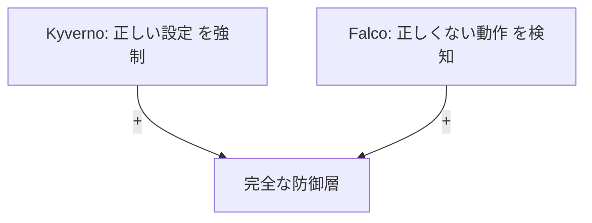

---

## Tetragon / Tracee との比較

### Tetragon

**Tetragon**は、CiliumプロジェクトのランタイムセキュリティツールでeBPF専用です。

| 項目 | Falco | Tetragon |
|------|-------|----------|
| **開発元** | Sysdig → CNCF | Isovalent (Cilium) |
| **ドライバー** | カーネルモジュール / eBPF | eBPF専用 |
| **ルール記述** | YAML | YAML（より詳細な制御） |
| **ネットワーク監視** | 基本的 | 強力（Ciliumと統合） |
| **パフォーマンス** | 良好 | 非常に良好（eBPF最適化） |
| **エコシステム** | 成熟（CNCF Graduated） | 成長中（CNCF Sandbox） |
| **Enforcement** | なし（検知のみ） | あり（プロセスKill可能） |

**Tetragonの強み**：

```yaml
# Tetragonの例：プロセス実行をブロック
apiVersion: cilium.io/v1alpha1
kind: TracingPolicy
metadata:
  name: block-shell-execution
spec:
  kprobes:
  - call: "security_bprm_check"
    syscall: false
    args:
    - index: 0
      type: "linux_binprm"
    selectors:
    - matchBinaries:
      - operator: "In"
        values:
        - "/bin/bash"
        - "/bin/sh"
      matchActions:
      - action: Sigkill  # プロセスを強制終了
```

**Falcoとの違い**：
- Tetragon: **Prevention（防止）** が可能
- Falco: **Detection（検知）** に特化

**選択の指針**：
- **Falco**: 検知・アラートに特化、エコシステムが成熟
- **Tetragon**: Ciliumを使用中で、Enforcementが必要な場合

### Tracee

**Tracee**は、Aqua Securityが開発するランタイムセキュリティツールです。

| 項目 | Falco | Tracee |
|------|-------|--------|
| **ユースケース** | 本番運用 | セキュリティ研究・フォレンジック |
| **ルール数** | 豊富（本番向け） | 限定的（研究向け） |
| **出力形式** | JSON/テキスト | 詳細なイベントログ |
| **使いやすさ** | 高 | 中（より技術的） |

**Traceeが得意なこと**：
- 詳細なフォレンジック分析
- セキュリティ研究
- eBPFのデバッグ

**選択の指針**：
- **Falco**: 本番環境での運用
- **Tracee**: セキュリティ研究・インシデント調査

---

## FalcoCTL

### FalcoCTLとは

**FalcoCTL（Falco Control）**は、Falcoルールの管理を効率化するCLIツールです（2022年登場）。

**主な機能**：
- ルールのインストール・更新
- OCI（Open Container Initiative）レジストリでのルール配布
- ルールのバージョン管理
- ドライバーのインストール

### 主要機能

#### 1. ルールのインストール

```bash
# 公式ルールのインストール
falcoctl index add falcosecurity https://falcosecurity.github.io/falcoctl/index.yaml
falcoctl artifact install falco-rules

# カスタムルールのインストール
falcoctl artifact install mycompany/custom-rules:1.2.0
```

#### 2. ルールの更新

```bash
# 利用可能な更新の確認
falcoctl artifact search falco-rules

# 更新の適用
falcoctl artifact update
```

#### 3. ルールの配布（OCI Registry）

```yaml
# .falcoctl.yaml
registry:
  auth:
    basic:
      - registry: myregistry.io
        username: ${REGISTRY_USER}
        password: ${REGISTRY_PASSWORD}
```

```bash
# カスタムルールをOCIレジストリにプッシュ
falcoctl registry push \
  myregistry.io/security/falco-rules:1.0.0 \
  --type rulesfile \
  --config custom-rules.yaml

# 他のクラスタでプル
falcoctl registry pull myregistry.io/security/falco-rules:1.0.0
```

### ルール管理の効率化

**GitOpsワークフロー例**：

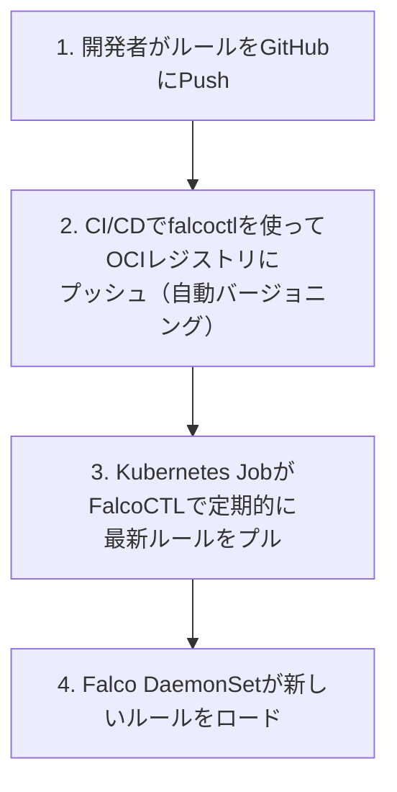

**CronJob設定例**：

```yaml
# rule-updater-cronjob.yaml
apiVersion: batch/v1
kind: CronJob
metadata:
  name: falco-rule-updater
  namespace: falco
spec:
  schedule: "0 2 * * *"  # 毎日2時に実行
  jobTemplate:
    spec:
      template:
        spec:
          containers:
          - name: falcoctl
            image: falcosecurity/falcoctl:latest
            command:
            - /bin/sh
            - -c
            - |
              falcoctl artifact update
              kubectl rollout restart daemonset falco -n falco
          restartPolicy: OnFailure
```

---

## Falco Plugins

### Pluginシステムの概要

Falco 0.31.0（2022年）から、**Pluginシステム**が導入されました。これにより、システムコール以外のイベントソースにも対応できるようになりました。

**Pluginアーキテクチャ**：

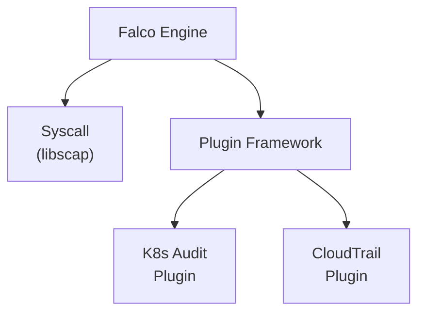

### 主要なPlugin

#### 1. K8s Audit Plugin

Kubernetes Audit Logを直接Falcoで処理します（第7回で解説）。

```yaml
# falco.yaml
plugins:
  - name: k8saudit
    library_path: libk8saudit.so
    init_config: ""
    open_params: "http://:9765/k8s-audit"

load_plugins: [k8saudit]
```

#### 2. CloudTrail Plugin

AWS CloudTrailイベントを監視します。

```yaml
# falco.yaml
plugins:
  - name: cloudtrail
    library_path: libcloudtrail.so
    init_config:
      aws_region: us-west-2
      sqs_queue: falco-cloudtrail-queue

load_plugins: [cloudtrail]
```

**検知ルール例**：

```yaml
- rule: AWS Root Account Usage
  desc: AWSルートアカウントが使用された
  condition: >
    cloudtrail.user = "root"
  output: >
    ROOT account used (user=%cloudtrail.user action=%cloudtrail.action)
  priority: CRITICAL
```

#### 3. GitHub Plugin

GitHubのAudit Logを監視します。

```yaml
# falco.yaml
plugins:
  - name: github
    library_path: libgithub.so
    init_config:
      organization: mycompany
      token: ${GITHUB_TOKEN}

load_plugins: [github]
```

**検知ルール例**：

```yaml
- rule: Sensitive Repo Access
  desc: 機密リポジトリへのアクセスを検知
  condition: >
    github.repo = "mycompany/secrets" and
    github.action in (clone, pull)
  output: >
    Sensitive repo accessed (user=%github.user repo=%github.repo)
  priority: WARNING
```

### カスタムPluginの作成

**Plugin SDK**を使ってカスタムPluginを作成できます。

```go
// custom-plugin.go
package main

import (
    "github.com/falcosecurity/plugin-sdk-go/pkg/sdk"
)

type MyPlugin struct{}

func (p *MyPlugin) Info() string {
    return `{"name":"myplugin","version":"0.1.0"}`
}

func (p *MyPlugin) Open(params string) (sdk.Instance, error) {
    // イベントソースへの接続処理
    return &MyInstance{}, nil
}

func (i *MyInstance) NextBatch() ([]sdk.EventReader, error) {
    // イベントの取得処理
    return events, nil
}
```

**ユースケース例**：
- 社内システムのAudit Log連携
- SaaSアプリケーション（Okta、Salesforceなど）の監視
- カスタムメトリクスの監視

---

## Policy as Code

### GitOpsとの統合

Falcoルールを**Infrastructure as Code**として管理します。

**リポジトリ構成例**：

```text
security-policies/
├── falco/
│   ├── base/
│   │   ├── default-rules.yaml        # 全環境共通
│   │   ├── pci-dss-rules.yaml        # コンプライアンス
│   │   └── kustomization.yaml
│   ├── overlays/
│   │   ├── development/
│   │   │   ├── exceptions.yaml       # 開発環境の例外
│   │   │   └── kustomization.yaml
│   │   ├── staging/
│   │   │   ├── exceptions.yaml
│   │   │   └── kustomization.yaml
│   │   └── production/
│   │       ├── exceptions.yaml       # 本番環境の例外
│   │       ├── custom-rules.yaml     # 本番専用ルール
│   │       └── kustomization.yaml
│   └── tests/
│       ├── test_rules.yaml           # ルールのテストケース
│       └── run_tests.sh
├── gatekeeper/
│   └── policies/
└── kyverno/
    └── policies/
```

### ポリシーのバージョン管理

**Semantic Versioning**を使ったルール管理：

```yaml
# falco-rules-metadata.yaml
apiVersion: v1
kind: ConfigMap
metadata:
  name: falco-rules-metadata
  namespace: falco
  annotations:
    version: "2.5.0"  # Semantic Versioning
    changelog: |
      v2.5.0:
        - Added: PCI-DSS compliance rules
        - Fixed: False positive in crypto miner detection
      v2.4.0:
        - Added: Container escape detection improvements
data:
  version: "2.5.0"
  compatibility: ">=falco-0.37.0"
```

### CI/CDパイプラインでのポリシーテスト

**GitHub Actions例**：

```yaml
# .github/workflows/falco-rules-test.yaml
name: Falco Rules Test

on:
  pull_request:
    paths:
      - 'falco/**'

jobs:
  test:
    runs-on: ubuntu-latest
    steps:
      - uses: actions/checkout@v3

      - name: Install Falco
        run: |
          curl -s https://falco.org/script/install | bash

      - name: Validate Rules Syntax
        run: |
          falco --dry-run \
            -r falco/base/default-rules.yaml \
            -r falco/overlays/production/custom-rules.yaml

      - name: Run Rule Tests
        run: |
          # カスタムテストスクリプト
          ./falco/tests/run_tests.sh

      - name: Policy Coverage Report
        run: |
          # どのCIS Benchmarkがカバーされているか確認
          ./scripts/coverage-report.sh
```

**テストスクリプト例**：

```bash
# tests/run_tests.sh
#!/bin/bash

# テストケース1: 特権コンテナ検知
echo "Test 1: Privileged Container Detection"
kubectl run test-privileged --image=alpine --restart=Never \
  --overrides='{"spec":{"containers":[{"name":"test","image":"alpine","securityContext":{"privileged":true}}]}}'

sleep 5

# Falcoログを確認
if kubectl logs -n falco -l app=falco | grep "Privileged container"; then
  echo "[OK] Test 1 Passed"
else
  echo "[NG] Test 1 Failed"
  exit 1
fi

kubectl delete pod test-privileged
```

---

## Sysdig Secure（商用版）

### オープンソース版との違い

| 機能 | OSS Falco | Sysdig Secure |
|------|-----------|---------------|
| **Runtime Detection** | [OK] | [OK] |
| **カスタムルール** | [OK] | [OK] |
| **Web UI** | Falcosidekick UI（基本的） | 高機能なダッシュボード |
| **マルチクラスタ管理** | 手動設定が必要 | 統合管理UI |
| **AIによる異常検知** | [NG] | [OK] Machine Learning |
| **脅威インテリジェンス** | [NG] | [OK] リアルタイム更新 |
| **コンプライアンスレポート** | 手動作成 | [OK] 自動生成（PCI-DSS/SOC2など） |
| **フォレンジック機能** | 基本的 | [OK] 詳細なプロセスツリー分析 |
| **Vulnerability Management** | 別途ツール必要 | [OK] 統合機能 |
| **サポート** | コミュニティ | 24/7商用サポート |
| **価格** | 無料 | $$$（ノード課金） |

### Sysdig Secureの追加機能

#### 1. Machine Learning異常検知

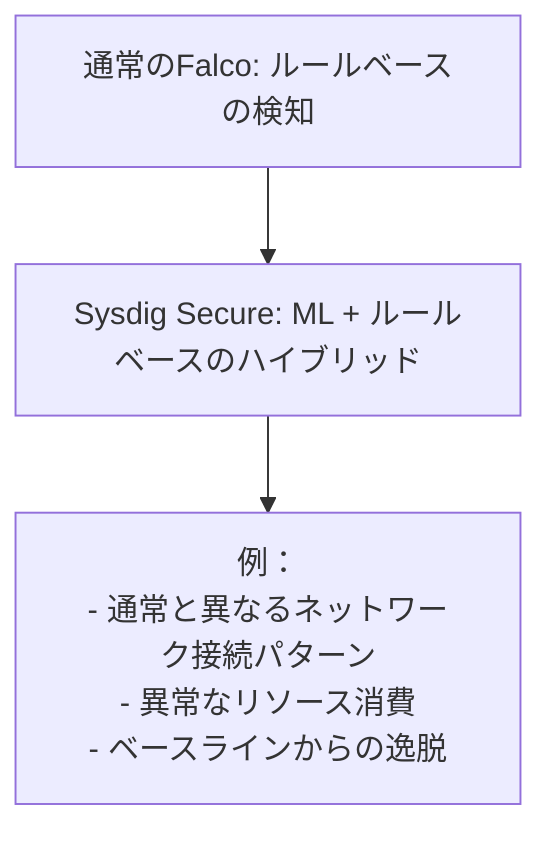

#### 2. 統合ダッシュボード

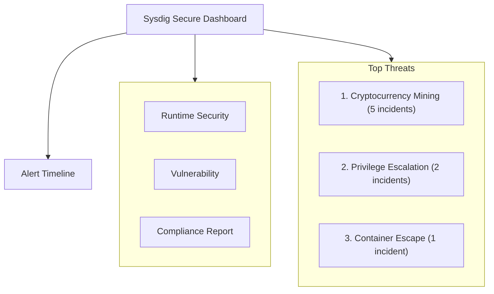

#### 3. フォレンジック機能

```bash
# OSS Falcoの場合
kubectl logs -n falco falco-xxxxx | grep "crypto"

# Sysdig Secureの場合
- プロセスツリー全体の可視化
- ネットワーク接続履歴
- ファイルアクセス履歴
- タイムライン分析
- ワンクリックでの封じ込め
```

### どちらを選ぶべきか

| ケース | 推奨 | 理由 |
|--------|------|------|
| **スタートアップ（<50ノード）** | OSS Falco | コストメリット、十分な機能 |
| **エンタープライズ（>200ノード）** | Sysdig Secure | 統合管理、ML、サポート |
| **コンプライアンス必須** | Sysdig Secure | 自動レポート生成 |
| **DIY精神が強いチーム** | OSS Falco | カスタマイズ性の高さ |
| **専任SREがいない** | Sysdig Secure | 運用負荷の軽減 |

### 移行パス

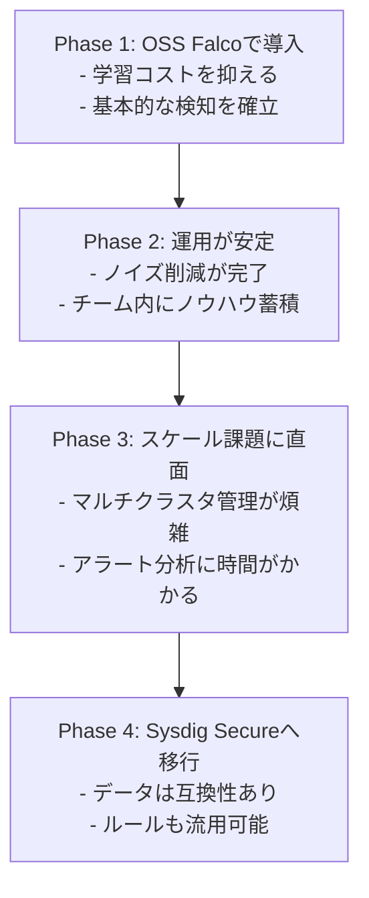

---

## CNAPPとFalco

### CNAPPとは

**CNAPP（Cloud Native Application Protection Platform）**は、クラウドネイティブアプリケーション全体を保護する統合プラットフォームです。

**CNAPPの5つの柱**：

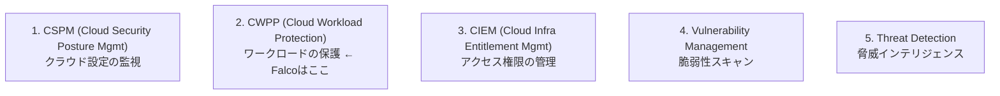

### FalcoのCNAPPにおける位置づけ

Falcoは**CWPP（Cloud Workload Protection）**の中核を担います。

**統合的なセキュリティスタック例**：

| 層 | ツール | Falcoとの関係 |
|----|--------|---------------|
| **CSPM** | Prowler, ScoutSuite | 設定ミスをFalcoルールに反映 |
| **CWPP（Runtime）** | **Falco** | 中核 |
| **CIEM** | AWS IAM Access Analyzer | 過剰権限をFalcoで監視 |
| **Vulnerability** | Trivy, Grype | 脆弱性情報をFalcoルールに活用 |
| **Threat Intel** | AlienVault OTX | IoC（Indicators of Compromise）をFalcoルールに変換 |

**統合例：TrivyとFalcoの連携**

```yaml
# Trivyでイメージスキャン
trivy image myapp:latest --format json > vulnerabilities.json

# 高リスク脆弱性を持つイメージを監視するFalcoルールを自動生成
- rule: High Risk CVE Image Running
  desc: 高リスクCVEを含むイメージが実行中
  condition: >
    container_started and
    container.image.repository in (vulnerable_images)
  output: High risk CVE detected (image=%container.image.repository)
  priority: CRITICAL
```

### 統合的なクラウドネイティブセキュリティ

**理想的なアーキテクチャ**：

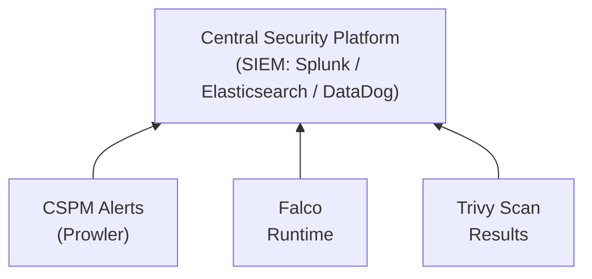

---

## コミュニティとエコシステム

### CNCF Falcoコミュニティ

**コミュニティの規模**：
- **GitHub Stars**: 8,000+
- **コントリビューター**: 200+名
- **月間ダウンロード**: 1,000万+
- **Slack**: 5,000+メンバー

**参加方法**：
- [Falco Slack](https://kubernetes.slack.com/messages/falco)（#falcoチャンネル）
- [GitHub Discussions](https://github.com/falcosecurity/falco/discussions)
- [月例コミュニティミーティング](https://github.com/falcosecurity/community)（毎月第3水曜日）

### コントリビューション方法

#### 1. ルールの共有

```bash
# 自作ルールをコミュニティに貢献
git clone https://github.com/falcosecurity/rules
cd rules
# ルールを追加
git add custom-rules/my-rule.yaml
git commit -m "Add: Detection rule for cryptocurrency mining"
git push origin my-feature-branch
# Pull Request作成
```

#### 2. Plugin開発

```bash
# Plugin SDKを使用
git clone https://github.com/falcosecurity/plugin-sdk-go
# カスタムPluginを開発
# コミュニティにフィードバック
```

#### 3. ドキュメント改善

```bash
# ドキュメントリポジトリ
git clone https://github.com/falcosecurity/falco-website
# 翻訳や改善を提案
```

### 今後のロードマップ

**Falco 2025年以降のビジョン**：

#### 1. マルチプラットフォーム対応

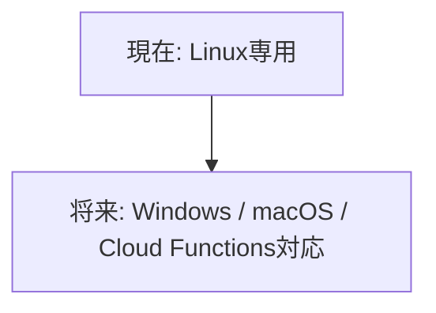

#### 2. AI/ML統合

```text
- 異常検知の自動化
- ルールの自動生成
- False Positiveの自動削減
```

#### 3. Enforcement機能

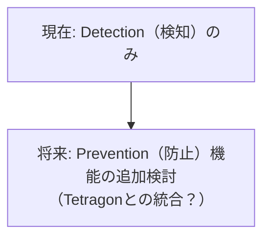

#### 4. より強力なPlugin Ecosystem

```text
- SaaS連携の拡充（Okta, Salesforce, Microsoft 365）
- IoT/Edge対応
- カスタムプロトコルサポート
```

---

## 連載を終えて

### 学んだことの振り返り

全10回を通じて、Falcoの基礎から実践まで学びました：

| 回 | タイトル | 学んだこと |
|----|----------|-----------|
| 第1回 | Falcoとは何か | Runtime Securityの本質、WiresharkとFalcoの哲学 |
| 第2回 | 基本動作の理解 | Syscallの仕組み、ドライバーの選択 |
| 第3回 | ローカル環境での実践 | Docker/Minikube/Kindでの動作確認 |
| 第4回 | ルール作成（初級） | condition/output/priorityの基本 |
| 第5回 | ルール作成（中級） | 例外管理、本番環境向けチューニング |
| 第6回 | 可視化 | Falcosidekick、Slack/PagerDuty連携 |
| 第7回 | K8s Audit連携 | API層とSyscall層の統合監視 |
| 第8回 | CI/CD統合 | DevSecOps、GitOps、Policy as Code |
| 第9回 | 本番運用 | リソース設計、ノイズ削減、SRE連携 |
| 第10回 | エコシステム | 他ツールとの組み合わせ、未来の展望 |

### 次のステップ

**実践編**：
1. まず開発環境でFalcoを動かしてみる（第3回）
2. 自分の環境に合わせたカスタムルールを作成（第4-5回）
3. 可視化とアラート連携を設定（第6回）
4. ステージング環境で観察モード運用（第9回）
5. 本番環境への段階的展開（第9回）

**発展編**：
1. OPA GatekeeperまたはKyvernoとの統合
2. FalcoCTLによる自動化
3. カスタムPluginの開発
4. コミュニティへのコントリビューション

### さらなる学習リソース

#### 公式ドキュメント
- [Falco Official Docs](https://falco.org/docs/)
- [Falco Rules Repository](https://github.com/falcosecurity/rules)
- [Falco Plugin SDK](https://github.com/falcosecurity/plugin-sdk-go)

#### ハンズオン
- [Falco Katacoda Scenarios](https://www.katacoda.com/falco)
- [Security Playground](https://github.com/falcosecurity/evolution)

#### コミュニティ
- [Falco Slack](https://kubernetes.slack.com/messages/falco)
- [Falco Blog](https://falco.org/blog/)
- [Sysdig Blog](https://sysdig.com/blog/)

#### カンファレンストーク
- KubeCon + CloudNativeCon（Falcoトラック）
- Cloud Security Summit
- CNCF Webinars

---

## まとめ

この連載では、FalcoによるKubernetesランタイムセキュリティの実装を、基礎から実践まで学びました。

**Falcoの本質**：
- **低レイヤー監視**: Syscallレベルで改ざん不可能な検知
- **ルールベース**: 宣言的で理解しやすい検知ロジック
- **エコシステム**: 他ツールとの組み合わせで多層防御

**成功のポイント**：
1. **段階的導入**: 一気に本番展開せず、観察→調整→展開
2. **ノイズ削減**: アラート疲れを防ぐための例外管理
3. **チーム連携**: SRE、セキュリティ、開発の協力
4. **継続的改善**: デプロイして終わりではなく、運用しながら最適化

**多層防御の考え方**：

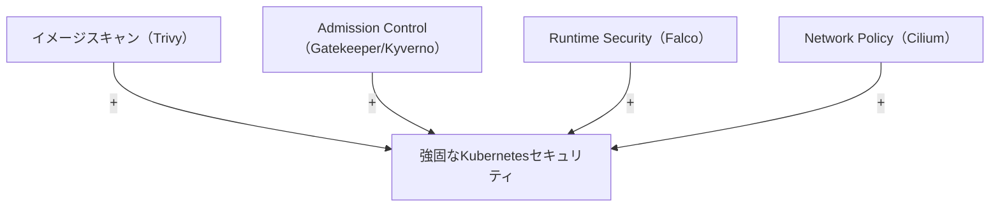

Falcoは、クラウドネイティブセキュリティの重要な一部です。この連載で学んだ知識を活かして、皆さんの環境のセキュリティ向上に役立てていただければ幸いです。

**Happy Securing with Falco! **

---

## 参考資料

### Falco公式
- [Falco Official Website](https://falco.org/)
- [Falco GitHub](https://github.com/falcosecurity/falco)
- [Falco Documentation](https://falco.org/docs/)
- [CNCF Falco Project Page](https://www.cncf.io/projects/falco/)

### 関連ツール
- [OPA Gatekeeper](https://open-policy-agent.github.io/gatekeeper/)
- [Kyverno](https://kyverno.io/)
- [Tetragon](https://tetragon.io/)
- [Tracee](https://github.com/aquasecurity/tracee)

### 商用版
- [Sysdig Secure](https://sysdig.com/products/secure/)

### コミュニティ
- [Falco Slack](https://kubernetes.slack.com/messages/falco)
- [Falco Mailing List](https://lists.cncf.io/g/cncf-falco-dev)
- [Falco Community Meetings](https://github.com/falcosecurity/community)

### 学習リソース
- [Falco Blog](https://falco.org/blog/)
- [Sysdig Blog - Falco Series](https://sysdig.com/blog/tag/falco/)
- [KubeCon Talks on Falco](https://www.youtube.com/results?search_query=kubecon+falco)
