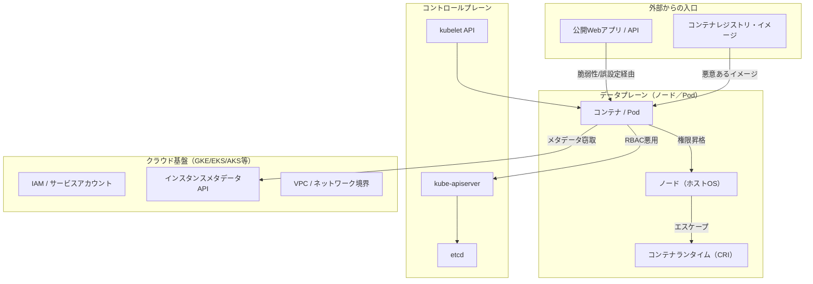
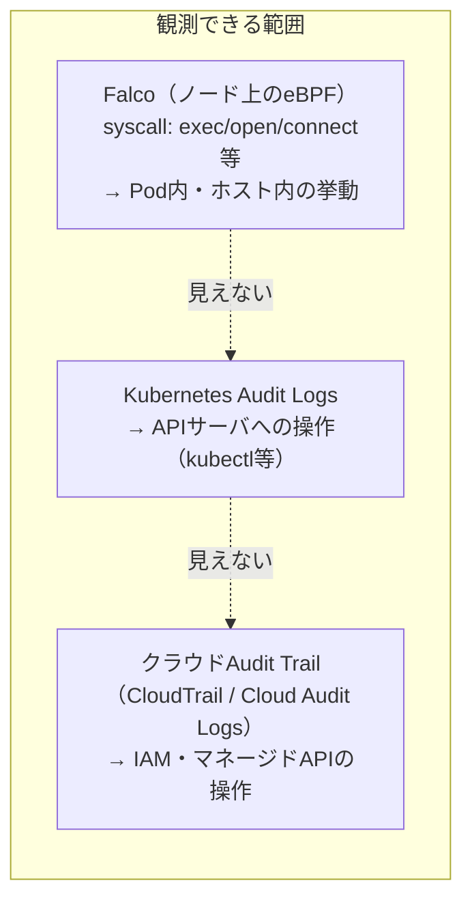
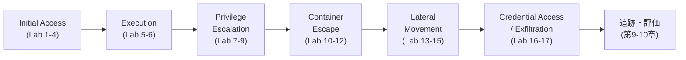

# 第1章：攻撃者から見たKubernetes

## この章で学ぶこと

- なぜ「守る側」の知識だけではKubernetesを守りきれないのか
- Kubernetesの攻撃対象領域（Attack Surface）の全体像
- MITRE ATT&CK for Containersというフレームワークの使い方
- Falcoが見える境界線と、K8s／クラウド基盤が守る境界線の違い
- 本書の実験ラボで再現する攻撃チェーンの全体図

---

## なぜ「守る側」だけでは不十分なのか

前作でFalcoのルールを書けるようになった人が次に抱く疑問は、たいてい次のようなものです。

- このルールは、実際にどんな攻撃を想定して書いているのか
- 「とりあえず入れた」ルールセットは、本当にクリティカルな攻撃を検知できるのか
- 検知できなかったとき、それはルールの不備なのか、そもそも観測できていないのか

これらに答えるには、**検知ルールを書く前に、攻撃者がどういう手順でクラスタを侵害するのかを知る**必要があります。守る側の知識だけでは、「何を検知すべきか」のリストが自分の想像力の範囲でしか作れません。

セキュリティの世界でよく言われる言葉を借りれば、

> Defense is a list of things you know to protect against. Offense is the limit of what's possible.

攻撃者視点は、防御側の想像力の限界を押し広げるための手段です。本書では、実際にラボ環境で攻撃を再現し、その挙動をFalcoやeBPFでどこまで捉えられるかを確認していきます。

## Kubernetesの攻撃対象領域（Attack Surface）

Kubernetesクラスタへの攻撃経路は、ひとつではありません。レイヤーごとに整理すると見通しが良くなります。

このうち本書が主に扱うのは、**データプレーン（Pod・ノード）を起点に、コントロールプレーンやクラウドIAMへ到達する経路**です。公開Webアプリの脆弱性のような「外部からの侵入口」は第3章で最小限扱いますが、本書の主題はその後の昇格・横展開・窃取のプロセスにあります。

## MITRE ATT&CK for Containersの全体像

攻撃チェーンを体系的に整理するために、本書では**MITRE ATT&CK for Containers**の戦術（Tactics）分類を使います。これはコンテナ・Kubernetes環境に特化した攻撃手法のカタログで、各手法に一意のID（例：T1610）が振られています。

| 戦術 | 本書での対応章 | 代表的な手法 |
|------|--------------|-------------|
| Initial Access | 第3章 | 公開アプリの脆弱性、誤設定イメージ、公開Kubelet API |
| Execution | 第4章 | コンテナ内シェル起動、ファイルレス実行 |
| Privilege Escalation | 第5章 | 特権コンテナ、ServiceAccountトークン悪用 |
| Defense Evasion / Container Escape | 第6章 | ランタイムエスケープ、共有Namespace悪用 |
| Lateral Movement | 第7章 | クラスタ内スキャン、Pod間・ノード間移動 |
| Credential Access / Exfiltration | 第8章 | Secret窃取、クラウドメタデータAPI悪用 |

本書の各実験には、対応するMITRE ATT&CK for ContainersのテクニックIDを付記します。これにより、「この実験が何を模しているのか」を既存の脅威インテリジェンスと突き合わせられるようにしています。

## Falcoが見える境界線、K8s／クラウドが守る境界線

実験ラボを設計する前に、整理しておくべき重要な論点があります。それは**「どのレイヤーを」「何で観測するか」**です。

- **Falco（eBPF）が見えるのは、ノード上で実行されたsyscallだけ**です。コンテナ内でシェルを起動した、機密ファイルを読んだ、といった挙動は検知できますが、**マネージドKubernetes（GKE/EKS/AKS）のコントロールプレーン内部や、クラウドAPIへの操作はそもそも見えません**。これはマネージドサービスである以上、ユーザー側にkube-apiserverやetcdのホストへのアクセス権がないためです。
- その空白を埋めるのが**Kubernetes Audit Logs**です。`kubectl exec`やRBAC変更など、APIサーバに対する操作はここに記録されます。ただしこれもAPIサーバを経由した操作に限られ、ノード内で直接起きたこと（例：コンテナ内のバイナリ実行）は記録されません。
- さらに、**サービスアカウントの一時認証情報を使ってクラウドAPI（例：S3バケット操作、IAMロール変更）に直接アクセス**された場合、それを捉えるのはクラウド側のAudit Trail（AWS CloudTrail、GCP Cloud Audit Logsなど）です。

つまり、**「Falcoを入れたから安心」ではなく、ノード内／APIサーバ／クラウドAPIという3つの異なる境界線を、3つの異なるデータソースで埋める設計が必要**です。この境界線をまたぐ攻撃（例：コンテナ内のServiceAccountトークン窃取 → クラウドAPI直接操作）は、単一のデータソースだけでは全体像が見えません。この点は第8章の実験と、第9章の追跡実験で具体的に検証します。

## 本書の実験ラボで扱う攻撃チェーン

本書を通して、次の攻撃チェーンを8つのフェーズ・20本の実験として再現します。

各実験は、次の3点をセットで記録します。

1. **攻撃者の操作**（実行したコマンド・手順）
2. **Falco / eBPF / Audit Logsで観測されたイベント**（検知できた場合はルール、できなかった場合はその理由）
3. **MITRE ATT&CK for Containersのテクニックとの対応**

次章では、この20本の実験を安全に・再現可能に実行するための攻撃・観測ラボを構築します。
