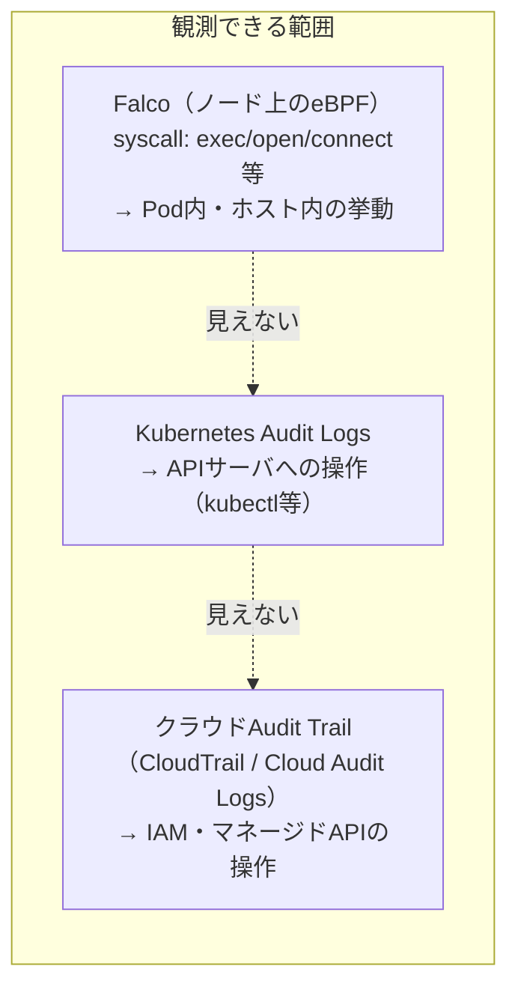
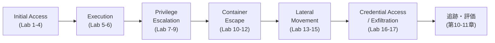

# 第1章：攻撃者から見たKubernetes

## この章で学ぶこと

- なぜ「守る側」の知識だけではKubernetesを守りきれないのか
- 実際に起きたインシデントから、攻撃者視点の必要性を学ぶ
- Kubernetesの攻撃対象領域（Attack Surface）の全体像
- Falcoが見える境界線と、K8s／クラウド基盤が守る境界線の違い
- 本書が扱う範囲と、意図的に扱わない範囲
- 本書の実験ラボで再現する攻撃チェーンの全体図

---

## なぜ「守る側」だけでは不十分なのか

前作でFalcoのルールを書けるようになった人が次に抱く疑問は、たいてい次のようなものです。

- このルールは、実際にどんな攻撃を想定して書いているのか
- 「とりあえず入れた」ルールセットは、本当にクリティカルな攻撃を検知できるのか
- 検知できなかったとき、それはルールの不備なのか、そもそも観測できていないのか

これらに答えるには、**検知ルールを書く前に、攻撃者がどういう手順でクラスタを侵害するのかを知る**必要があります。守る側の知識だけでは、「何を検知すべきか」のリストが自分の想像力の範囲でしか作れません。

セキュリティの世界でよく言われる言葉を借りれば、

> Defense is a list of things you know to protect against. Offense is the limit of what's possible.

攻撃者視点は、防御側の想像力の限界を押し広げるための手段です。本書では、実際にラボ環境で攻撃を再現し、その挙動をFalcoやeBPFでどこまで捉えられるかを確認していきます。

## 実際に起きたインシデントから学ぶ

「攻撃者視点」と言うと、抽象的な話に聞こえるかもしれません。しかし、本書で扱う手法の多くは、実際に報告されたインシデントの手口そのものです。3つの事例を見ておきます。

**事例1：Teslaの公開ダッシュボードを悪用した暗号通貨マイニング（2018年）**

Teslaが運用していたKubernetesのダッシュボードが、認証なしでインターネットに公開されていました。攻撃者はこのダッシュボードからクラスタの認証情報を取得し、Pod内でマイニングソフトを実行。さらに、検知を避けるためにCPU使用率を低く抑え、公開されたマイニングプールを使わずプライベートなプールを使うなど、**検知回避を前提にした巧妙さ**が特徴でした。これは本書の第4章（Initial Access）で扱う「誤公開されたAPI」の実例にあたります。

**事例2：Kinsingマルウェアによる、公開Docker/Kubernetes APIの継続的スキャン（2020年〜）**

Kinsingは、インターネット上の公開されたDocker API・誤設定のKubernetesクラスタを常時スキャンし、脆弱なエンドポイントを見つけ次第、仮想通貨マイニングマルウェアを展開するキャンペーンです。**単発の攻撃ではなく、継続的で自動化された偵察と侵入**という点が特徴で、本書のLab 3（kubelet誤公開API）が再現するシナリオと直接対応します。

**事例3：Capital Oneのインシデント（2019年）に見るメタデータAPIの悪用**

Kubernetes自体の侵害ではありませんが、設定ミスのあるWAF（Webアプリケーションファイアウォール）を踏み台に、クラウドのインスタンスメタデータAPIから一時認証情報を取得され、大規模なデータ漏洩に繋がった事例です。**「アプリケーション層の脆弱性」から「クラウドIAMの認証情報窃取」へとつながる経路**は、本書の第9章（Credential Access）で扱うLab 16とほぼ同じ構造をしています。

これらの事例に共通するのは、**単一の脆弱性ではなく、複数の設定ミスや監視の空白が連鎖した結果として被害が拡大している**ことです。本書が8つのフェーズに分けて攻撃チェーンを再現するのも、この「連鎖」を一つずつ検証することで、どこで断ち切れたのか、どこが見えていなかったのかを明らかにするためです。

## Kubernetesの攻撃対象領域（Attack Surface）

Kubernetesクラスタへの攻撃経路は、ひとつではありません。レイヤーごとに整理すると見通しが良くなります。

それぞれのレイヤーで、攻撃者が何を狙っているのかを具体的に見ておきます。

**外部からの入口（External）**: 公開Webアプリやコンテナイメージは、クラスタの外にいる攻撃者が最初に触れる場所です。アプリケーションの脆弱性そのものよりも、**「その先にあるコンテナ環境にどこまで到達できるか」**が攻撃者の関心事になります。公開レジストリから取得したイメージに脆弱性や悪意あるコードが仕込まれているケースも、同じ入口に分類されます。

**コントロールプレーン**: `kube-apiserver`はクラスタのあらゆる操作が経由するハブであり、ここへの到達はクラスタ全体への影響力を意味します。`etcd`はSecretを含む全リソースの実データを保持しており、直接アクセスできれば認証情報は筒抜けです。

**データプレーン（ノード／Pod）**: 実際にワークロードが動く場所であり、本書の実験の多くがここを起点にします。コンテナ自体への侵入だけでなく、**コンテナが動いているノード（ホストOS）への到達**が、昇格・横展開の分岐点になります。図で`kubelet API`を点線で結んでいるのは、**ノード上で動くコンポーネントでありながら、コントロールプレーンともデータプレーンとも言い切れない独立した経路**だからです。誤って外部に公開された場合にのみ到達可能になる、という条件付きの経路であることを示しています。これは本章後半と、第4章のLab 3で詳しく扱います。

**クラウド基盤（GKE/EKS/AKS等）**: マネージドKubernetesを使っている場合、クラスタの外側にクラウドIAM・インスタンスメタデータAPI・VPCという独自のレイヤーが存在します。ここに到達すると、**Kubernetesの枠を超えてクラウドアカウント全体に影響が及ぶ**ため、被害規模が一段階上がります。

このうち本書が主に扱うのは、**データプレーン（Pod・ノード）を起点に、コントロールプレーンやクラウドIAMへ到達する経路**です。公開Webアプリの脆弱性のような「外部からの侵入口」は第4章で最小限扱いますが、本書の主題はその後の昇格・横展開・窃取のプロセスにあります。

この攻撃対象領域を体系的に整理するためのフレームワークが、次章で扱う**MITRE ATT&CK for Containers**です。本章ではまず、攻撃チェーン全体を俯瞰する前提として、Falcoが見える範囲とそうでない範囲の境界線を押さえておきます。

## Falcoが見える境界線、K8s／クラウドが守る境界線

実験ラボを設計する前に、整理しておくべき重要な論点があります。それは**「どのレイヤーを」「何で観測するか」**です。

- **Falco（eBPF）が見えるのは、ノード上で実行されたsyscallだけ**です。コンテナ内でシェルを起動した、機密ファイルを読んだ、といった挙動は検知できますが、**マネージドKubernetes（GKE/EKS/AKS）のコントロールプレーン内部や、クラウドAPIへの操作はそもそも見えません**。これはマネージドサービスである以上、ユーザー側にkube-apiserverやetcdのホストへのアクセス権がないためです。
- その空白を埋めるのが**Kubernetes Audit Logs**です。`kubectl exec`やRBAC変更など、APIサーバに対する操作はここに記録されます。ただしこれもAPIサーバを経由した操作に限られ、ノード内で直接起きたこと（例：コンテナ内のバイナリ実行）は記録されません。
- さらに、**サービスアカウントの一時認証情報を使ってクラウドAPI（例：S3バケット操作、IAMロール変更）に直接アクセス**された場合、それを捉えるのはクラウド側のAudit Trail（AWS CloudTrail、GCP Cloud Audit Logsなど）です。

つまり、**「Falcoを入れたから安心」ではなく、ノード内／APIサーバ／クラウドAPIという3つの異なる境界線を、3つの異なるデータソースで埋める設計が必要**です。この境界線をまたぐ攻撃（例：コンテナ内のServiceAccountトークン窃取 → クラウドAPI直接操作）は、単一のデータソースだけでは全体像が見えません。この点は第9章の実験と、第10章の追跡実験で具体的に検証します。

## 本書の実験ラボで扱う攻撃チェーン

本書を通して、次の攻撃チェーンを8つのフェーズ・20本の実験として再現します。

各実験は、次の3点をセットで記録します。

1. **攻撃者の操作**（実行したコマンド・手順）
2. **Falco / eBPF / Audit Logsで観測されたイベント**（検知できた場合はルール、できなかった場合はその理由）
3. **MITRE ATT&CK for Containersのテクニックとの対応**

## 本書が扱う範囲と、意図的に扱わない範囲

最後に、本書のスコープを明確にしておきます。Kubernetesを狙う攻撃は本章で見た以上に幅広く、本書だけで全てを網羅することはできません。次のような領域は、**意図的に本書の対象外**としています。

- **ソーシャルエンジニアリング・フィッシング**: 認証情報の窃取経路として現実には重要ですが、本書はあくまで「侵入が成立した後、クラスタ内でどう検知するか」に焦点を絞ります
- **サプライチェーン攻撃（CI/CDパイプライン・ビルド工程への侵入）**: イメージが侵害された後の挙動（第5・6章）は扱いますが、ビルドパイプライン自体への侵入手法は扱いません。これは別途、独立したテーマとして扱うべき領域です
- **物理的セキュリティ・内部不正**: データセンターへの物理アクセスや、正規の権限を持つ内部関係者による意図的な不正操作は、技術的な検知の範囲を超えるため対象外とします
- **ゼロデイ脆弱性の発見・開発**: 本書で使う手法はすべて公知のパターンの再現であり、新しい脆弱性を発掘することは目的にしていません

こうした線引きをする理由は、**「攻撃者視点」という言葉が指す範囲を無限に広げると、検証も検知も曖昧になる**からです。本書は、**侵入が成立した後、Kubernetesというプラットフォーム特有の手口に対して、観測技術がどこまで追従できるか**という一点に絞って検証します。

次章では、ここまで触れてきた攻撃チェーンを体系的に整理するフレームワーク——**MITRE ATT&CK for Containers**を詳しく見ていきます。
