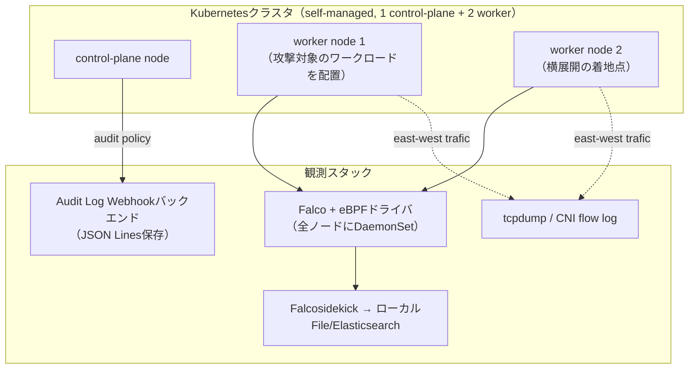

# 第2章：攻撃・観測ラボの構築

## この章で学ぶこと

- 実験ラボ全体の設計方針（どこまでをラボに含め、どこを境界として切るか）
- わざと脆弱にしたワークロードの用意の仕方
- Falco（eBPFドライバ）のセットアップ
- Kubernetes Audit Logsの有効化
- ネットワーク観測（CNI／pcap）の下準備
- 実験結果を再現可能な形で記録する方法

---

## ラボ環境の全体設計

前章で整理した「3つの境界線」（ノード内 / APIサーバ / クラウドAPI）をすべて観測できる状態にしてから、攻撃実験を始めます。そうしないと、「検知できなかった」のが**ルールの不備なのか、そもそも観測範囲外だったのか**を判別できません。



**なぜself-managed Kubernetesを選ぶのか**：本書の実験の一部（第6章のContainer Escape、第5章の一部のPrivilege Escalation手法）は、コントロールプレーンやノードの設定を直接いじる必要があります。GKE/EKSのようなマネージドサービスではコントロールプレーンに手が届かないため、**再現実験はself-managed（kubeadmやkindベース）のクラスタで行い、マネージド環境との差分は都度注記する**方針にします。本番でマネージドKubernetesを使っている読者は、「この実験はマネージド環境では起きない／別の形で現れる」という注記を必ず確認してください。

ラボはクラウド（コスト最適化のため最小構成）とローカル（kind）の両方で動くように構築します。本書のサンプルコードはどちらでも再現できるよう、Terraform（クラウド版）とkind config（ローカル版）の両方をリポジトリに含めます。

## 脆弱なワークロードの用意

攻撃実験には、意図的に脆弱にしたワークロードが必要です。本書では次の3種類を用意します。

| ワークロード | 脆弱性の種類 | 主に使う章 |
|---|---|---|
| `vulnerable-webapp` | 既知CVEを含む脆弱なWebアプリ（コマンドインジェクション可能） | 第3章 |
| `misconfigured-pod` | 特権モード・hostPath・過剰なCapabilities | 第5・6章 |
| `over-privileged-sa` | クラスタ全体に近い権限を持つServiceAccountを紐付け | 第5・7・8章 |

```yaml
# misconfigured-pod（例）: 意図的に特権コンテナ化
apiVersion: v1
kind: Pod
metadata:
  name: misconfigured-pod
spec:
  containers:
    - name: app
      image: alpine:3.19
      securityContext:
        privileged: true
      volumeMounts:
        - name: host-root
          mountPath: /host
  volumes:
    - name: host-root
      hostPath:
        path: /
```

**注意**: これらのマニフェストは実験ラボ専用です。本番環境や共有クラスタには絶対に適用しないでください。リポジトリの`lab/manifests/`配下には、誤適用防止のためnamespace分離と`NetworkPolicy`によるラボ外への通信遮断を同梱しています。

## Falco + eBPFドライバのセットアップ

前作でも扱った内容ですが、本書のラボでは**modern eBPF**ドライバを前提にします（カーネルモジュール版は本書では扱いません）。

```bash
helm repo add falcosecurity https://falcosecurity.github.io/charts
helm repo update

helm install falco falcosecurity/falco \
  --namespace falco --create-namespace \
  --set driver.kind=modern_ebpf \
  --set tty=true
```

ラボ用途では、**標準ルールセットに加えて、本書で扱う攻撃チェーンに対応したカスタムルールファイルを後の章で順次追加**していきます。第2章の時点では、まず標準ルールだけが入った状態を「ベースライン」として記録しておきます（第9章の検知カバレッジ評価で、このベースラインとの差分を測るためです）。

```bash
# ベースラインの確認
kubectl logs -n falco -l app.kubernetes.io/name=falco --tail=50
```

## Kubernetes Audit Logsの有効化

前章で触れた「APIサーバ境界」を埋めるのがAudit Logsです。self-managedクラスタでは、kube-apiserverの起動オプションにAudit Policyを追加します。

```yaml
# audit-policy.yaml（抜粋）
apiVersion: audit.k8s.io/v1
kind: Policy
rules:
  - level: RequestResponse
    resources:
      - group: ""
        resources: ["secrets", "serviceaccounts"]
  - level: Request
    verbs: ["create", "update", "patch", "delete"]
    resources:
      - group: "rbac.authorization.k8s.io"
  - level: Metadata
```

```bash
# kube-apiserver起動オプション（kubeadm構成の場合は /etc/kubernetes/manifests/kube-apiserver.yaml に追記）
--audit-policy-file=/etc/kubernetes/audit-policy.yaml
--audit-log-path=/var/log/kubernetes/audit.log
--audit-log-maxage=7
--audit-log-maxbackup=3
```

`secrets`や`serviceaccounts`、RBAC変更といった**第7・8章で狙われるリソース**を重点的にログレベルを上げているのがポイントです。全リソースを`RequestResponse`にするとログ量が膨大になり、実験ラボでも扱いにくくなるため、攻撃チェーンに即して段階的に絞り込んでいます。

## ネットワーク観測（CNI/pcap）の下準備

第7章のLateral Movement実験では、クラスタ内ネットワークの挙動を観測する必要があります。本書では次の2系統を併用します。

- **CNIのフローログ**（Calicoを使う場合は`FelixConfiguration`でフローログを有効化）
- **ノード上での`tcpdump`によるパケットキャプチャ**（ピンポイントの実験でのみ使用し、常時稼働はさせません）

```bash
# Calico環境でのフローログ有効化例
calicoctl patch felixconfiguration default --patch \
  '{"spec": {"flowLogsFileEnabled": true, "flowLogsFileIncludeLabels": true}}'
```

常時フルパケットキャプチャはディスクを圧迫するため、本書では「攻撃実験の実行中だけ」`tcpdump`を起動するスクリプトをリポジトリに用意し、実験ごとにオン/オフを明示します。

## 実験の記録方法

20本の実験すべてで、再現性を担保するために統一フォーマットを使います。

```markdown
## Lab XX: <実験名>
- MITRE ATT&CK for Containers: <Technique ID>
- 前提: <クラスタ状態・使うワークロード>
- 手順: <実行したコマンド>
- Falcoの検知結果: <ログ抜粋 or 「未検知」>
- Audit Logsの記録: <ログ抜粋 or 「対象外」>
- ネットワーク観測: <該当する場合のみ>
- 考察: <検知できた/できなかった理由>
```

このフォーマットに沿ったログは`lab/results/lab-XX.md`としてリポジトリに蓄積し、第9章・第10章の横断分析（研究A・B・C）では、この20本分の記録を集計して結論を導きます。

---

次章からは、いよいよ実際の攻撃チェーンの再現に入ります。まずはInitial Access——攻撃者がコンテナに最初の足がかりを得るところからです。
