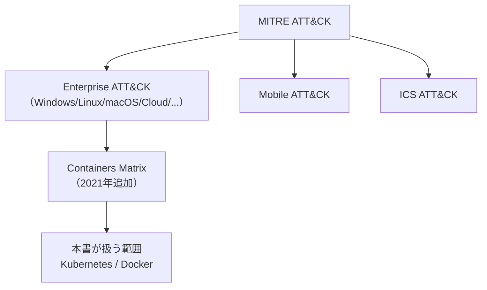
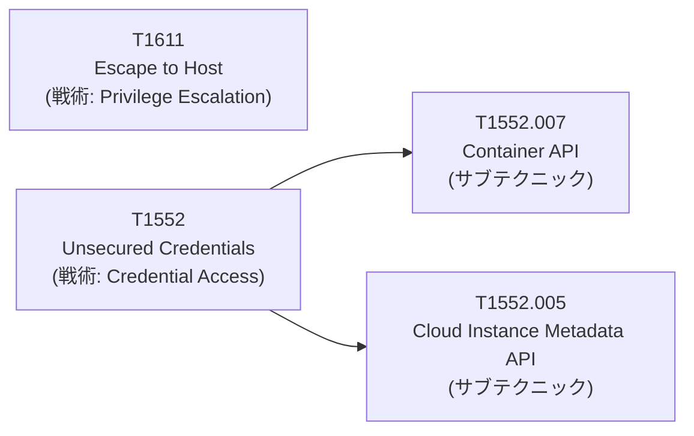
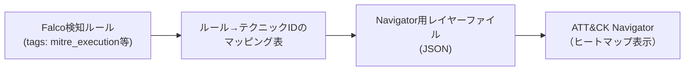

# 第2章：MITRE ATT&CK for Containersの全体像

## この章で学ぶこと

- MITRE ATT&CKというフレームワークの成り立ちと、Containers Matrixの位置づけ
- Containers Matrixを構成する全戦術（Tactics）と、代表的な手法（Techniques）
- テクニックID・サブテクニックの読み方
- 本書の章構成とMITRE ATT&CK for Containersの対応関係
- 検知エンジニアリングの実務でどう活用するか（Falcoルールへのタグ付けを例に）
- 類似のコンテナ脅威分類フレームワークとの違い

前章で、Kubernetesの攻撃対象領域を4つのレイヤーに整理しました。本章では、その攻撃対象領域に対する**攻撃者の具体的な行動**を体系的に分類したフレームワーク——MITRE ATT&CK for Containersを詳しく見ていきます。本書の第4章以降は、すべてこのフレームワークの戦術分類に沿って構成されています。

---

## MITRE ATT&CKとは何か

MITRE ATT&CK（Adversarial Tactics, Techniques, and Common Knowledge）は、非営利団体MITREが2013年から公開している、**実際に観測された攻撃者の行動を体系的にカタログ化したナレッジベース**です。もともとはWindowsを中心とした企業ネットワークへの攻撃（Enterprise ATT&CK）を対象にスタートしましたが、現在ではクラウド、モバイル、ICS（産業制御システム）、そして本書が扱う**Containers**まで、対象領域ごとにMatrix（マトリクス）が用意されています。

ATT&CKの最大の特徴は、**攻撃を「何を使ったか（マルウェアの種類等）」ではなく「何をしたか（振る舞い）」で分類する**ことです。これは本書がFalcoによる振る舞いベースの検知を重視する姿勢と一致します。マルウェアのハッシュ値や既知の悪性ドメインは陳腐化が早い一方、「特権コンテナを使ってホストに書き込む」「ServiceAccountトークンを読み取る」といった**振る舞いのパターンは、ツールが変わっても再利用され続けます**。



Containers Matrixは、Enterprise ATT&CKのサブセットという位置づけで**2021年に追加**されました。背景には、コンテナとKubernetesの普及に伴い、**既存のEnterprise Matrixだけでは説明しきれない、コンテナ特有の攻撃手法**（例：特権コンテナの悪用、ServiceAccountトークンの窃取）が急増したことがあります。

## Containers Matrixの全戦術

Containers Matrixは、攻撃チェーンの段階を表す**戦術（Tactics）**と、各戦術を実現する具体的な**手法（Techniques）**の2階層で構成されます。本書執筆時点でのContainers Matrixは、次の9つの戦術をカバーしています。

| 戦術（Tactics） | 意味 | 代表的な手法 | 本書の対応章 |
|---|---|---|---|
| Initial Access | クラスタ・コンテナへの最初の侵入 | T1190 (Exploit Public-Facing Application), T1133 (External Remote Services) | 第4章 |
| Execution | コンテナ内でのコード実行 | T1609 (Container Administration Command), T1059 (Command and Scripting Interpreter) | 第5章 |
| Persistence | 再起動・再デプロイをまたいだ永続化 | T1053 (Scheduled Task/Job), T1543 (Create or Modify System Process) | 第5・7章で部分的に言及 |
| Privilege Escalation | より強い権限の獲得 | T1611 (Escape to Host), T1068 (Exploitation for Privilege Escalation) | 第6章 |
| Defense Evasion | 検知・ログからの回避 | T1562 (Impair Defenses), T1070 (Indicator Removal) | 第5・7章で部分的に言及 |
| Credential Access | 認証情報の窃取 | T1552 (Unsecured Credentials), T1528 (Steal Application Access Token) | 第9章 |
| Discovery | 環境の偵察 | T1613 (Container and Resource Discovery), T1046 (Network Service Discovery) | 第8章で部分的に言及 |
| Lateral Movement | クラスタ内外への移動 | T1021 (Remote Services), T1210 (Exploitation of Remote Services) | 第8章 |
| Impact | 可用性・完全性の毀損 | T1496 (Resource Hijacking), T1485 (Data Destruction) | 本書では深く扱わない |

本書が8フェーズとして組み立てた実験は、**Initial Access → Execution → Privilege Escalation → Defense Evasion寄りのContainer Escape → Lateral Movement → Credential Access/Exfiltration**という流れで、Containers Matrixの戦術をほぼ順番通りになぞる形になっています。ただし、**Persistence**と**Discovery**は独立した章を立てず、関連する章の中で言及する形にしています。これは、本書の主題が「観測技術の検証」であり、個々の戦術を網羅的に解説する教科書ではないためです。**Impact**（データ破壊やリソース占有そのもの）も、検知観点では他の戦術ほど新しい論点がないため本書では深く扱いません。

## テクニックID・サブテクニックの読み方

Containers Matrixの各手法には、`T####`という一意のIDが振られています。さらに、手法によっては`.00#`という**サブテクニック**で細分化されています。



例えば本書のLab 16（第9章）で扱った「クラウドメタデータAPI経由のクレデンシャル窃取」は`T1552.005`というサブテクニックに対応します。同じ`T1552`（Unsecured Credentials）という大分類の中でも、**「どこから認証情報を盗むか」によってサブテクニックが分かれている**ため、検知ルールを設計する際にも「このルールはT1552のどのサブテクニックに効くのか」まで意識すると、カバレッジの抜け漏れが把握しやすくなります。

本書の各実験（Lab）には、この章で示した粒度でテクニックIDを付記しています。読者が本書の内容を自分の組織の脅威モデルと突き合わせる際は、**章単位ではなくテクニックID単位で参照する**ことをおすすめします。章はあくまで本書の都合による区切りであり、実際の攻撃は章をまたいで複合的に組み合わさるためです。

## ATT&CK Navigatorでの可視化

MITREは、ATT&CK Matrixをインタラクティブに可視化する**ATT&CK Navigator**というツールを無償で提供しています。自組織の検知ルールがどのテクニックをカバーしているかを、マトリクス上にヒートマップとして表示できます。



本書の第10章（Falco・eBPFによる攻撃の追跡）で行う「検知カバレッジの比較」も、本質的には**このヒートマップを手作業で再現している**ことに相当します。実務では、検知ルールにMITREタグを埋め込み、そのタグを集計してNavigator用のレイヤーファイルを自動生成する運用がよく行われます。

## 検知エンジニアリングでの実務活用：Falcoルールへのタグ付け

Falcoのルールには、`tags`フィールドで任意のラベルを付けられます。本書のラボでは、カスタムルールに**MITRE ATT&CK for Containersのテクニック単位でタグを付与**しています。

```yaml
- rule: Fileless Execution via memfd_create
  desc: memfd_create経由のファイルレス実行
  condition: >
    evt.type=execve and
    proc.exepath startswith "/proc/self/fd/" or proc.exepath contains "memfd:"
  output: >
    Fileless execution detected (command=%proc.cmdline parent=%proc.pname)
  priority: CRITICAL
  tags: [mitre_execution, T1059.004, T1620]

- rule: Contact Cloud Metadata Service From Container
  desc: コンテナからクラウドメタデータAPIへの接続
  condition: >
    outbound and fd.sip="169.254.169.254"
  output: >
    Contact Cloud Metadata Service From Container (container=%container.name dest=%fd.sip)
  priority: CRITICAL
  tags: [mitre_credential_access, T1552.005]
```

この`tags`情報を集計すれば、「自分のFalcoルールセットは、Containers Matrixのどの戦術・どのテクニックをカバーしていて、どこが手薄か」を機械的に棚卸しできます。本書の第10章で行う研究A（20シナリオの検知カバレッジ比較）も、この集計の考え方をそのまま使っています。**タグ付けは一度やれば終わりではなく、新しいルールを追加するたびに更新していく運用プロセス**として組み込むことが重要です。

## 類似フレームワークとの違い

MITRE ATT&CK for Containers以外にも、コンテナ・Kubernetesの脅威を分類する試みはいくつか存在します。代表的なものと、本書がATT&CKを採用した理由を整理しておきます。

| フレームワーク | 特徴 | ATT&CKとの違い |
|---|---|---|
| Kubernetes Threat Matrix（Microsoft, 2020年公開） | Kubernetes特化、ATT&CKのフォーマットを参考に独自策定 | MITRE公式ではなく、後にATT&CK for Containersの土台の一つになった |
| NSA/CISA Kubernetes Hardening Guidance | 攻撃分類ではなく、設定強化のベストプラクティス集 | 「どう攻撃されるか」ではなく「どう予防するか」が主眼 |
| Cloud Native Security Whitepaper（CNCF） | クラウドネイティブ全体のセキュリティ原則を整理 | 個別の攻撃手法ではなく、4C（Cloud/Cluster/Container/Code）モデルなど設計原則が中心 |

本書がMITRE ATT&CK for Containersを採用したのは、**テクニックIDという共通言語を使うことで、本書の実験結果を他の組織の脅威モデルや、既存の検知製品のカバレッジ表と直接比較できる**ためです。Kubernetes Threat MatrixやHardening Guidanceも有用な資料ですが、本書の「検知できたか・できなかったかを定量的に積み上げる」という構成には、ID単位で参照できるATT&CKの方が適しています。

---

## 本章のまとめ

- MITRE ATT&CK for Containersは、**攻撃者の振る舞いをツールに依存しない形で分類する**フレームワークであり、Falcoの振る舞いベース検知と相性が良い
- Containers Matrixは9つの戦術で構成され、本書はそのうち6つ（Initial Access〜Credential Access/Exfiltration）を中心に扱う
- テクニックID・サブテクニックという粒度で検知ルールを管理すると、カバレッジの可視化（ATT&CK Navigator等）が機械的に行える
- 類似フレームワークは複数あるが、本書は**比較可能性**を重視してMITRE ATT&CK for Containersを採用している

次章では、このフレームワークに沿って実験を行うための、攻撃・観測ラボを構築します。
