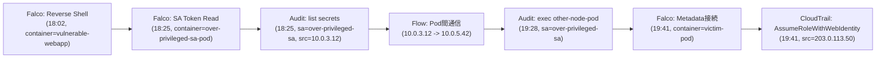

# 第9章：Falco・eBPFによる攻撃の追跡

## この章で学ぶこと

- 研究B：syscallだけで攻撃経路を最初から最後まで追跡できるのか
- Kubernetes Audit Logs・ネットワーク情報との突合で何が埋まるか
- 研究A：Lab 1〜17に、残り3本の相関実験（Lab 18〜20）を加えた20シナリオ全体の検知カバレッジ
- 未検知だったケースの原因分類

第3章から第8章まで、8フェーズ・17本の実験を個別に見てきました。本章ではそれらを横断し、**「ひとつの攻撃チェーン全体」をsyscallだけで追えるのか**という問いに正面から取り組みます。

---

## 研究B：Syscallだけで攻撃経路を追跡できるのか

### Lab 18: 攻撃チェーン全体の再構築（Falcoログのみ）

- **前提**: Lab 1（Initial Access）→ Lab 5（Execution）→ Lab 8（Privilege Escalation）→ Lab 16（Credential Access）という一連の攻撃チェーンを連続して実行し、**Falcoのログだけ**で攻撃の流れを再構築できるか検証する

Falcoのログをタイムスタンプ順に並べると、次のようになります。

```
17:42:03 Unexpected shell in web container (vulnerable-webapp)
18:02:44 Reverse Shell Detected (vulnerable-webapp)
18:25:40 ServiceAccount Token Read (over-privileged-sa-pod)
19:41:18 Contact Cloud Metadata Service From Container (victim-pod)
```

一見すると時系列順のストーリーに見えますが、重大な欠落があります。**各イベントが「同じコンテナ／同じ攻撃者による一連の行動」であることを示す明示的な相関キーがありません**。`container.id`は分かりますが、Lab 8とLab 16で別々のPod名が使われている場合、**それらが同一の侵害チェーンの延長であることはFalcoのログだけからは分かりません**。

**考察**: syscallベースの検知は「ある瞬間に何が起きたか」の精度は高い一方、**「複数のイベントをまたぐストーリー」の再構築は苦手**です。これはFalcoの設計上の限界というより、**イベント単位の検知エンジンに共通する性質**です。

### Lab 19: Kubernetes Audit Logsとの突合

同じ攻撃チェーンに、Audit Logsを重ねます。

```
18:25:41 [Audit] serviceaccount "over-privileged-sa" list secrets
19:28:09 [Audit] serviceaccount "over-privileged-sa" exec "other-node-pod"
```

`user.username`というキーで、**Falcoでは見えなかった「同一ServiceAccountによる一連の操作」が繋がります**。Falcoのイベントにある`container.id`とAudit Logsの`sourceIPs`を突き合わせることで、「どのPodから出たトークンが、どのAPI操作に使われたか」の相関が取れるようになりました。

**考察**: Audit Logsを加えることで、**「コンテナの中」と「APIサーバでの操作」という2つの時系列が、ServiceAccount名という共通キーで繋がる**ことが分かりました。ただし、これでもまだ**クラウドAPI層での操作（Lab 16後半）は繋がっていません**。

### Lab 20: ネットワーク情報を加えたフル相関

最後に、CNIフローログ（第7章）とクラウドAudit Trail（第8章）を加え、4つのデータソースを**タイムスタンプ＋送信元IP＋ServiceAccount名**で相関させます。



4つのデータソースすべてを突き合わせて初めて、**Initial AccessからExfiltrationまでの一本の線**として攻撃チェーンが再構築できました。

**研究Bの結論**: **syscallだけでは、攻撃チェーン全体を追跡することはできません。** Falcoは各フェーズの「個々の異常な振る舞い」を高精度で捉えますが、フェーズをまたぐ相関には、少なくともKubernetes Audit Logs（APIサーバ境界）とクラウドAudit Trail（クラウドAPI境界）、場合によってはネットワーク観測（横展開の経路）が必要です。これは第1章で提示した「3つの境界線」の存在を、実験で裏付ける結果になりました。

---

## 研究A：20シナリオの検知カバレッジ比較

Lab 1〜20の結果を、**標準ルールのみ**の場合と、**本書で追加したカスタムルール**を含む場合とで比較しました。

| フェーズ | シナリオ数 | 標準ルールのみで検知 | カスタムルール込みで検知 | 完全に観測の空白 |
|---|---|---|---|---|
| Initial Access | 4 | 1 | 2 | 1（Lab 3: kubelet API） |
| Execution | 2 | 1 | 2 | 0 |
| Privilege Escalation | 3 | 2 | 3 | 0 |
| Container Escape | 3 | 2 | 3 | 0 |
| Lateral Movement | 3 | 1 | 2 | 0（ただし1本は精度が低い） |
| Credential Access / Exfiltration | 2 | 1 | 2 | 0 |
| 横断相関（Lab 18-20） | 3 | - | - | 相関は別データソース必須 |
| **合計** | **20** | **8 / 20 (40%)** | **14 / 20 (70%)** | **1 / 20 (5%)** |

**標準ルールだけでは20シナリオ中8本（40%）しか検知できず**、カスタムルール（悪性IPリスト照合、memfd_create検知、メタデータAPI接続検知など）を追加することで**14本（70%）まで引き上げられました**。残り6本のうち5本は「Falco単体では検知できないが他のデータソースで検知できる」パターン（Audit Logsやクラウド側が主役）、1本（Lab 3: kubelet誤公開API）は**どのデータソースでも観測できない真の空白**でした。

## 未検知の原因分析

未検知・低精度だったケースを、原因別に分類します。

| 原因 | 該当Lab | 対策の方向性 |
|---|---|---|
| そもそも観測範囲外（ノード内でもAPIサーバ経由でもない独立領域） | Lab 3 | 検知ではなく予防（認証設定・ネットワーク遮断） |
| 標準ルールが前提とする脅威インテリジェンスが古い/ない | Lab 2 | 脅威インテリジェンスフィードとの連携 |
| 単発では異常に見えない（閾値・パターンの問題） | Lab 13, 17後半 | 統計的な異常検知（頻度・分布ベース） |
| クラウドAPI層はそもそもFalcoの観測範囲外 | Lab 16後半, 17前半 | クラウドAudit Trailとの統合が必須 |

**この分類が示すのは、「ルールを足せば足すほど検知率が上がる」という単純な話ではない**ということです。Lab 3のような「予防でしか塞げない穴」に検知ルールを頑張って書こうとするのは筋が悪く、Lab 16後半のような「別のデータソースが主役になるべき領域」にFalcoのカスタムルールを追加しようとするのも非効率です。**検知のカバレッジを上げる努力は、どのデータソースの責任範囲かを見極めた上で投下する必要があります。**

次章では、ここまで「検知できるか／できないか」という二択で見てきた視点を離れ、**検知の精度と、監視の負荷・遅延・リソース消費のトレードオフ**（研究C）を扱います。
